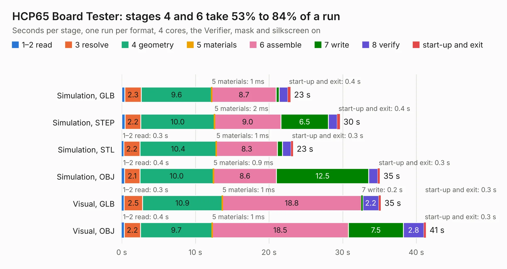

# 289. HCP65 Board Tester

Board 289 of the 3,110 of [Corpus Testing](../Corpus-Testing.md), on [Corpus Page 3](../CorpusTestingPages/Corpus-Testing-03.md#289-hcp65-board-tester).

| Mode and format | 1–2 read | 3 resolve | 4 geometry | 5 materials | 6 assemble | 7 write | 8 verify | start-up and exit | Total |
|---|---:|---:|---:|---:|---:|---:|---:|---:|---:|
| Simulation, GLB | 0.4 | 2.3 | 9.6 | 1&nbsp;ms | 8.7 | 0.4 | 1.2 | 0.4 | 22.9 |
| Simulation, STEP | 0.4 | 2.2 | 10.0 | 2&nbsp;ms | 9.0 | 6.5 | 1.2 | 0.4 | 29.6 |
| Simulation, STL | 0.3 | 2.2 | 10.4 | 1&nbsp;ms | 8.3 | 0.7 | 1.2 | 0.3 | 23.3 |
| Simulation, OBJ | 0.4 | 2.1 | 10.0 | 0.9&nbsp;ms | 8.6 | 12.5 | 1.2 | 0.3 | 35.0 |
| Visual, GLB | 0.3 | 2.5 | 10.9 | 1&nbsp;ms | 18.8 | 0.2 | 2.2 | 0.3 | 35.2 |
| Visual, OBJ | 0.4 | 2.2 | 9.7 | 1&nbsp;ms | 18.5 | 7.5 | 2.8 | 0.3 | 41.3 |

<table align="center"><tr><td valign="top">

| Board | Repo: [andrewpaterson/658-Computer](https://github.com/andrewpaterson/658-Computer) Board: `HCP65 Board Tester.kicad_pcb` |
|---|---|
| Folder | Kicad / Pico / HCP65 Board Tester |
| Complexity | 242&nbsp;/&nbsp;1000 (size&nbsp;162, features&nbsp;80) |
| KESE&nbsp;features | through vias, rounded, trapezoid or chamfered pads, curved board outline, knockout text, stack-up, dielectric εr and tanδ |
| Tested | 9th November 2026 |
| Copper&nbsp;layers | 2 |
| File&nbsp;format | KiCad 9 (20241229) |
| Parts,&nbsp;tracks,&nbsp;vias | 8, 1,437, 88 |
| Triangles,&nbsp;simulation | 2,280,818 in 161 parts |
| Verifier | PASS in all six runs |

</td><td valign="top">

<table>
<tr><th>File type</th><th>File size</th><th>Peak memory used</th></tr>
<tr><th colspan="3" align="left">Simulation</th></tr>
<tr><td>GLB</td><td align="right">77&nbsp;MB</td><td align="right">786&nbsp;MB</td></tr>
<tr><td>STEP</td><td align="right">313&nbsp;MB</td><td align="right">982&nbsp;MB</td></tr>
<tr><td>STL</td><td align="right">114&nbsp;MB</td><td align="right">804&nbsp;MB</td></tr>
<tr><td>OBJ</td><td align="right">236&nbsp;MB</td><td align="right">1.5&nbsp;GB</td></tr>
<tr><th colspan="3" align="left">Visual</th></tr>
<tr><td>GLB</td><td align="right">46&nbsp;MB</td><td align="right">1.1&nbsp;GB</td></tr>
<tr><td>OBJ</td><td align="right">141&nbsp;MB</td><td align="right">1.0&nbsp;GB</td></tr>
</table>

</td></tr></table>

| Previous | Next |
|:---|---:|
| [288. HCP65 64 Pin Tester](b0288b_658-Computer_HCP65-64-Pin-Tester.md) | [290. HCP65 Narrow Analyser](b0290b_658-Computer_HCP65-Narrow-Analyser.md) |
