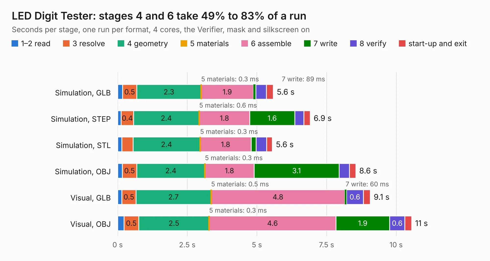

# 290. LED Digit Tester

Board 290 of the 3,102 of [Corpus Testing](../Corpus-Testing.md), on [Corpus Page 3](../CorpusTestingPages/Corpus-Testing-03.md#290-led-digit-tester).

| Mode and format | 1–2 read | 3 resolve | 4 geometry | 5 materials | 6 assemble | 7 write | 8 verify | start-up and exit | Total |
|---|---:|---:|---:|---:|---:|---:|---:|---:|---:|
| Simulation, GLB | 0.2 | 0.5 | 2.3 | 0.3&nbsp;ms | 1.9 | 89&nbsp;ms | 0.4 | 0.2 | 5.6 |
| Simulation, STEP | 0.1 | 0.4 | 2.4 | 0.6&nbsp;ms | 1.8 | 1.6 | 0.3 | 0.2 | 6.9 |
| Simulation, STL | 0.2 | 0.4 | 2.4 | 0.3&nbsp;ms | 1.8 | 0.2 | 0.4 | 0.2 | 5.6 |
| Simulation, OBJ | 0.2 | 0.5 | 2.4 | 0.3&nbsp;ms | 1.8 | 3.1 | 0.4 | 0.2 | 8.6 |
| Visual, GLB | 0.2 | 0.5 | 2.7 | 0.5&nbsp;ms | 4.8 | 60&nbsp;ms | 0.6 | 0.2 | 9.1 |
| Visual, OBJ | 0.2 | 0.5 | 2.5 | 0.3&nbsp;ms | 4.6 | 1.9 | 0.6 | 0.2 | 10.6 |

<table align="center"><tr><td valign="top">

| Board | Repo: [andrewpaterson/658-Computer](https://github.com/andrewpaterson/658-Computer) Board: `LED Digit Tester.kicad_pcb` |
|---|---|
| Folder | Kicad / Pico / LED Digit Tester |
| Complexity | 219&nbsp;/&nbsp;1000 (size&nbsp;154, features&nbsp;65) |
| KESE&nbsp;features | through vias, rounded, trapezoid or chamfered pads, curved board outline, stack-up, dielectric εr and tanδ |
| Tested | 9th November 2026 |
| Copper&nbsp;layers | 2 |
| File&nbsp;format | KiCad 9 (20241229) |
| Parts,&nbsp;tracks,&nbsp;vias | 21, 482, 30 |
| Triangles,&nbsp;simulation | 586,786 in 91 parts |
| Verifier | PASS in all six runs |

</td><td valign="top">

<table>
<tr><th>File type</th><th>File size</th><th>Peak memory used</th></tr>
<tr><th colspan="3" align="left">Simulation</th></tr>
<tr><td>GLB</td><td align="right">20&nbsp;MB</td><td align="right">340&nbsp;MB</td></tr>
<tr><td>STEP</td><td align="right">84&nbsp;MB</td><td align="right">374&nbsp;MB</td></tr>
<tr><td>STL</td><td align="right">29&nbsp;MB</td><td align="right">314&nbsp;MB</td></tr>
<tr><td>OBJ</td><td align="right">59&nbsp;MB</td><td align="right">544&nbsp;MB</td></tr>
<tr><th colspan="3" align="left">Visual</th></tr>
<tr><td>GLB</td><td align="right">13&nbsp;MB</td><td align="right">380&nbsp;MB</td></tr>
<tr><td>OBJ</td><td align="right">39&nbsp;MB</td><td align="right">380&nbsp;MB</td></tr>
</table>

</td></tr></table>

| Previous | Next |
|:---|---:|
| [289. HCP65 Wide Analyser](b0289b_658-Computer_HCP65-Wide-Analyser.md) | [291. SDRAM](b0291b_658-Computer_SDRAM.md) |
