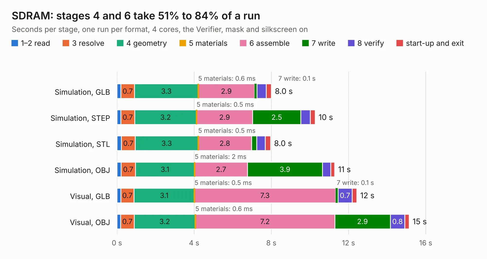

# 291. SDRAM

Board 291 of the 3,101 of [Corpus Testing](../Corpus-Testing.md), on [Corpus Page 3](../CorpusTestingPages/Corpus-Testing-03.md#291-sdram).

| Mode and format | 1–2 read | 3 resolve | 4 geometry | 5 materials | 6 assemble | 7 write | 8 verify | start-up and exit | Total |
|---|---:|---:|---:|---:|---:|---:|---:|---:|---:|
| Simulation, GLB | 0.2 | 0.7 | 3.3 | 0.6&nbsp;ms | 2.9 | 0.1 | 0.5 | 0.3 | 8.0 |
| Simulation, STEP | 0.2 | 0.7 | 3.2 | 0.5&nbsp;ms | 2.9 | 2.5 | 0.5 | 0.3 | 10.3 |
| Simulation, STL | 0.2 | 0.7 | 3.3 | 0.5&nbsp;ms | 2.8 | 0.3 | 0.4 | 0.3 | 8.0 |
| Simulation, OBJ | 0.2 | 0.7 | 3.1 | 2&nbsp;ms | 2.7 | 3.9 | 0.4 | 0.2 | 11.3 |
| Visual, GLB | 0.2 | 0.7 | 3.1 | 0.5&nbsp;ms | 7.3 | 0.1 | 0.7 | 0.2 | 12.4 |
| Visual, OBJ | 0.2 | 0.7 | 3.2 | 0.6&nbsp;ms | 7.2 | 2.9 | 0.8 | 0.2 | 15.1 |

<table align="center"><tr><td valign="top">

| Board | Repo: [andrewpaterson/658-Computer](https://github.com/andrewpaterson/658-Computer) Board: `SDRAM.kicad_pcb` |
|---|---|
| Folder | Kicad / Pico / SDRAM |
| Complexity | 248&nbsp;/&nbsp;1000 (size&nbsp;168, features&nbsp;80) |
| KESE&nbsp;features | through vias, rounded, trapezoid or chamfered pads, curved board outline, knockout text, stack-up, dielectric εr and tanδ |
| Tested | 9th November 2026 |
| Copper&nbsp;layers | 2 |
| File&nbsp;format | KiCad 10 (20260206) |
| Parts,&nbsp;tracks,&nbsp;vias | 25, 928, 96 |
| Triangles,&nbsp;simulation | 791,702 in 138 parts |
| Verifier | PASS in all six runs |

</td><td valign="top">

<table>
<tr><th>File type</th><th>File size</th><th>Peak memory used</th></tr>
<tr><th colspan="3" align="left">Simulation</th></tr>
<tr><td>GLB</td><td align="right">27&nbsp;MB</td><td align="right">379&nbsp;MB</td></tr>
<tr><td>STEP</td><td align="right">118&nbsp;MB</td><td align="right">456&nbsp;MB</td></tr>
<tr><td>STL</td><td align="right">40&nbsp;MB</td><td align="right">363&nbsp;MB</td></tr>
<tr><td>OBJ</td><td align="right">80&nbsp;MB</td><td align="right">569&nbsp;MB</td></tr>
<tr><th colspan="3" align="left">Visual</th></tr>
<tr><td>GLB</td><td align="right">20&nbsp;MB</td><td align="right">497&nbsp;MB</td></tr>
<tr><td>OBJ</td><td align="right">62&nbsp;MB</td><td align="right">558&nbsp;MB</td></tr>
</table>

</td></tr></table>

| Previous | Next |
|:---|---:|
| [290. LED Digit Tester](b0290b_658-Computer_LED-Digit-Tester.md) | [292. Signal Protection](b0292b_658-Computer_Signal-Protection.md) |
