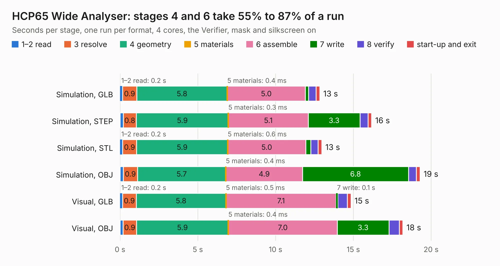

# 292. HCP65 Wide Analyser

Board 292 of the 3,120 of [Corpus Testing](../Corpus-Testing.md), on [Corpus Page 3](../CorpusTestingPages/Corpus-Testing-03.md#292-hcp65-wide-analyser).

| Mode and format | 1–2 read | 3 resolve | 4 geometry | 5 materials | 6 assemble | 7 write | 8 verify | start-up and exit | Total |
|---|---:|---:|---:|---:|---:|---:|---:|---:|---:|
| Simulation, GLB | 0.2 | 0.9 | 5.8 | 0.4&nbsp;ms | 5.0 | 0.2 | 0.5 | 0.2 | 12.8 |
| Simulation, STEP | 0.2 | 0.8 | 5.9 | 0.3&nbsp;ms | 5.1 | 3.3 | 0.5 | 0.2 | 16.2 |
| Simulation, STL | 0.2 | 0.9 | 5.9 | 0.6&nbsp;ms | 5.0 | 0.3 | 0.5 | 0.2 | 13.0 |
| Simulation, OBJ | 0.2 | 0.9 | 5.7 | 0.4&nbsp;ms | 4.9 | 6.8 | 0.5 | 0.2 | 19.3 |
| Visual, GLB | 0.2 | 0.9 | 5.8 | 0.5&nbsp;ms | 7.1 | 0.1 | 0.6 | 0.2 | 14.8 |
| Visual, OBJ | 0.2 | 0.9 | 5.9 | 0.4&nbsp;ms | 7.0 | 3.3 | 0.7 | 0.2 | 18.2 |

<table align="center"><tr><td valign="top">

| Board | Repo: [andrewpaterson/658-Computer](https://github.com/andrewpaterson/658-Computer) Board: `HCP65 Wide Analyser.kicad_pcb` |
|---|---|
| Folder | Kicad / Pico / HCP65 Wide Analyser |
| Complexity | 191&nbsp;/&nbsp;1000 (size&nbsp;126, features&nbsp;65) |
| KESE&nbsp;features | rounded, trapezoid or chamfered pads, curved board outline, knockout text, stack-up, dielectric εr and tanδ |
| Tested | 9th November 2026 |
| Copper&nbsp;layers | 2 |
| File&nbsp;format | KiCad 10 (20260206) |
| Parts,&nbsp;tracks,&nbsp;vias | 7, 203, 0 |
| Triangles,&nbsp;simulation | 1,203,908 in 75 parts |
| Verifier | PASS in all six runs |

</td><td valign="top">

<table>
<tr><th>File type</th><th>File size</th><th>Peak memory used</th></tr>
<tr><th colspan="3" align="left">Simulation</th></tr>
<tr><td>GLB</td><td align="right">38&nbsp;MB</td><td align="right">471&nbsp;MB</td></tr>
<tr><td>STEP</td><td align="right">147&nbsp;MB</td><td align="right">592&nbsp;MB</td></tr>
<tr><td>STL</td><td align="right">60&nbsp;MB</td><td align="right">466&nbsp;MB</td></tr>
<tr><td>OBJ</td><td align="right">120&nbsp;MB</td><td align="right">826&nbsp;MB</td></tr>
<tr><th colspan="3" align="left">Visual</th></tr>
<tr><td>GLB</td><td align="right">20&nbsp;MB</td><td align="right">552&nbsp;MB</td></tr>
<tr><td>OBJ</td><td align="right">60&nbsp;MB</td><td align="right">586&nbsp;MB</td></tr>
</table>

</td></tr></table>

| Previous | Next |
|:---|---:|
| [291. HCP65 Narrow Analyser](b0291b_658-Computer_HCP65-Narrow-Analyser.md) | [293. LED Digit Tester](b0293b_658-Computer_LED-Digit-Tester.md) |
