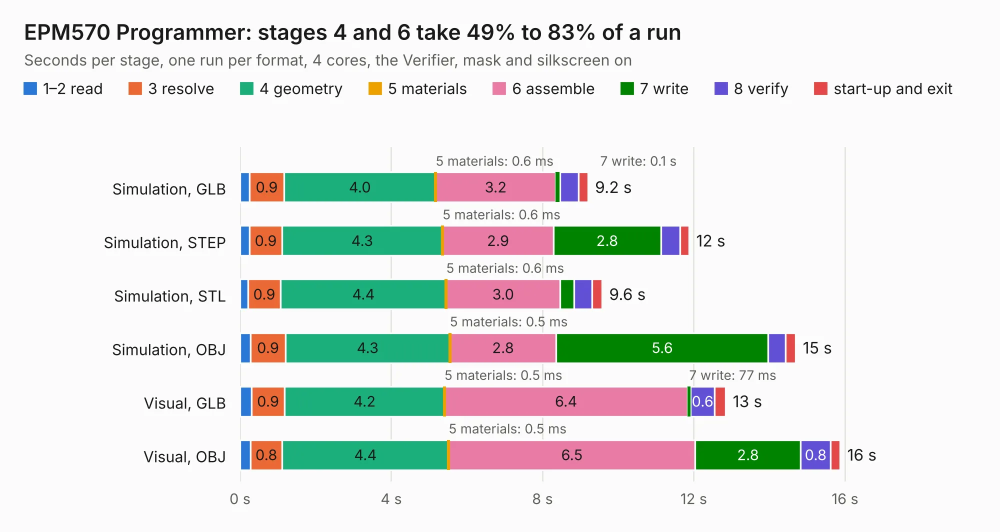

# 295. EPM570 Programmer

Board 295 of the 3,110 of [Corpus Testing](../Corpus-Testing.md), on [Corpus Page 3](../CorpusTestingPages/Corpus-Testing-03.md#295-epm570-programmer).

| Mode and format | 1–2 read | 3 resolve | 4 geometry | 5 materials | 6 assemble | 7 write | 8 verify | start-up and exit | Total |
|---|---:|---:|---:|---:|---:|---:|---:|---:|---:|
| Simulation, GLB | 0.2 | 0.9 | 4.0 | 0.6&nbsp;ms | 3.2 | 0.1 | 0.5 | 0.2 | 9.2 |
| Simulation, STEP | 0.3 | 0.9 | 4.3 | 0.6&nbsp;ms | 2.9 | 2.8 | 0.5 | 0.2 | 11.9 |
| Simulation, STL | 0.2 | 0.9 | 4.4 | 0.6&nbsp;ms | 3.0 | 0.4 | 0.5 | 0.3 | 9.6 |
| Simulation, OBJ | 0.3 | 0.9 | 4.3 | 0.5&nbsp;ms | 2.8 | 5.6 | 0.5 | 0.3 | 14.7 |
| Visual, GLB | 0.3 | 0.9 | 4.2 | 0.5&nbsp;ms | 6.4 | 77&nbsp;ms | 0.6 | 0.3 | 12.8 |
| Visual, OBJ | 0.3 | 0.8 | 4.4 | 0.5&nbsp;ms | 6.5 | 2.8 | 0.8 | 0.2 | 15.9 |

<table align="center"><tr><td valign="top">

| Board | Repo: [andrewpaterson/658-Computer](https://github.com/andrewpaterson/658-Computer) Board: `EPM570 Programmer.kicad_pcb` |
|---|---|
| Folder | Kicad / Programmers / EPM570 Programmer |
| Complexity | 259&nbsp;/&nbsp;1000 (size&nbsp;179, features&nbsp;80) |
| KESE&nbsp;features | through vias, rounded, trapezoid or chamfered pads, curved board outline, knockout text, stack-up, dielectric εr and tanδ |
| Tested | 9th November 2026 |
| Copper&nbsp;layers | 2 |
| File&nbsp;format | KiCad 9 (20241229) |
| Parts,&nbsp;tracks,&nbsp;vias | 19, 226, 6 |
| Triangles,&nbsp;simulation | 745,970 in 106 parts |
| Verifier | PASS in all six runs |

</td><td valign="top">

<table>
<tr><th>File type</th><th>File size</th><th>Peak memory used</th></tr>
<tr><th colspan="3" align="left">Simulation</th></tr>
<tr><td>GLB</td><td align="right">24&nbsp;MB</td><td align="right">350&nbsp;MB</td></tr>
<tr><td>STEP</td><td align="right">98&nbsp;MB</td><td align="right">408&nbsp;MB</td></tr>
<tr><td>STL</td><td align="right">37&nbsp;MB</td><td align="right">350&nbsp;MB</td></tr>
<tr><td>OBJ</td><td align="right">75&nbsp;MB</td><td align="right">534&nbsp;MB</td></tr>
<tr><th colspan="3" align="left">Visual</th></tr>
<tr><td>GLB</td><td align="right">15&nbsp;MB</td><td align="right">435&nbsp;MB</td></tr>
<tr><td>OBJ</td><td align="right">46&nbsp;MB</td><td align="right">448&nbsp;MB</td></tr>
</table>

</td></tr></table>

| Previous | Next |
|:---|---:|
| [294. Signal Protection](b0294b_658-Computer_Signal-Protection.md) | [296. EPM7032S Programmer](b0296b_658-Computer_EPM7032S-Programmer.md) |
