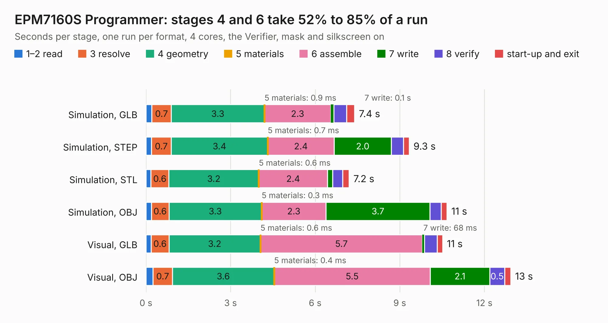

# 295. EPM7160S Programmer

Board 295 of the 3,100 of [Corpus Testing](../Corpus-Testing.md), on [Corpus Page 3](../CorpusTestingPages/Corpus-Testing-03.md#295-epm7160s-programmer).

| Mode and format | 1–2 read | 3 resolve | 4 geometry | 5 materials | 6 assemble | 7 write | 8 verify | start-up and exit | Total |
|---|---:|---:|---:|---:|---:|---:|---:|---:|---:|
| Simulation, GLB | 0.2 | 0.7 | 3.3 | 0.9&nbsp;ms | 2.3 | 0.1 | 0.4 | 0.3 | 7.4 |
| Simulation, STEP | 0.2 | 0.7 | 3.4 | 0.7&nbsp;ms | 2.4 | 2.0 | 0.4 | 0.2 | 9.3 |
| Simulation, STL | 0.2 | 0.6 | 3.2 | 0.6&nbsp;ms | 2.4 | 0.2 | 0.4 | 0.2 | 7.2 |
| Simulation, OBJ | 0.2 | 0.6 | 3.3 | 0.3&nbsp;ms | 2.3 | 3.7 | 0.4 | 0.2 | 10.7 |
| Visual, GLB | 0.2 | 0.6 | 3.2 | 0.6&nbsp;ms | 5.7 | 68&nbsp;ms | 0.5 | 0.2 | 10.5 |
| Visual, OBJ | 0.2 | 0.7 | 3.6 | 0.4&nbsp;ms | 5.5 | 2.1 | 0.5 | 0.2 | 12.9 |

<table align="center"><tr><td valign="top">

| Board | Repo: [andrewpaterson/658-Computer](https://github.com/andrewpaterson/658-Computer) Board: `EPM7160S Programmer.kicad_pcb` |
|---|---|
| Folder | Kicad / Programmers / EPM7160S Programmer |
| Complexity | 246&nbsp;/&nbsp;1000 (size&nbsp;176, features&nbsp;70) |
| KESE&nbsp;features | through vias, curved board outline, knockout text, stack-up, dielectric εr and tanδ |
| Tested | 9th November 2026 |
| Copper&nbsp;layers | 2 |
| File&nbsp;format | KiCad 9 (20241229) |
| Parts,&nbsp;tracks,&nbsp;vias | 16, 197, 7 |
| Triangles,&nbsp;simulation | 738,980 in 109 parts |
| Verifier | PASS in all six runs |

</td><td valign="top">

<table>
<tr><th>File type</th><th>File size</th><th>Peak memory used</th></tr>
<tr><th colspan="3" align="left">Simulation</th></tr>
<tr><td>GLB</td><td align="right">24&nbsp;MB</td><td align="right">352&nbsp;MB</td></tr>
<tr><td>STEP</td><td align="right">95&nbsp;MB</td><td align="right">408&nbsp;MB</td></tr>
<tr><td>STL</td><td align="right">37&nbsp;MB</td><td align="right">321&nbsp;MB</td></tr>
<tr><td>OBJ</td><td align="right">74&nbsp;MB</td><td align="right">525&nbsp;MB</td></tr>
<tr><th colspan="3" align="left">Visual</th></tr>
<tr><td>GLB</td><td align="right">15&nbsp;MB</td><td align="right">447&nbsp;MB</td></tr>
<tr><td>OBJ</td><td align="right">45&nbsp;MB</td><td align="right">438&nbsp;MB</td></tr>
</table>

</td></tr></table>

| Previous | Next |
|:---|---:|
| [294. EPM7032S Programmer](b0294b_658-Computer_EPM7032S-Programmer.md) | [296. Speed](b0296b_658-Computer_Speed.md) |
