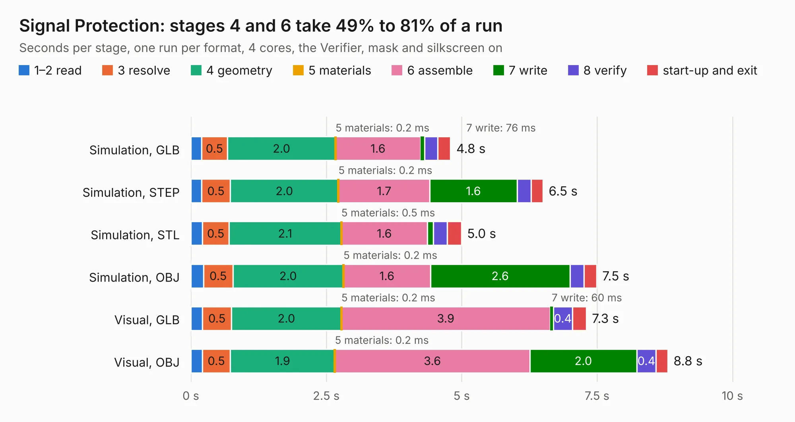

# 295. Signal Protection

Board 295 of the 3,119 of [Corpus Testing](../Corpus-Testing.md), on [Corpus Page 3](../CorpusTestingPages/Corpus-Testing-03.md#295-signal-protection).

| Mode and format | 1–2 read | 3 resolve | 4 geometry | 5 materials | 6 assemble | 7 write | 8 verify | start-up and exit | Total |
|---|---:|---:|---:|---:|---:|---:|---:|---:|---:|
| Simulation, GLB | 0.2 | 0.5 | 2.0 | 0.2&nbsp;ms | 1.6 | 76&nbsp;ms | 0.2 | 0.2 | 4.8 |
| Simulation, STEP | 0.2 | 0.5 | 2.0 | 0.2&nbsp;ms | 1.7 | 1.6 | 0.3 | 0.2 | 6.5 |
| Simulation, STL | 0.2 | 0.5 | 2.1 | 0.5&nbsp;ms | 1.6 | 0.1 | 0.3 | 0.3 | 5.0 |
| Simulation, OBJ | 0.2 | 0.5 | 2.0 | 0.2&nbsp;ms | 1.6 | 2.6 | 0.3 | 0.2 | 7.5 |
| Visual, GLB | 0.2 | 0.5 | 2.0 | 0.2&nbsp;ms | 3.9 | 60&nbsp;ms | 0.4 | 0.3 | 7.3 |
| Visual, OBJ | 0.2 | 0.5 | 1.9 | 0.2&nbsp;ms | 3.6 | 2.0 | 0.4 | 0.2 | 8.8 |

<table align="center"><tr><td valign="top">

| Board | Repo: [andrewpaterson/658-Computer](https://github.com/andrewpaterson/658-Computer) Board: `Signal Protection.kicad_pcb` |
|---|---|
| Folder | Kicad / Pico / Signal Protection |
| Complexity | 252&nbsp;/&nbsp;1000 (size&nbsp;162, features&nbsp;90) |
| KESE&nbsp;features | through vias, rounded, trapezoid or chamfered pads, filled zones, knockout text, stack-up, dielectric εr and tanδ |
| Tested | 9th November 2026 |
| Copper&nbsp;layers | 2 |
| File&nbsp;format | KiCad 9 (20241229) |
| Parts,&nbsp;tracks,&nbsp;vias | 49, 344, 65 |
| Triangles,&nbsp;simulation | 462,784 in 43 parts |
| Verifier | PASS in all six runs |

</td><td valign="top">

<table>
<tr><th>File type</th><th>File size</th><th>Peak memory used</th></tr>
<tr><th colspan="3" align="left">Simulation</th></tr>
<tr><td>GLB</td><td align="right">16&nbsp;MB</td><td align="right">283&nbsp;MB</td></tr>
<tr><td>STEP</td><td align="right">68&nbsp;MB</td><td align="right">344&nbsp;MB</td></tr>
<tr><td>STL</td><td align="right">23&nbsp;MB</td><td align="right">293&nbsp;MB</td></tr>
<tr><td>OBJ</td><td align="right">47&nbsp;MB</td><td align="right">417&nbsp;MB</td></tr>
<tr><th colspan="3" align="left">Visual</th></tr>
<tr><td>GLB</td><td align="right">12&nbsp;MB</td><td align="right">355&nbsp;MB</td></tr>
<tr><td>OBJ</td><td align="right">36&nbsp;MB</td><td align="right">357&nbsp;MB</td></tr>
</table>

</td></tr></table>

| Previous | Next |
|:---|---:|
| [294. SDRAM](b0294b_658-Computer_SDRAM.md) | [296. EPM570 Programmer](b0296b_658-Computer_EPM570-Programmer.md) |
