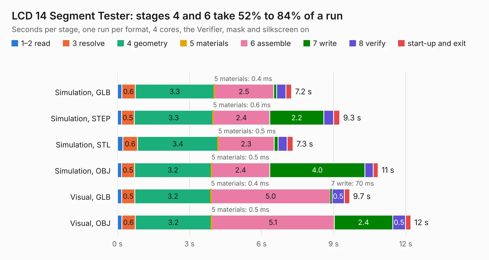

# 299. LCD 14 Segment Tester

Board 299 of the 3,108 of [Corpus Testing](../Corpus-Testing.md), on [Corpus Page 3](../CorpusTestingPages/Corpus-Testing-03.md#299-lcd-14-segment-tester).

| Mode and format | 1–2 read | 3 resolve | 4 geometry | 5 materials | 6 assemble | 7 write | 8 verify | start-up and exit | Total |
|---|---:|---:|---:|---:|---:|---:|---:|---:|---:|
| Simulation, GLB | 0.2 | 0.6 | 3.3 | 0.4&nbsp;ms | 2.5 | 0.1 | 0.4 | 0.2 | 7.2 |
| Simulation, STEP | 0.2 | 0.5 | 3.3 | 0.6&nbsp;ms | 2.4 | 2.2 | 0.4 | 0.3 | 9.3 |
| Simulation, STL | 0.2 | 0.6 | 3.4 | 0.5&nbsp;ms | 2.3 | 0.2 | 0.4 | 0.2 | 7.3 |
| Simulation, OBJ | 0.2 | 0.5 | 3.2 | 0.5&nbsp;ms | 2.4 | 4.0 | 0.3 | 0.2 | 10.9 |
| Visual, GLB | 0.2 | 0.5 | 3.2 | 0.4&nbsp;ms | 5.0 | 70&nbsp;ms | 0.5 | 0.2 | 9.7 |
| Visual, OBJ | 0.2 | 0.6 | 3.2 | 0.5&nbsp;ms | 5.1 | 2.4 | 0.5 | 0.2 | 12.2 |

<table align="center"><tr><td valign="top">

| Board | Repo: [andrewpaterson/658-Computer](https://github.com/andrewpaterson/658-Computer) Board: `LCD 14 Segment Tester.kicad_pcb` |
|---|---|
| Folder | Kicad / Tester / LCD 14 Segment Tester |
| Complexity | 273&nbsp;/&nbsp;1000 (size&nbsp;208, features&nbsp;65) |
| KESE&nbsp;features | through vias, rounded, trapezoid or chamfered pads, curved board outline, stack-up, dielectric εr and tanδ |
| Tested | 9th November 2026 |
| Copper&nbsp;layers | 2 |
| File&nbsp;format | KiCad 9 (20241229) |
| Parts,&nbsp;tracks,&nbsp;vias | 26, 660, 42 |
| Triangles,&nbsp;simulation | 730,016 in 81 parts |
| Verifier | PASS in all six runs |

</td><td valign="top">

<table>
<tr><th>File type</th><th>File size</th><th>Peak memory used</th></tr>
<tr><th colspan="3" align="left">Simulation</th></tr>
<tr><td>GLB</td><td align="right">25&nbsp;MB</td><td align="right">387&nbsp;MB</td></tr>
<tr><td>STEP</td><td align="right">125&nbsp;MB</td><td align="right">427&nbsp;MB</td></tr>
<tr><td>STL</td><td align="right">37&nbsp;MB</td><td align="right">381&nbsp;MB</td></tr>
<tr><td>OBJ</td><td align="right">75&nbsp;MB</td><td align="right">671&nbsp;MB</td></tr>
<tr><th colspan="3" align="left">Visual</th></tr>
<tr><td>GLB</td><td align="right">16&nbsp;MB</td><td align="right">425&nbsp;MB</td></tr>
<tr><td>OBJ</td><td align="right">48&nbsp;MB</td><td align="right">434&nbsp;MB</td></tr>
</table>

</td></tr></table>

| Previous | Next |
|:---|---:|
| [298. Speed](b0298b_658-Computer_Speed.md) | [300. LCD Dual 7 Segment Tester](b0300b_658-Computer_LCD-Dual-7-Segment-Tester.md) |
