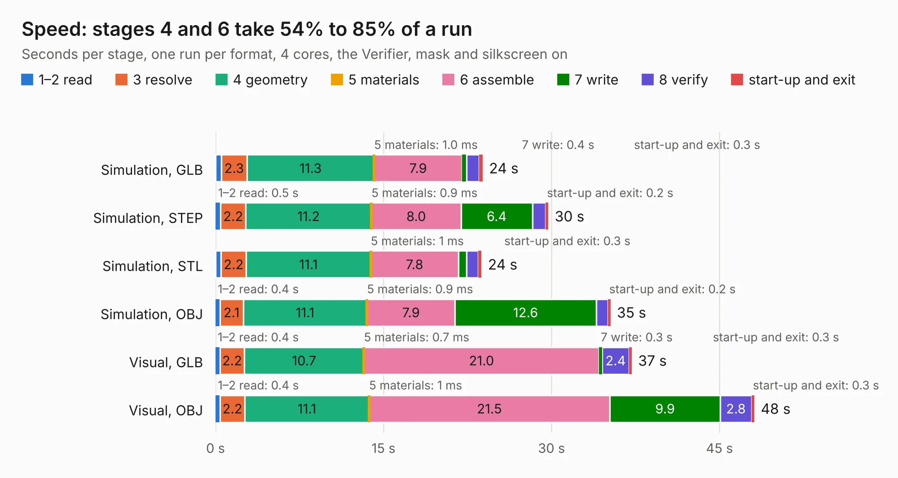

# 299. Speed

Board 299 of the 3,121 of [Corpus Testing](../Corpus-Testing.md), on [Corpus Page 3](../CorpusTestingPages/Corpus-Testing-03.md#299-speed).

| Mode and format | 1–2 read | 3 resolve | 4 geometry | 5 materials | 6 assemble | 7 write | 8 verify | start-up and exit | Total |
|---|---:|---:|---:|---:|---:|---:|---:|---:|---:|
| Simulation, GLB | 0.5 | 2.3 | 11.3 | 1.0&nbsp;ms | 7.9 | 0.4 | 1.1 | 0.3 | 23.9 |
| Simulation, STEP | 0.5 | 2.2 | 11.2 | 0.9&nbsp;ms | 8.0 | 6.4 | 1.2 | 0.2 | 29.7 |
| Simulation, STL | 0.5 | 2.2 | 11.1 | 1&nbsp;ms | 7.8 | 0.7 | 1.0 | 0.3 | 23.8 |
| Simulation, OBJ | 0.4 | 2.1 | 11.1 | 0.9&nbsp;ms | 7.9 | 12.6 | 1.1 | 0.2 | 35.3 |
| Visual, GLB | 0.4 | 2.2 | 10.7 | 0.7&nbsp;ms | 21.0 | 0.3 | 2.4 | 0.3 | 37.2 |
| Visual, OBJ | 0.4 | 2.2 | 11.1 | 1&nbsp;ms | 21.5 | 9.9 | 2.8 | 0.3 | 48.1 |

<table align="center"><tr><td valign="top">

| Board | Repo: [andrewpaterson/658-Computer](https://github.com/andrewpaterson/658-Computer) Board: `Speed.kicad_pcb` |
|---|---|
| Folder | Kicad / Speed |
| Complexity | 268&nbsp;/&nbsp;1000 (size&nbsp;188, features&nbsp;80) |
| KESE&nbsp;features | through vias, rounded, trapezoid or chamfered pads, curved board outline, knockout text, stack-up, dielectric εr and tanδ |
| Tested | 9th November 2026 |
| Copper&nbsp;layers | 2 |
| File&nbsp;format | KiCad 9 (20241229) |
| Parts,&nbsp;tracks,&nbsp;vias | 50, 1,767, 278 |
| Triangles,&nbsp;simulation | 2,444,740 in 242 parts |
| Verifier | PASS in all six runs |

</td><td valign="top">

<table>
<tr><th>File type</th><th>File size</th><th>Peak memory used</th></tr>
<tr><th colspan="3" align="left">Simulation</th></tr>
<tr><td>GLB</td><td align="right">82&nbsp;MB</td><td align="right">894&nbsp;MB</td></tr>
<tr><td>STEP</td><td align="right">347&nbsp;MB</td><td align="right">1.0&nbsp;GB</td></tr>
<tr><td>STL</td><td align="right">122&nbsp;MB</td><td align="right">896&nbsp;MB</td></tr>
<tr><td>OBJ</td><td align="right">254&nbsp;MB</td><td align="right">1.6&nbsp;GB</td></tr>
<tr><th colspan="3" align="left">Visual</th></tr>
<tr><td>GLB</td><td align="right">59&nbsp;MB</td><td align="right">1.1&nbsp;GB</td></tr>
<tr><td>OBJ</td><td align="right">184&nbsp;MB</td><td align="right">1.2&nbsp;GB</td></tr>
</table>

</td></tr></table>

| Previous | Next |
|:---|---:|
| [298. EPM7160S Programmer](b0298b_658-Computer_EPM7160S-Programmer.md) | [300. LCD 14 Segment Tester](b0300b_658-Computer_LCD-14-Segment-Tester.md) |
