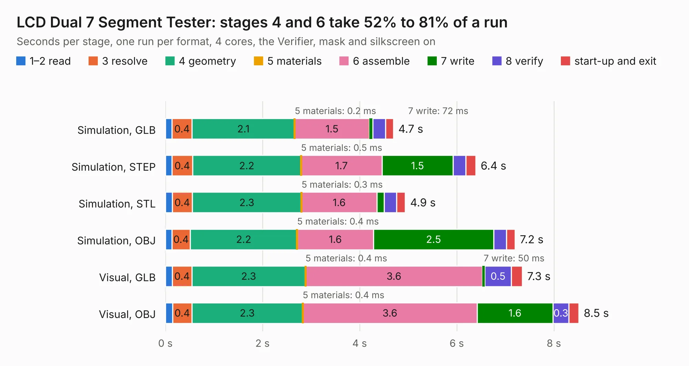

# 300. LCD Dual 7 Segment Tester

Board 300 of the 3,110 of [Corpus Testing](../Corpus-Testing.md), on [Corpus Page 3](../CorpusTestingPages/Corpus-Testing-03.md#300-lcd-dual-7-segment-tester).

| Mode and format | 1–2 read | 3 resolve | 4 geometry | 5 materials | 6 assemble | 7 write | 8 verify | start-up and exit | Total |
|---|---:|---:|---:|---:|---:|---:|---:|---:|---:|
| Simulation, GLB | 0.1 | 0.4 | 2.1 | 0.2&nbsp;ms | 1.5 | 72&nbsp;ms | 0.3 | 0.2 | 4.7 |
| Simulation, STEP | 0.1 | 0.4 | 2.2 | 0.5&nbsp;ms | 1.7 | 1.5 | 0.3 | 0.2 | 6.4 |
| Simulation, STL | 0.1 | 0.4 | 2.3 | 0.3&nbsp;ms | 1.6 | 0.1 | 0.3 | 0.2 | 4.9 |
| Simulation, OBJ | 0.1 | 0.4 | 2.2 | 0.4&nbsp;ms | 1.6 | 2.5 | 0.3 | 0.2 | 7.2 |
| Visual, GLB | 0.1 | 0.4 | 2.3 | 0.4&nbsp;ms | 3.6 | 50&nbsp;ms | 0.5 | 0.2 | 7.3 |
| Visual, OBJ | 0.1 | 0.4 | 2.3 | 0.4&nbsp;ms | 3.6 | 1.6 | 0.3 | 0.2 | 8.5 |

<table align="center"><tr><td valign="top">

| Board | Repo: [andrewpaterson/658-Computer](https://github.com/andrewpaterson/658-Computer) Board: `LCD Dual 7 Segment Tester.kicad_pcb` |
|---|---|
| Folder | Kicad / Tester / LCD Dual 7 Segment Tester |
| Complexity | 206&nbsp;/&nbsp;1000 (size&nbsp;151, features&nbsp;55) |
| KESE&nbsp;features | through vias, curved board outline, stack-up, dielectric εr and tanδ |
| Tested | 9th November 2026 |
| Copper&nbsp;layers | 2 |
| File&nbsp;format | KiCad 9 (20241229) |
| Parts,&nbsp;tracks,&nbsp;vias | 20, 386, 32 |
| Triangles,&nbsp;simulation | 566,016 in 60 parts |
| Verifier | PASS in all six runs |

</td><td valign="top">

<table>
<tr><th>File type</th><th>File size</th><th>Peak memory used</th></tr>
<tr><th colspan="3" align="left">Simulation</th></tr>
<tr><td>GLB</td><td align="right">20&nbsp;MB</td><td align="right">332&nbsp;MB</td></tr>
<tr><td>STEP</td><td align="right">93&nbsp;MB</td><td align="right">362&nbsp;MB</td></tr>
<tr><td>STL</td><td align="right">28&nbsp;MB</td><td align="right">331&nbsp;MB</td></tr>
<tr><td>OBJ</td><td align="right">58&nbsp;MB</td><td align="right">478&nbsp;MB</td></tr>
<tr><th colspan="3" align="left">Visual</th></tr>
<tr><td>GLB</td><td align="right">12&nbsp;MB</td><td align="right">363&nbsp;MB</td></tr>
<tr><td>OBJ</td><td align="right">36&nbsp;MB</td><td align="right">361&nbsp;MB</td></tr>
</table>

</td></tr></table>

| Previous | Next |
|:---|---:|
| [299. LCD 14 Segment Tester](b0299b_658-Computer_LCD-14-Segment-Tester.md) | [301. RAM 48K Select](b0301b_658-Computer_RAM-48K-Select.md) |
