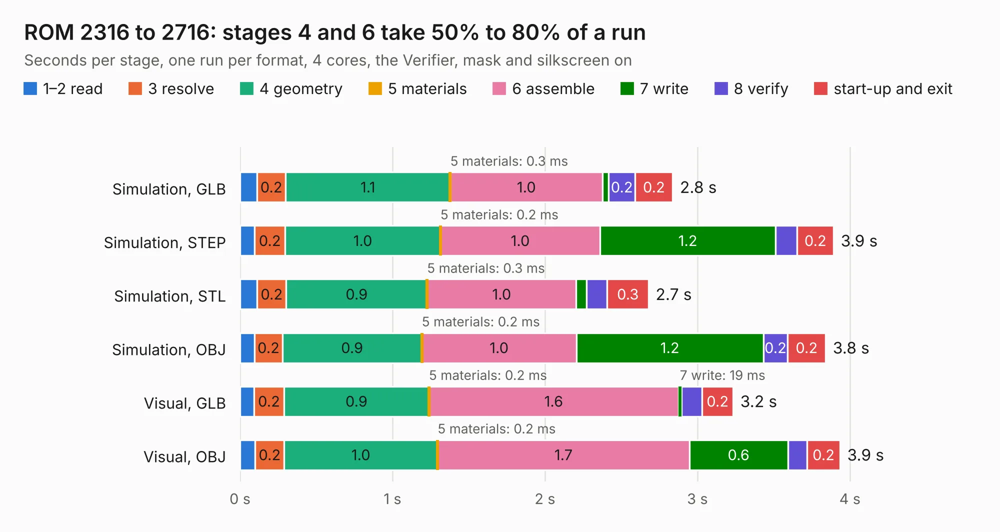

# 300. ROM 2316 to 2716

Board 300 of the 3,101 of [Corpus Testing](../Corpus-Testing.md), on [Corpus Page 3](../CorpusTestingPages/Corpus-Testing-03.md#300-rom-2316-to-2716).

| Mode and format | 1–2 read | 3 resolve | 4 geometry | 5 materials | 6 assemble | 7 write | 8 verify | start-up and exit | Total |
|---|---:|---:|---:|---:|---:|---:|---:|---:|---:|
| Simulation, GLB | 0.1 | 0.2 | 1.1 | 0.3&nbsp;ms | 1.0 | 40&nbsp;ms | 0.2 | 0.2 | 2.8 |
| Simulation, STEP | 95&nbsp;ms | 0.2 | 1.0 | 0.2&nbsp;ms | 1.0 | 1.2 | 0.1 | 0.2 | 3.9 |
| Simulation, STL | 0.1 | 0.2 | 0.9 | 0.3&nbsp;ms | 1.0 | 67&nbsp;ms | 0.1 | 0.3 | 2.7 |
| Simulation, OBJ | 96&nbsp;ms | 0.2 | 0.9 | 0.2&nbsp;ms | 1.0 | 1.2 | 0.2 | 0.2 | 3.8 |
| Visual, GLB | 91&nbsp;ms | 0.2 | 0.9 | 0.2&nbsp;ms | 1.6 | 19&nbsp;ms | 0.1 | 0.2 | 3.2 |
| Visual, OBJ | 0.1 | 0.2 | 1.0 | 0.2&nbsp;ms | 1.7 | 0.6 | 0.1 | 0.2 | 3.9 |

<table align="center"><tr><td valign="top">

| Board | Repo: [andrewpaterson/658-Computer](https://github.com/andrewpaterson/658-Computer) Board: `ROM 2316 to 2716.kicad_pcb` |
|---|---|
| Folder | Kicad / Tester / ROM 2316 to 2716 |
| Complexity | 114&nbsp;/&nbsp;1000 (size&nbsp;104, features&nbsp;10) |
| KESE&nbsp;features | rounded, trapezoid or chamfered pads |
| Tested | 9th November 2026 |
| Copper&nbsp;layers | 2 |
| File&nbsp;format | KiCad 9 (20241229) |
| Parts,&nbsp;tracks,&nbsp;vias | 6, 55, 0 |
| Triangles,&nbsp;simulation | 216,216 in 36 parts |
| Verifier | PASS in all six runs |

</td><td valign="top">

<table>
<tr><th>File type</th><th>File size</th><th>Peak memory used</th></tr>
<tr><th colspan="3" align="left">Simulation</th></tr>
<tr><td>GLB</td><td align="right">6.8&nbsp;MB</td><td align="right">204&nbsp;MB</td></tr>
<tr><td>STEP</td><td align="right">24&nbsp;MB</td><td align="right">224&nbsp;MB</td></tr>
<tr><td>STL</td><td align="right">11&nbsp;MB</td><td align="right">200&nbsp;MB</td></tr>
<tr><td>OBJ</td><td align="right">21&nbsp;MB</td><td align="right">203&nbsp;MB</td></tr>
<tr><th colspan="3" align="left">Visual</th></tr>
<tr><td>GLB</td><td align="right">3.8&nbsp;MB</td><td align="right">184&nbsp;MB</td></tr>
<tr><td>OBJ</td><td align="right">11&nbsp;MB</td><td align="right">184&nbsp;MB</td></tr>
</table>

</td></tr></table>

| Previous | Next |
|:---|---:|
| [299. RAM 48K Select](b0299b_658-Computer_RAM-48K-Select.md) | [301. TSSOP32-14mm Adapter](b0301b_658-Computer_TSSOP32-14mm-Adapter.md) |
