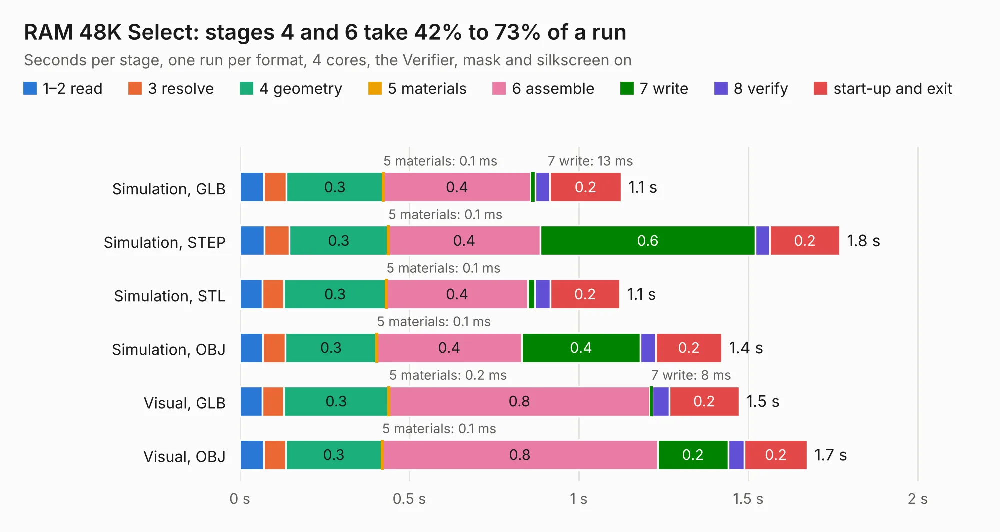

# 301. RAM 48K Select

Board 301 of the 3,105 of [Corpus Testing](../Corpus-Testing.md), on [Corpus Page 3](../CorpusTestingPages/Corpus-Testing-03.md#301-ram-48k-select).

| Mode and format | 1–2 read | 3 resolve | 4 geometry | 5 materials | 6 assemble | 7 write | 8 verify | start-up and exit | Total |
|---|---:|---:|---:|---:|---:|---:|---:|---:|---:|
| Simulation, GLB | 71&nbsp;ms | 67&nbsp;ms | 0.3 | 0.1&nbsp;ms | 0.4 | 13&nbsp;ms | 43&nbsp;ms | 0.2 | 1.1 |
| Simulation, STEP | 72&nbsp;ms | 74&nbsp;ms | 0.3 | 0.1&nbsp;ms | 0.4 | 0.6 | 42&nbsp;ms | 0.2 | 1.8 |
| Simulation, STL | 67&nbsp;ms | 63&nbsp;ms | 0.3 | 0.1&nbsp;ms | 0.4 | 21&nbsp;ms | 46&nbsp;ms | 0.2 | 1.1 |
| Simulation, OBJ | 68&nbsp;ms | 66&nbsp;ms | 0.3 | 0.1&nbsp;ms | 0.4 | 0.4 | 46&nbsp;ms | 0.2 | 1.4 |
| Visual, GLB | 67&nbsp;ms | 62&nbsp;ms | 0.3 | 0.2&nbsp;ms | 0.8 | 8&nbsp;ms | 50&nbsp;ms | 0.2 | 1.5 |
| Visual, OBJ | 71&nbsp;ms | 64&nbsp;ms | 0.3 | 0.1&nbsp;ms | 0.8 | 0.2 | 48&nbsp;ms | 0.2 | 1.7 |

<table align="center"><tr><td valign="top">

| Board | Repo: [andrewpaterson/658-Computer](https://github.com/andrewpaterson/658-Computer) Board: `RAM 48K Select.kicad_pcb` |
|---|---|
| Folder | Kicad / Tester / RAM 48K Select |
| Complexity | 103&nbsp;/&nbsp;1000 (size&nbsp;78, features&nbsp;25) |
| KESE&nbsp;features | through vias, rounded, trapezoid or chamfered pads |
| Tested | 9th November 2026 |
| Copper&nbsp;layers | 2 |
| File&nbsp;format | KiCad 9 (20241229) |
| Parts,&nbsp;tracks,&nbsp;vias | 1, 13, 4 |
| Triangles,&nbsp;simulation | 76,744 in 21 parts |
| Verifier | PASS in all six runs |

</td><td valign="top">

<table>
<tr><th>File type</th><th>File size</th><th>Peak memory used</th></tr>
<tr><th colspan="3" align="left">Simulation</th></tr>
<tr><td>GLB</td><td align="right">2.4&nbsp;MB</td><td align="right">171&nbsp;MB</td></tr>
<tr><td>STEP</td><td align="right">9.0&nbsp;MB</td><td align="right">177&nbsp;MB</td></tr>
<tr><td>STL</td><td align="right">3.8&nbsp;MB</td><td align="right">168&nbsp;MB</td></tr>
<tr><td>OBJ</td><td align="right">7.1&nbsp;MB</td><td align="right">169&nbsp;MB</td></tr>
<tr><th colspan="3" align="left">Visual</th></tr>
<tr><td>GLB</td><td align="right">1.5&nbsp;MB</td><td align="right">148&nbsp;MB</td></tr>
<tr><td>OBJ</td><td align="right">4.1&nbsp;MB</td><td align="right">149&nbsp;MB</td></tr>
</table>

</td></tr></table>

| Previous | Next |
|:---|---:|
| [300. LCD Dual 7 Segment Tester](b0300b_658-Computer_LCD-Dual-7-Segment-Tester.md) | [302. ROM 2316 to 2716](b0302b_658-Computer_ROM-2316-to-2716.md) |
