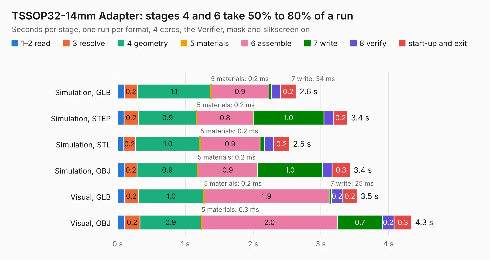

# 303. TSSOP32-14mm Adapter

Board 303 of the 3,111 of [Corpus Testing](../Corpus-Testing.md), on [Corpus Page 3](../CorpusTestingPages/Corpus-Testing-03.md#303-tssop32-14mm-adapter).

| Mode and format | 1–2 read | 3 resolve | 4 geometry | 5 materials | 6 assemble | 7 write | 8 verify | start-up and exit | Total |
|---|---:|---:|---:|---:|---:|---:|---:|---:|---:|
| Simulation, GLB | 0.1 | 0.2 | 1.1 | 0.2&nbsp;ms | 0.9 | 34&nbsp;ms | 0.1 | 0.2 | 2.6 |
| Simulation, STEP | 94&nbsp;ms | 0.2 | 0.9 | 0.2&nbsp;ms | 0.8 | 1.0 | 0.1 | 0.2 | 3.4 |
| Simulation, STL | 89&nbsp;ms | 0.2 | 1.0 | 0.2&nbsp;ms | 0.9 | 68&nbsp;ms | 0.1 | 0.2 | 2.5 |
| Simulation, OBJ | 0.1 | 0.2 | 0.9 | 0.2&nbsp;ms | 0.9 | 1.0 | 0.1 | 0.3 | 3.4 |
| Visual, GLB | 0.1 | 0.2 | 1.0 | 0.2&nbsp;ms | 1.9 | 25&nbsp;ms | 0.2 | 0.2 | 3.5 |
| Visual, OBJ | 96&nbsp;ms | 0.2 | 0.9 | 0.3&nbsp;ms | 2.0 | 0.7 | 0.2 | 0.3 | 4.3 |

<table align="center"><tr><td valign="top">

| Board | Repo: [andrewpaterson/658-Computer](https://github.com/andrewpaterson/658-Computer) Board: `TSSOP32-14mm Adapter.kicad_pcb` |
|---|---|
| Folder | Kicad / Tester / TSSOP32-14mm Adapter |
| Complexity | 170&nbsp;/&nbsp;1000 (size&nbsp;115, features&nbsp;55) |
| KESE&nbsp;features | through vias, rounded, trapezoid or chamfered pads, stack-up, dielectric εr and tanδ |
| Tested | 9th November 2026 |
| Copper&nbsp;layers | 2 |
| File&nbsp;format | KiCad 9 (20241229) |
| Parts,&nbsp;tracks,&nbsp;vias | 2, 146, 15 |
| Triangles,&nbsp;simulation | 213,532 in 44 parts |
| Verifier | PASS in all six runs |

</td><td valign="top">

<table>
<tr><th>File type</th><th>File size</th><th>Peak memory used</th></tr>
<tr><th colspan="3" align="left">Simulation</th></tr>
<tr><td>GLB</td><td align="right">7.0&nbsp;MB</td><td align="right">218&nbsp;MB</td></tr>
<tr><td>STEP</td><td align="right">29&nbsp;MB</td><td align="right">227&nbsp;MB</td></tr>
<tr><td>STL</td><td align="right">11&nbsp;MB</td><td align="right">217&nbsp;MB</td></tr>
<tr><td>OBJ</td><td align="right">21&nbsp;MB</td><td align="right">208&nbsp;MB</td></tr>
<tr><th colspan="3" align="left">Visual</th></tr>
<tr><td>GLB</td><td align="right">4.8&nbsp;MB</td><td align="right">207&nbsp;MB</td></tr>
<tr><td>OBJ</td><td align="right">14&nbsp;MB</td><td align="right">205&nbsp;MB</td></tr>
</table>

</td></tr></table>

| Previous | Next |
|:---|---:|
| [302. ROM 2316 to 2716](b0302b_658-Computer_ROM-2316-to-2716.md) | [304. W65C64](b0304b_658-Computer_W65C64.md) |
