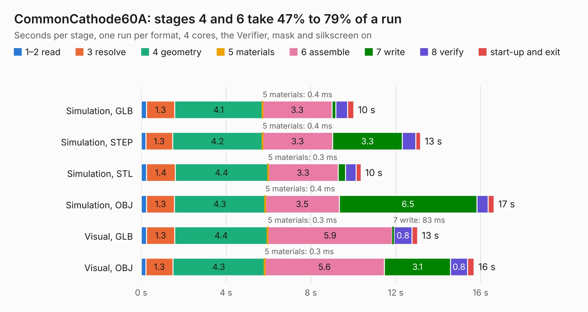

# 303. CommonCathode60A

Board 303 of the 3,101 of [Corpus Testing](../Corpus-Testing.md), on [Corpus Page 3](../CorpusTestingPages/Corpus-Testing-03.md#303-commoncathode60a).

| Mode and format | 1–2 read | 3 resolve | 4 geometry | 5 materials | 6 assemble | 7 write | 8 verify | start-up and exit | Total |
|---|---:|---:|---:|---:|---:|---:|---:|---:|---:|
| Simulation, GLB | 0.2 | 1.3 | 4.1 | 0.4&nbsp;ms | 3.3 | 0.2 | 0.6 | 0.3 | 10.0 |
| Simulation, STEP | 0.2 | 1.3 | 4.2 | 0.4&nbsp;ms | 3.3 | 3.3 | 0.6 | 0.2 | 13.2 |
| Simulation, STL | 0.2 | 1.4 | 4.4 | 0.3&nbsp;ms | 3.3 | 0.4 | 0.5 | 0.2 | 10.4 |
| Simulation, OBJ | 0.3 | 1.3 | 4.3 | 0.4&nbsp;ms | 3.5 | 6.5 | 0.5 | 0.3 | 16.6 |
| Visual, GLB | 0.2 | 1.3 | 4.4 | 0.3&nbsp;ms | 5.9 | 83&nbsp;ms | 0.8 | 0.3 | 13.0 |
| Visual, OBJ | 0.2 | 1.3 | 4.3 | 0.3&nbsp;ms | 5.6 | 3.1 | 0.8 | 0.3 | 15.7 |

<table align="center"><tr><td valign="top">

| Board | Repo: [antevens/boatcontrol](https://github.com/antevens/boatcontrol) Board: `CommonCathode60A.kicad_pcb` |
|---|---|
| Folder | addon / CommonCathode60A |
| Complexity | 186&nbsp;/&nbsp;1000 (size&nbsp;156, features&nbsp;30) |
| KESE&nbsp;features | filled zones, curved board outline |
| Tested | 9th November 2026 |
| Copper&nbsp;layers | 4 |
| File&nbsp;format | KiCad 5 (20171130) |
| Parts,&nbsp;tracks,&nbsp;vias | 11, 337, 0 |
| Triangles,&nbsp;simulation | 1,116,070 in 46 parts |
| Verifier | PASS in all six runs |

</td><td valign="top">

<table>
<tr><th>File type</th><th>File size</th><th>Peak memory used</th></tr>
<tr><th colspan="3" align="left">Simulation</th></tr>
<tr><td>GLB</td><td align="right">38&nbsp;MB</td><td align="right">391&nbsp;MB</td></tr>
<tr><td>STEP</td><td align="right">151&nbsp;MB</td><td align="right">477&nbsp;MB</td></tr>
<tr><td>STL</td><td align="right">56&nbsp;MB</td><td align="right">402&nbsp;MB</td></tr>
<tr><td>OBJ</td><td align="right">113&nbsp;MB</td><td align="right">772&nbsp;MB</td></tr>
<tr><th colspan="3" align="left">Visual</th></tr>
<tr><td>GLB</td><td align="right">15&nbsp;MB</td><td align="right">428&nbsp;MB</td></tr>
<tr><td>OBJ</td><td align="right">45&nbsp;MB</td><td align="right">421&nbsp;MB</td></tr>
</table>

</td></tr></table>

| Previous | Next |
|:---|---:|
| [302. W65C64](b0302b_658-Computer_W65C64.md) | [304. CurrentSensor](b0304b_boatcontrol_CurrentSensor.md) |
