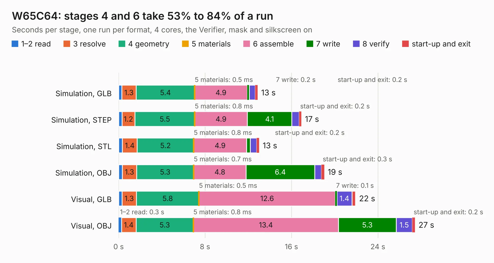

# 304. W65C64

Board 304 of the 3,112 of [Corpus Testing](../Corpus-Testing.md), on [Corpus Page 3](../CorpusTestingPages/Corpus-Testing-03.md#304-w65c64).

| Mode and format | 1–2 read | 3 resolve | 4 geometry | 5 materials | 6 assemble | 7 write | 8 verify | start-up and exit | Total |
|---|---:|---:|---:|---:|---:|---:|---:|---:|---:|
| Simulation, GLB | 0.3 | 1.3 | 5.4 | 0.5&nbsp;ms | 4.9 | 0.2 | 0.5 | 0.2 | 12.9 |
| Simulation, STEP | 0.3 | 1.2 | 5.5 | 0.8&nbsp;ms | 4.9 | 4.1 | 0.7 | 0.2 | 16.9 |
| Simulation, STL | 0.4 | 1.4 | 5.2 | 0.8&nbsp;ms | 4.9 | 0.4 | 0.6 | 0.2 | 13.0 |
| Simulation, OBJ | 0.4 | 1.3 | 5.3 | 0.7&nbsp;ms | 4.8 | 6.4 | 0.6 | 0.3 | 19.0 |
| Visual, GLB | 0.3 | 1.3 | 5.8 | 0.5&nbsp;ms | 12.6 | 0.1 | 1.4 | 0.3 | 21.9 |
| Visual, OBJ | 0.3 | 1.4 | 5.3 | 0.8&nbsp;ms | 13.4 | 5.3 | 1.5 | 0.2 | 27.4 |

<table align="center"><tr><td valign="top">

| Board | Repo: [andrewpaterson/658-Computer](https://github.com/andrewpaterson/658-Computer) Board: `W65C64.kicad_pcb` |
|---|---|
| Folder | Kicad / W65C64 |
| Complexity | 260&nbsp;/&nbsp;1000 (size&nbsp;190, features&nbsp;70) |
| KESE&nbsp;features | through vias, rounded, trapezoid or chamfered pads, knockout text, stack-up, dielectric εr and tanδ |
| Tested | 9th November 2026 |
| Copper&nbsp;layers | 2 |
| File&nbsp;format | KiCad 9 (20241229) |
| Parts,&nbsp;tracks,&nbsp;vias | 51, 2,018, 270 |
| Triangles,&nbsp;simulation | 1,320,418 in 119 parts |
| Verifier | PASS in all six runs |

</td><td valign="top">

<table>
<tr><th>File type</th><th>File size</th><th>Peak memory used</th></tr>
<tr><th colspan="3" align="left">Simulation</th></tr>
<tr><td>GLB</td><td align="right">46&nbsp;MB</td><td align="right">599&nbsp;MB</td></tr>
<tr><td>STEP</td><td align="right">217&nbsp;MB</td><td align="right">668&nbsp;MB</td></tr>
<tr><td>STL</td><td align="right">66&nbsp;MB</td><td align="right">594&nbsp;MB</td></tr>
<tr><td>OBJ</td><td align="right">136&nbsp;MB</td><td align="right">890&nbsp;MB</td></tr>
<tr><th colspan="3" align="left">Visual</th></tr>
<tr><td>GLB</td><td align="right">40&nbsp;MB</td><td align="right">746&nbsp;MB</td></tr>
<tr><td>OBJ</td><td align="right">122&nbsp;MB</td><td align="right">919&nbsp;MB</td></tr>
</table>

</td></tr></table>

| Previous | Next |
|:---|---:|
| [303. TSSOP32-14mm Adapter](b0303b_658-Computer_TSSOP32-14mm-Adapter.md) | [305. CommonCathode60A](b0305b_boatcontrol_CommonCathode60A.md) |
