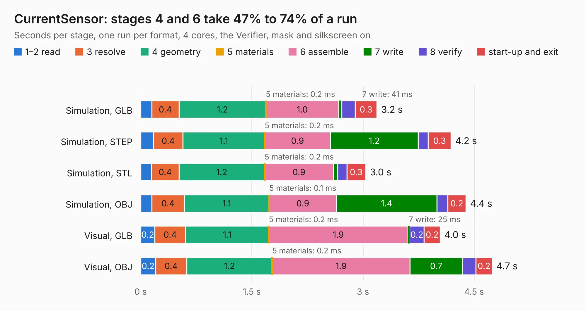

# 307. CurrentSensor

Board 307 of the 3,139 of [Corpus Testing](../Corpus-Testing.md), on [Corpus Page 3](../CorpusTestingPages/Corpus-Testing-03.md#307-currentsensor).

| Mode and format | 1–2 read | 3 resolve | 4 geometry | 5 materials | 6 assemble | 7 write | 8 verify | start-up and exit | Total |
|---|---:|---:|---:|---:|---:|---:|---:|---:|---:|
| Simulation, GLB | 0.1 | 0.4 | 1.2 | 0.2&nbsp;ms | 1.0 | 41&nbsp;ms | 0.2 | 0.3 | 3.2 |
| Simulation, STEP | 0.2 | 0.4 | 1.1 | 0.2&nbsp;ms | 0.9 | 1.2 | 0.1 | 0.3 | 4.2 |
| Simulation, STL | 0.1 | 0.4 | 1.2 | 0.2&nbsp;ms | 0.9 | 58&nbsp;ms | 0.1 | 0.3 | 3.0 |
| Simulation, OBJ | 0.1 | 0.4 | 1.1 | 0.1&nbsp;ms | 0.9 | 1.4 | 0.1 | 0.2 | 4.4 |
| Visual, GLB | 0.2 | 0.4 | 1.1 | 0.2&nbsp;ms | 1.9 | 25&nbsp;ms | 0.2 | 0.2 | 4.0 |
| Visual, OBJ | 0.2 | 0.4 | 1.2 | 0.2&nbsp;ms | 1.9 | 0.7 | 0.2 | 0.2 | 4.7 |

<table align="center"><tr><td valign="top">

| Board | Repo: [antevens/boatcontrol](https://github.com/antevens/boatcontrol) Board: `CurrentSensor.kicad_pcb` |
|---|---|
| Folder | addon / CurrentSensor |
| Complexity | 85&nbsp;/&nbsp;1000 (size&nbsp;50, features&nbsp;35) |
| KESE&nbsp;features | custom pads, rounded, trapezoid or chamfered pads, copper drawings |
| Tested | 9th November 2026 |
| Copper&nbsp;layers | 2 |
| File&nbsp;format | KiCad 5 (20171130) |
| Parts,&nbsp;tracks,&nbsp;vias | 20, 0, 0 |
| Triangles,&nbsp;simulation | 222,452 in 34 parts |
| Verifier | PASS in all six runs |

</td><td valign="top">

<table>
<tr><th>File type</th><th>File size</th><th>Peak memory used</th></tr>
<tr><th colspan="3" align="left">Simulation</th></tr>
<tr><td>GLB</td><td align="right">7.7&nbsp;MB</td><td align="right">221&nbsp;MB</td></tr>
<tr><td>STEP</td><td align="right">36&nbsp;MB</td><td align="right">237&nbsp;MB</td></tr>
<tr><td>STL</td><td align="right">11&nbsp;MB</td><td align="right">215&nbsp;MB</td></tr>
<tr><td>OBJ</td><td align="right">23&nbsp;MB</td><td align="right">215&nbsp;MB</td></tr>
<tr><th colspan="3" align="left">Visual</th></tr>
<tr><td>GLB</td><td align="right">4.3&nbsp;MB</td><td align="right">189&nbsp;MB</td></tr>
<tr><td>OBJ</td><td align="right">12&nbsp;MB</td><td align="right">197&nbsp;MB</td></tr>
</table>

</td></tr></table>

| Previous | Next |
|:---|---:|
| [306. CommonCathode60A](b0306b_boatcontrol_CommonCathode60A.md) | [308. NonLatchingNO30A](b0308b_boatcontrol_NonLatchingNO30A.md) |
