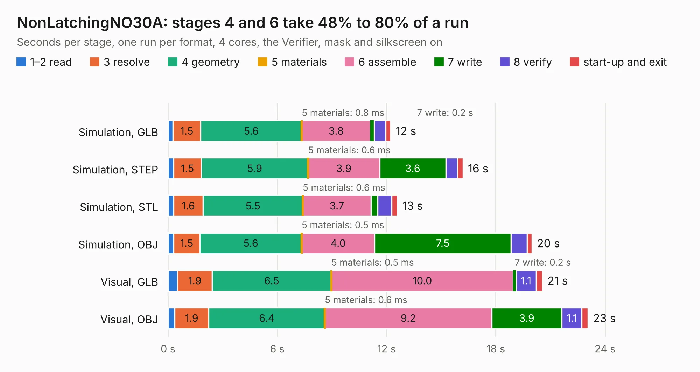

# 308. NonLatchingNO30A

Board 308 of the 3,120 of [Corpus Testing](../Corpus-Testing.md), on [Corpus Page 3](../CorpusTestingPages/Corpus-Testing-03.md#308-nonlatchingno30a).

| Mode and format | 1–2 read | 3 resolve | 4 geometry | 5 materials | 6 assemble | 7 write | 8 verify | start-up and exit | Total |
|---|---:|---:|---:|---:|---:|---:|---:|---:|---:|
| Simulation, GLB | 0.3 | 1.5 | 5.6 | 0.8&nbsp;ms | 3.8 | 0.2 | 0.6 | 0.3 | 12.2 |
| Simulation, STEP | 0.3 | 1.5 | 5.9 | 0.6&nbsp;ms | 3.9 | 3.6 | 0.6 | 0.3 | 16.2 |
| Simulation, STL | 0.3 | 1.6 | 5.5 | 0.6&nbsp;ms | 3.7 | 0.4 | 0.8 | 0.3 | 12.6 |
| Simulation, OBJ | 0.3 | 1.5 | 5.6 | 0.5&nbsp;ms | 4.0 | 7.5 | 0.9 | 0.3 | 20.0 |
| Visual, GLB | 0.5 | 1.9 | 6.5 | 0.5&nbsp;ms | 10.0 | 0.2 | 1.1 | 0.3 | 20.6 |
| Visual, OBJ | 0.4 | 1.9 | 6.4 | 0.6&nbsp;ms | 9.2 | 3.9 | 1.1 | 0.3 | 23.1 |

<table align="center"><tr><td valign="top">

| Board | Repo: [antevens/boatcontrol](https://github.com/antevens/boatcontrol) Board: `NonLatchingNO30A.kicad_pcb` |
|---|---|
| Folder | addon / NonLatchingNO30A |
| Complexity | 198&nbsp;/&nbsp;1000 (size&nbsp;168, features&nbsp;30) |
| KESE&nbsp;features | filled zones, curved board outline |
| Tested | 9th November 2026 |
| Copper&nbsp;layers | 4 |
| File&nbsp;format | KiCad 5 (20171130) |
| Parts,&nbsp;tracks,&nbsp;vias | 19, 499, 0 |
| Triangles,&nbsp;simulation | 1,069,614 in 62 parts |
| Verifier | PASS in all six runs |

</td><td valign="top">

<table>
<tr><th>File type</th><th>File size</th><th>Peak memory used</th></tr>
<tr><th colspan="3" align="left">Simulation</th></tr>
<tr><td>GLB</td><td align="right">37&nbsp;MB</td><td align="right">420&nbsp;MB</td></tr>
<tr><td>STEP</td><td align="right">163&nbsp;MB</td><td align="right">481&nbsp;MB</td></tr>
<tr><td>STL</td><td align="right">53&nbsp;MB</td><td align="right">418&nbsp;MB</td></tr>
<tr><td>OBJ</td><td align="right">109&nbsp;MB</td><td align="right">751&nbsp;MB</td></tr>
<tr><th colspan="3" align="left">Visual</th></tr>
<tr><td>GLB</td><td align="right">18&nbsp;MB</td><td align="right">449&nbsp;MB</td></tr>
<tr><td>OBJ</td><td align="right">54&nbsp;MB</td><td align="right">445&nbsp;MB</td></tr>
</table>

</td></tr></table>

| Previous | Next |
|:---|---:|
| [307. CurrentSensor](b0307b_boatcontrol_CurrentSensor.md) | [309. ac922interposer](b0309b_ac922interposer_ac922interposer.md) |
