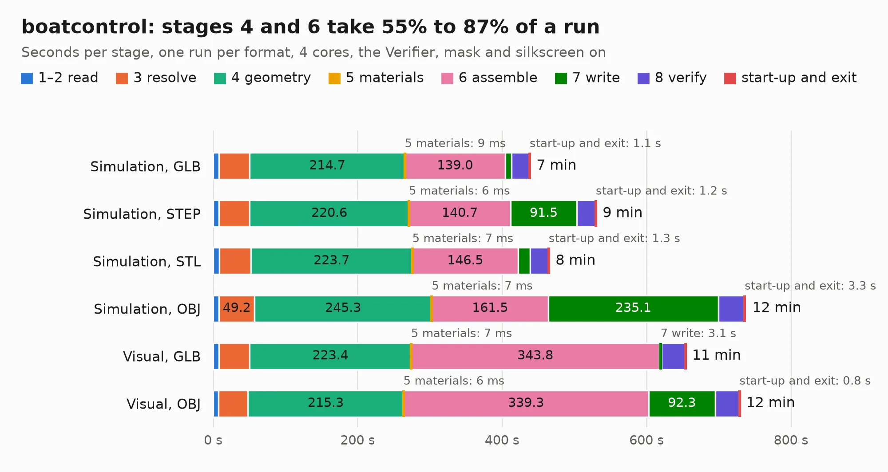

# 309. boatcontrol

Board 309 of the 3,138 of [Corpus Testing](../Corpus-Testing.md), on [Corpus Page 3](../CorpusTestingPages/Corpus-Testing-03.md#309-boatcontrol).

| Mode and format | 1–2 read | 3 resolve | 4 geometry | 5 materials | 6 assemble | 7 write | 8 verify | start-up and exit | Total |
|---|---:|---:|---:|---:|---:|---:|---:|---:|---:|
| Simulation, GLB | 7.9 | 42.7 | 214.7 | 9&nbsp;ms | 139.0 | 8.5 | 24.8 | 1.1 | 438.8 |
| Simulation, STEP | 7.8 | 42.6 | 220.6 | 6&nbsp;ms | 140.7 | 91.5 | 26.0 | 1.2 | 530.4 |
| Simulation, STL | 8.6 | 43.5 | 223.7 | 7&nbsp;ms | 146.5 | 16.8 | 24.9 | 1.3 | 465.2 |
| Simulation, OBJ |  |  |  |  |  |  |  |  | exceeded 11 GB on a 15 GB machine (stopped there, not a KESE failure); it will be run again on a machine with more memory |
| Visual, GLB | 8.1 | 42.5 | 223.4 | 7&nbsp;ms | 343.8 | 3.1 | 32.6 | 0.8 | 654.3 |
| Visual, OBJ | 7.7 | 40.5 | 215.3 | 6&nbsp;ms | 339.3 | 92.3 | 33.2 | 0.8 | 729.1 |

<table align="center"><tr><td valign="top">

| Board | Repo: [antevens/boatcontrol](https://github.com/antevens/boatcontrol) Board: `boatcontrol.kicad_pcb` |
|---|---|
| Folder | boatcontrol |
| Complexity | 358&nbsp;/&nbsp;1000 (size&nbsp;263, features&nbsp;95) |
| KESE&nbsp;features | through vias, blind and buried vias, rounded, trapezoid or chamfered pads, filled zones, curved board outline |
| Tested | 9th November 2026 |
| Copper&nbsp;layers | 4 |
| File&nbsp;format | KiCad 5 (20171130) |
| Parts,&nbsp;tracks,&nbsp;vias | 632, 15,097, 727 |
| Triangles,&nbsp;simulation | 30,876,084 in 1197 parts |
| Verifier | Simulation, OBJ: exceeded 11 GB on a 15 GB machine (stopped there, not a KESE failure); it will be run again on a machine with more memory |

</td><td valign="top">

<table>
<tr><th>File type</th><th>File size</th><th>Peak memory used</th></tr>
<tr><th colspan="3" align="left">Simulation</th></tr>
<tr><td>GLB</td><td align="right">1.0&nbsp;GB</td><td align="right">6.1&nbsp;GB</td></tr>
<tr><td>STEP</td><td align="right">4.8&nbsp;GB</td><td align="right">8.4&nbsp;GB</td></tr>
<tr><td>STL</td><td align="right">1.5&nbsp;GB</td><td align="right">6.1&nbsp;GB</td></tr>
<tr><td>OBJ</td><td align="right">–</td><td align="right">11&nbsp;GB</td></tr>
<tr><th colspan="3" align="left">Visual</th></tr>
<tr><td>GLB</td><td align="right">516&nbsp;MB</td><td align="right">8.0&nbsp;GB</td></tr>
<tr><td>OBJ</td><td align="right">1.7&nbsp;GB</td><td align="right">10&nbsp;GB</td></tr>
</table>

</td></tr></table>

| Previous | Next |
|:---|---:|
| [308. NonLatchingNO30A](b0308b_boatcontrol_NonLatchingNO30A.md) | [310. ac922interposer](b0310b_ac922interposer_ac922interposer.md) |
