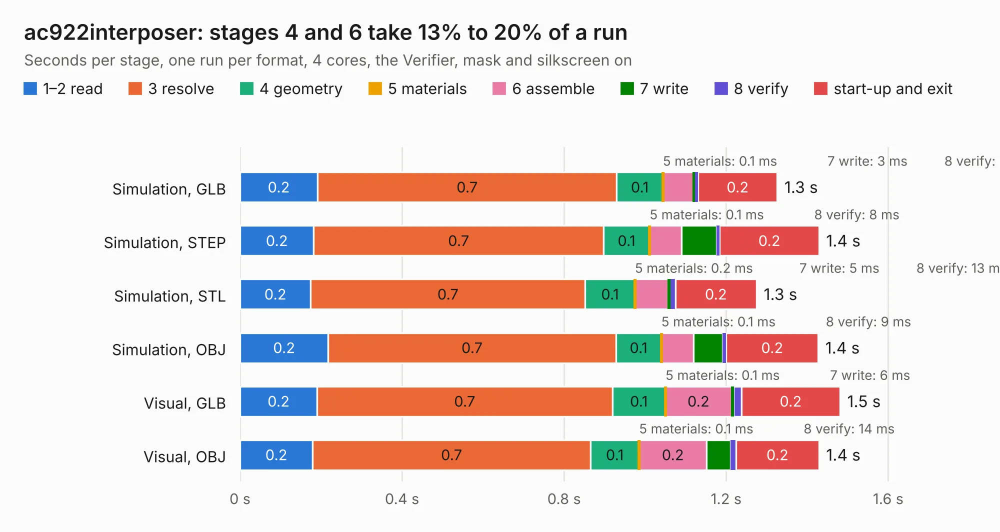

# 310. ac922interposer

Board 310 of the 3,138 of [Corpus Testing](../Corpus-Testing.md), on [Corpus Page 3](../CorpusTestingPages/Corpus-Testing-03.md#310-ac922interposer).

| Mode and format | 1–2 read | 3 resolve | 4 geometry | 5 materials | 6 assemble | 7 write | 8 verify | start-up and exit | Total |
|---|---:|---:|---:|---:|---:|---:|---:|---:|---:|
| Simulation, GLB | 0.2 | 0.7 | 0.1 | 0.1&nbsp;ms | 75&nbsp;ms | 3&nbsp;ms | 8&nbsp;ms | 0.2 | 1.3 |
| Simulation, STEP | 0.2 | 0.7 | 0.1 | 0.1&nbsp;ms | 78&nbsp;ms | 86&nbsp;ms | 8&nbsp;ms | 0.2 | 1.4 |
| Simulation, STL | 0.2 | 0.7 | 0.1 | 0.2&nbsp;ms | 81&nbsp;ms | 5&nbsp;ms | 13&nbsp;ms | 0.2 | 1.3 |
| Simulation, OBJ | 0.2 | 0.7 | 0.1 | 0.1&nbsp;ms | 79&nbsp;ms | 71&nbsp;ms | 9&nbsp;ms | 0.2 | 1.4 |
| Visual, GLB | 0.2 | 0.7 | 0.1 | 0.1&nbsp;ms | 0.2 | 6&nbsp;ms | 19&nbsp;ms | 0.2 | 1.5 |
| Visual, OBJ | 0.2 | 0.7 | 0.1 | 0.1&nbsp;ms | 0.2 | 59&nbsp;ms | 14&nbsp;ms | 0.2 | 1.4 |

<table align="center"><tr><td valign="top">

| Board | Repo: [antmicro/ac922interposer](https://github.com/antmicro/ac922interposer) Board: `ac922interposer.kicad_pcb` |
|---|---|
| Complexity | 212&nbsp;/&nbsp;1000 (size&nbsp;177, features&nbsp;35) |
| KESE&nbsp;features | through vias, rounded, trapezoid or chamfered pads, curved board outline |
| Tested | 9th November 2026 |
| Copper&nbsp;layers | 6 |
| File&nbsp;format | KiCad 5 (20171130) |
| Parts,&nbsp;tracks,&nbsp;vias | 15, 449, 43 |
| Triangles,&nbsp;simulation | 15,704 in 7 parts |
| Verifier | PASS in all six runs |

</td><td valign="top">

<table>
<tr><th>File type</th><th>File size</th><th>Peak memory used</th></tr>
<tr><th colspan="3" align="left">Simulation</th></tr>
<tr><td>GLB</td><td align="right">345&nbsp;kB</td><td align="right">159&nbsp;MB</td></tr>
<tr><td>STEP</td><td align="right">227&nbsp;kB</td><td align="right">160&nbsp;MB</td></tr>
<tr><td>STL</td><td align="right">786&nbsp;kB</td><td align="right">160&nbsp;MB</td></tr>
<tr><td>OBJ</td><td align="right">1.4&nbsp;MB</td><td align="right">158&nbsp;MB</td></tr>
<tr><th colspan="3" align="left">Visual</th></tr>
<tr><td>GLB</td><td align="right">352&nbsp;kB</td><td align="right">160&nbsp;MB</td></tr>
<tr><td>OBJ</td><td align="right">1.1&nbsp;MB</td><td align="right">160&nbsp;MB</td></tr>
</table>

</td></tr></table>

| Previous | Next |
|:---|---:|
| [309. boatcontrol](b0309b_boatcontrol_boatcontrol.md) | [311. jetson-agx-thor-baseboard-pcie-x1-interposer](b0311b_agx-thor-baseboard-pcie-interposer_jetson-agx-thor-baseboard-pcie-x1-interposer.md) |
