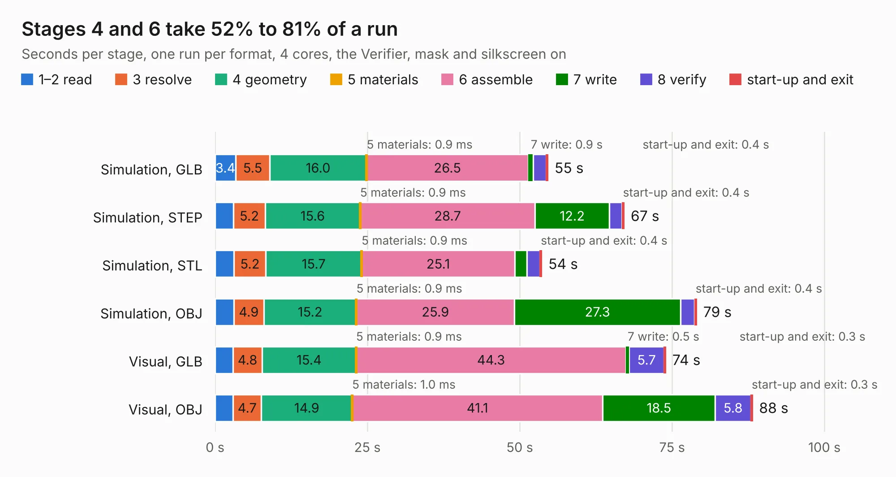

# 310. jetson-agx-thor-baseboard-pcie-x1-interposer

Board 310 of the 3,119 of [Corpus Testing](../Corpus-Testing.md), on [Corpus Page 3](../CorpusTestingPages/Corpus-Testing-03.md#310-jetson-agx-thor-baseboard-pcie-x1-interposer).

| Mode and format | 1–2 read | 3 resolve | 4 geometry | 5 materials | 6 assemble | 7 write | 8 verify | start-up and exit | Total |
|---|---:|---:|---:|---:|---:|---:|---:|---:|---:|
| Simulation, GLB | 3.4 | 5.5 | 16.0 | 0.9&nbsp;ms | 26.5 | 0.9 | 2.1 | 0.4 | 54.7 |
| Simulation, STEP | 3.0 | 5.2 | 15.6 | 0.9&nbsp;ms | 28.7 | 12.2 | 2.0 | 0.4 | 67.2 |
| Simulation, STL | 3.1 | 5.2 | 15.7 | 0.9&nbsp;ms | 25.1 | 2.0 | 2.1 | 0.4 | 53.6 |
| Simulation, OBJ | 3.1 | 4.9 | 15.2 | 0.9&nbsp;ms | 25.9 | 27.3 | 2.3 | 0.4 | 79.1 |
| Visual, GLB | 2.9 | 4.8 | 15.4 | 0.9&nbsp;ms | 44.3 | 0.5 | 5.7 | 0.3 | 74.0 |
| Visual, OBJ | 2.9 | 4.7 | 14.9 | 1.0&nbsp;ms | 41.1 | 18.5 | 5.8 | 0.3 | 88.2 |

<table align="center"><tr><td valign="top">

| Board | Repo: [antmicro/agx-thor-baseboard-pcie-interposer](https://github.com/antmicro/agx-thor-baseboard-pcie-interposer) Board: `jetson-agx-thor-baseboard-pcie-x1-interposer.kicad_pcb` |
|---|---|
| Complexity | 364&nbsp;/&nbsp;1000 (size&nbsp;214, features&nbsp;150) |
| KESE&nbsp;features | through vias, custom pads, rounded, trapezoid or chamfered pads, arc tracks, filled zones, copper drawings, copper text, curved board outline, knockout text, stack-up, dielectric εr and tanδ |
| Tested | 9th November 2026 |
| Copper&nbsp;layers | 4 |
| File&nbsp;format | KiCad 9 (20241229) |
| Parts,&nbsp;tracks,&nbsp;vias | 68, 948, 940 |
| Triangles,&nbsp;simulation | 4,223,912 in 375 parts |
| Verifier | PASS in all six runs |

</td><td valign="top">

<table>
<tr><th>File type</th><th>File size</th><th>Peak memory used</th></tr>
<tr><th colspan="3" align="left">Simulation</th></tr>
<tr><td>GLB</td><td align="right">143&nbsp;MB</td><td align="right">1.4&nbsp;GB</td></tr>
<tr><td>STEP</td><td align="right">533&nbsp;MB</td><td align="right">1.9&nbsp;GB</td></tr>
<tr><td>STL</td><td align="right">211&nbsp;MB</td><td align="right">1.4&nbsp;GB</td></tr>
<tr><td>OBJ</td><td align="right">444&nbsp;MB</td><td align="right">2.8&nbsp;GB</td></tr>
<tr><th colspan="3" align="left">Visual</th></tr>
<tr><td>GLB</td><td align="right">101&nbsp;MB</td><td align="right">1.7&nbsp;GB</td></tr>
<tr><td>OBJ</td><td align="right">318&nbsp;MB</td><td align="right">2.1&nbsp;GB</td></tr>
</table>

</td></tr></table>

| Previous | Next |
|:---|---:|
| [309. ac922interposer](b0309b_ac922interposer_ac922interposer.md) | [311. antmicro-alvium-flex-csi-adapter-100mm-double-opposite-sides](b0311b_alvium-flexible-csi-adapter_antmicro-alvium-flex-csi-adapter-100mm-double-opposite-sides.md) |
