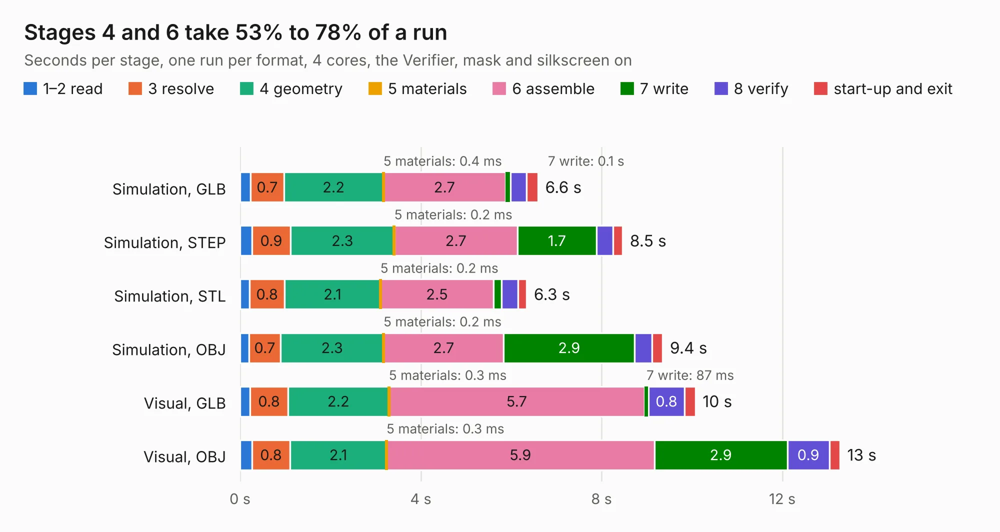

# 310. antmicro-alvium-flex-csi-adapter-100mm-double-opposite-sides

Board 310 of the 3,117 of [Corpus Testing](../Corpus-Testing.md), on [Corpus Page 3](../CorpusTestingPages/Corpus-Testing-03.md#310-antmicro-alvium-flex-csi-adapter-100mm-double-opposite-sides).

| Mode and format | 1–2 read | 3 resolve | 4 geometry | 5 materials | 6 assemble | 7 write | 8 verify | start-up and exit | Total |
|---|---:|---:|---:|---:|---:|---:|---:|---:|---:|
| Simulation, GLB | 0.2 | 0.7 | 2.2 | 0.4&nbsp;ms | 2.7 | 0.1 | 0.4 | 0.3 | 6.6 |
| Simulation, STEP | 0.3 | 0.9 | 2.3 | 0.2&nbsp;ms | 2.7 | 1.7 | 0.4 | 0.2 | 8.5 |
| Simulation, STL | 0.2 | 0.8 | 2.1 | 0.2&nbsp;ms | 2.5 | 0.2 | 0.4 | 0.2 | 6.3 |
| Simulation, OBJ | 0.2 | 0.7 | 2.3 | 0.2&nbsp;ms | 2.7 | 2.9 | 0.4 | 0.2 | 9.4 |
| Visual, GLB | 0.2 | 0.8 | 2.2 | 0.3&nbsp;ms | 5.7 | 87&nbsp;ms | 0.8 | 0.2 | 10.1 |
| Visual, OBJ | 0.3 | 0.8 | 2.1 | 0.3&nbsp;ms | 5.9 | 2.9 | 0.9 | 0.2 | 13.3 |

<table align="center"><tr><td valign="top">

| Board | Repo: [antmicro/alvium-flexible-csi-adapter](https://github.com/antmicro/alvium-flexible-csi-adapter) Board: `antmicro-alvium-flex-csi-adapter-100mm-double-opposite-sides.kicad_pcb` |
|---|---|
| Folder | 100mm-double-opposite-sides |
| Complexity | 200&nbsp;/&nbsp;1000 (size&nbsp;165, features&nbsp;35) |
| KESE&nbsp;features | through vias, filled zones |
| Tested | 9th November 2026 |
| Copper&nbsp;layers | 2 |
| File&nbsp;format | KiCad 5 (20171130) |
| Parts,&nbsp;tracks,&nbsp;vias | 5, 1,782, 294 |
| Triangles,&nbsp;simulation | 631,300 in 56 parts |
| Verifier | PASS in all six runs |

</td><td valign="top">

<table>
<tr><th>File type</th><th>File size</th><th>Peak memory used</th></tr>
<tr><th colspan="3" align="left">Simulation</th></tr>
<tr><td>GLB</td><td align="right">22&nbsp;MB</td><td align="right">397&nbsp;MB</td></tr>
<tr><td>STEP</td><td align="right">86&nbsp;MB</td><td align="right">455&nbsp;MB</td></tr>
<tr><td>STL</td><td align="right">32&nbsp;MB</td><td align="right">401&nbsp;MB</td></tr>
<tr><td>OBJ</td><td align="right">63&nbsp;MB</td><td align="right">458&nbsp;MB</td></tr>
<tr><th colspan="3" align="left">Visual</th></tr>
<tr><td>GLB</td><td align="right">20&nbsp;MB</td><td align="right">498&nbsp;MB</td></tr>
<tr><td>OBJ</td><td align="right">61&nbsp;MB</td><td align="right">534&nbsp;MB</td></tr>
</table>

</td></tr></table>

| Previous | Next |
|:---|---:|
| [309. jetson-agx-thor-baseboard-pcie-x1-interposer](b0309b_agx-thor-baseboard-pcie-interposer_jetson-agx-thor-baseboard-pcie-x1-interposer.md) | [311. antmicro-alvium-flex-csi-adapter-100mm-double-same-side](b0311b_alvium-flexible-csi-adapter_antmicro-alvium-flex-csi-adapter-100mm-double-same-side.md) |
