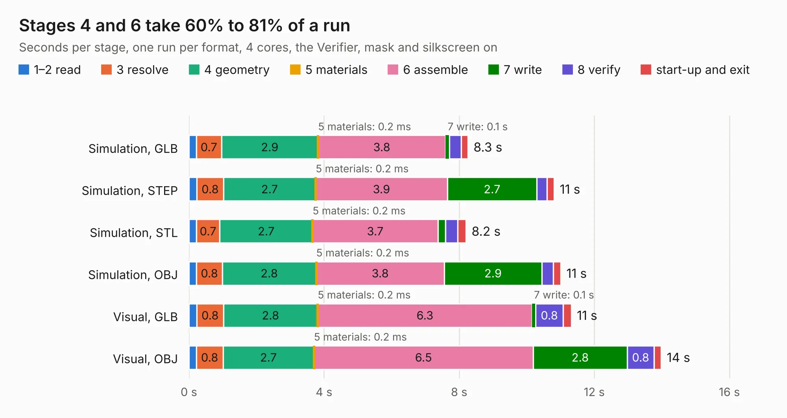

# 312. antmicro-alvium-flex-csi-adapter-100mm-double-same-side

Board 312 of the 3,129 of [Corpus Testing](../Corpus-Testing.md), on [Corpus Page 3](../CorpusTestingPages/Corpus-Testing-03.md#312-antmicro-alvium-flex-csi-adapter-100mm-double-same-side).

| Mode and format | 1–2 read | 3 resolve | 4 geometry | 5 materials | 6 assemble | 7 write | 8 verify | start-up and exit | Total |
|---|---:|---:|---:|---:|---:|---:|---:|---:|---:|
| Simulation, GLB | 0.2 | 0.7 | 2.9 | 0.2&nbsp;ms | 3.8 | 0.1 | 0.4 | 0.2 | 8.3 |
| Simulation, STEP | 0.2 | 0.8 | 2.7 | 0.2&nbsp;ms | 3.9 | 2.7 | 0.3 | 0.2 | 10.8 |
| Simulation, STL | 0.2 | 0.7 | 2.7 | 0.2&nbsp;ms | 3.7 | 0.2 | 0.4 | 0.2 | 8.2 |
| Simulation, OBJ | 0.2 | 0.8 | 2.8 | 0.2&nbsp;ms | 3.8 | 2.9 | 0.3 | 0.2 | 11.0 |
| Visual, GLB | 0.2 | 0.8 | 2.8 | 0.2&nbsp;ms | 6.3 | 0.1 | 0.8 | 0.2 | 11.3 |
| Visual, OBJ | 0.2 | 0.8 | 2.7 | 0.2&nbsp;ms | 6.5 | 2.8 | 0.8 | 0.2 | 14.0 |

<table align="center"><tr><td valign="top">

| Board | Repo: [antmicro/alvium-flexible-csi-adapter](https://github.com/antmicro/alvium-flexible-csi-adapter) Board: `antmicro-alvium-flex-csi-adapter-100mm-double-same-side.kicad_pcb` |
|---|---|
| Folder | 100mm-double-same-side |
| Complexity | 206&nbsp;/&nbsp;1000 (size&nbsp;171, features&nbsp;35) |
| KESE&nbsp;features | through vias, filled zones |
| Tested | 9th November 2026 |
| Copper&nbsp;layers | 2 |
| File&nbsp;format | KiCad 5 (20171130) |
| Parts,&nbsp;tracks,&nbsp;vias | 5, 2,906, 269 |
| Triangles,&nbsp;simulation | 704,936 in 56 parts |
| Verifier | PASS in all six runs |

</td><td valign="top">

<table>
<tr><th>File type</th><th>File size</th><th>Peak memory used</th></tr>
<tr><th colspan="3" align="left">Simulation</th></tr>
<tr><td>GLB</td><td align="right">24&nbsp;MB</td><td align="right">433&nbsp;MB</td></tr>
<tr><td>STEP</td><td align="right">108&nbsp;MB</td><td align="right">511&nbsp;MB</td></tr>
<tr><td>STL</td><td align="right">35&nbsp;MB</td><td align="right">425&nbsp;MB</td></tr>
<tr><td>OBJ</td><td align="right">70&nbsp;MB</td><td align="right">539&nbsp;MB</td></tr>
<tr><th colspan="3" align="left">Visual</th></tr>
<tr><td>GLB</td><td align="right">23&nbsp;MB</td><td align="right">628&nbsp;MB</td></tr>
<tr><td>OBJ</td><td align="right">69&nbsp;MB</td><td align="right">594&nbsp;MB</td></tr>
</table>

</td></tr></table>

| Previous | Next |
|:---|---:|
| [311. antmicro-alvium-flex-csi-adapter-100mm-double-opposite-sides](b0311b_alvium-flexible-csi-adapter_antmicro-alvium-flex-csi-adapter-100mm-double-opposite-sides.md) | [313. antmicro-alvium-flex-csi-adapter-100mm-single-opposite-sides](b0313b_alvium-flexible-csi-adapter_antmicro-alvium-flex-csi-adapter-100mm-single-opposite-sides.md) |
