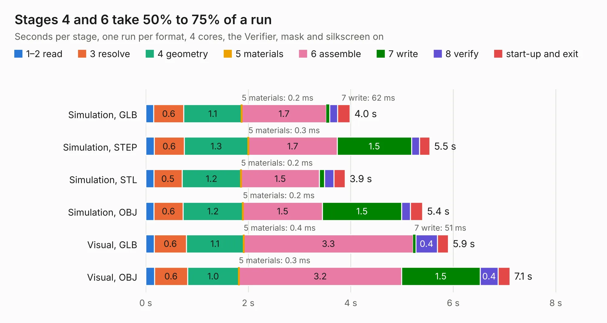

# 313. antmicro-alvium-flex-csi-adapter_200mm-single-same-side

Board 313 of the 3,100 of [Corpus Testing](../Corpus-Testing.md), on [Corpus Page 3](../CorpusTestingPages/Corpus-Testing-03.md#313-antmicro-alvium-flex-csi-adapter_200mm-single-same-side).

| Mode and format | 1–2 read | 3 resolve | 4 geometry | 5 materials | 6 assemble | 7 write | 8 verify | start-up and exit | Total |
|---|---:|---:|---:|---:|---:|---:|---:|---:|---:|
| Simulation, GLB | 0.2 | 0.6 | 1.1 | 0.2&nbsp;ms | 1.7 | 62&nbsp;ms | 0.2 | 0.2 | 4.0 |
| Simulation, STEP | 0.2 | 0.6 | 1.3 | 0.3&nbsp;ms | 1.7 | 1.5 | 0.2 | 0.2 | 5.5 |
| Simulation, STL | 0.2 | 0.5 | 1.2 | 0.2&nbsp;ms | 1.5 | 0.1 | 0.2 | 0.2 | 3.9 |
| Simulation, OBJ | 0.2 | 0.6 | 1.2 | 0.2&nbsp;ms | 1.5 | 1.5 | 0.2 | 0.2 | 5.4 |
| Visual, GLB | 0.2 | 0.6 | 1.1 | 0.4&nbsp;ms | 3.3 | 51&nbsp;ms | 0.4 | 0.2 | 5.9 |
| Visual, OBJ | 0.2 | 0.6 | 1.0 | 0.3&nbsp;ms | 3.2 | 1.5 | 0.4 | 0.2 | 7.1 |

<table align="center"><tr><td valign="top">

| Board | Repo: [antmicro/alvium-flexible-csi-adapter](https://github.com/antmicro/alvium-flexible-csi-adapter) Board: `antmicro-alvium-flex-csi-adapter_200mm-single-same-side.kicad_pcb` |
|---|---|
| Folder | 200mm-single-same-side |
| Complexity | 186&nbsp;/&nbsp;1000 (size&nbsp;151, features&nbsp;35) |
| KESE&nbsp;features | through vias, filled zones |
| Tested | 9th November 2026 |
| Copper&nbsp;layers | 2 |
| File&nbsp;format | KiCad 5 (20171130) |
| Parts,&nbsp;tracks,&nbsp;vias | 3, 913, 181 |
| Triangles,&nbsp;simulation | 337,742 in 55 parts |
| Verifier | PASS in all six runs |

</td><td valign="top">

<table>
<tr><th>File type</th><th>File size</th><th>Peak memory used</th></tr>
<tr><th colspan="3" align="left">Simulation</th></tr>
<tr><td>GLB</td><td align="right">12&nbsp;MB</td><td align="right">268&nbsp;MB</td></tr>
<tr><td>STEP</td><td align="right">44&nbsp;MB</td><td align="right">317&nbsp;MB</td></tr>
<tr><td>STL</td><td align="right">17&nbsp;MB</td><td align="right">267&nbsp;MB</td></tr>
<tr><td>OBJ</td><td align="right">33&nbsp;MB</td><td align="right">266&nbsp;MB</td></tr>
<tr><th colspan="3" align="left">Visual</th></tr>
<tr><td>GLB</td><td align="right">11&nbsp;MB</td><td align="right">329&nbsp;MB</td></tr>
<tr><td>OBJ</td><td align="right">32&nbsp;MB</td><td align="right">328&nbsp;MB</td></tr>
</table>

</td></tr></table>

| Previous | Next |
|:---|---:|
| [312. antmicro-alvium-flex-csi-adapter-200mm-single-opposite-sides](b0312b_alvium-flexible-csi-adapter_antmicro-alvium-flex-csi-adapter-200mm-single-opposite-sides.md) | [314. artix-dc-scm](b0314b_artix-dc-scm_artix-dc-scm.md) |
