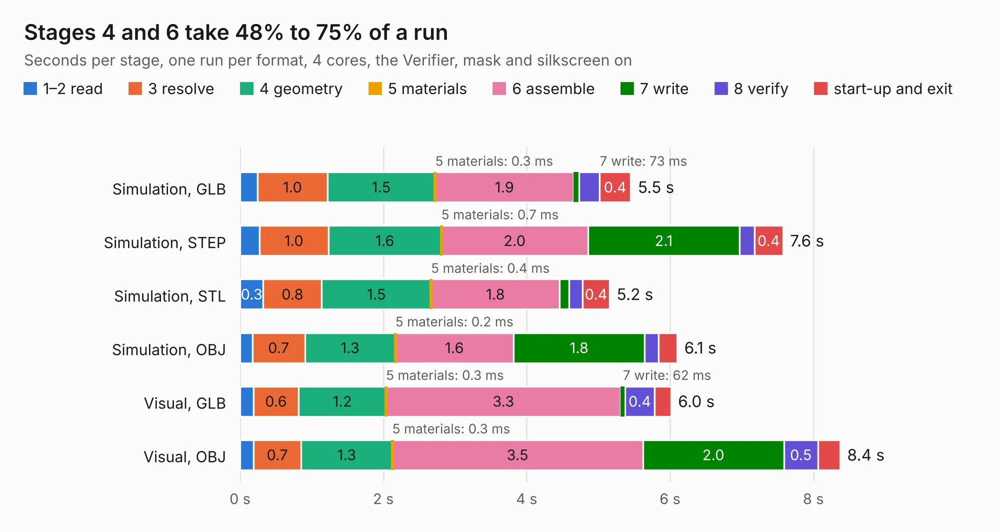

# 316. antmicro-alvium-flex-csi-adapter-200mm-single-opposite-sides

Board 316 of the 3,139 of [Corpus Testing](../Corpus-Testing.md), on [Corpus Page 3](../CorpusTestingPages/Corpus-Testing-03.md#316-antmicro-alvium-flex-csi-adapter-200mm-single-opposite-sides).

| Mode and format | 1–2 read | 3 resolve | 4 geometry | 5 materials | 6 assemble | 7 write | 8 verify | start-up and exit | Total |
|---|---:|---:|---:|---:|---:|---:|---:|---:|---:|
| Simulation, GLB | 0.2 | 1.0 | 1.5 | 0.3&nbsp;ms | 1.9 | 73&nbsp;ms | 0.3 | 0.4 | 5.5 |
| Simulation, STEP | 0.3 | 1.0 | 1.6 | 0.7&nbsp;ms | 2.0 | 2.1 | 0.2 | 0.4 | 7.6 |
| Simulation, STL | 0.3 | 0.8 | 1.5 | 0.4&nbsp;ms | 1.8 | 0.1 | 0.2 | 0.4 | 5.2 |
| Simulation, OBJ | 0.2 | 0.7 | 1.3 | 0.2&nbsp;ms | 1.6 | 1.8 | 0.2 | 0.3 | 6.1 |
| Visual, GLB | 0.2 | 0.6 | 1.2 | 0.3&nbsp;ms | 3.3 | 62&nbsp;ms | 0.4 | 0.2 | 6.0 |
| Visual, OBJ | 0.2 | 0.7 | 1.3 | 0.3&nbsp;ms | 3.5 | 2.0 | 0.5 | 0.3 | 8.4 |

<table align="center"><tr><td valign="top">

| Board | Repo: [antmicro/alvium-flexible-csi-adapter](https://github.com/antmicro/alvium-flexible-csi-adapter) Board: `antmicro-alvium-flex-csi-adapter-200mm-single-opposite-sides.kicad_pcb` |
|---|---|
| Folder | 200mm-single-opposite-sides |
| Complexity | 182&nbsp;/&nbsp;1000 (size&nbsp;147, features&nbsp;35) |
| KESE&nbsp;features | through vias, filled zones |
| Tested | 9th November 2026 |
| Copper&nbsp;layers | 2 |
| File&nbsp;format | KiCad 5 (20171130) |
| Parts,&nbsp;tracks,&nbsp;vias | 3, 635, 173 |
| Triangles,&nbsp;simulation | 306,536 in 55 parts |
| Verifier | PASS in all six runs |

</td><td valign="top">

<table>
<tr><th>File type</th><th>File size</th><th>Peak memory used</th></tr>
<tr><th colspan="3" align="left">Simulation</th></tr>
<tr><td>GLB</td><td align="right">11&nbsp;MB</td><td align="right">257&nbsp;MB</td></tr>
<tr><td>STEP</td><td align="right">39&nbsp;MB</td><td align="right">296&nbsp;MB</td></tr>
<tr><td>STL</td><td align="right">15&nbsp;MB</td><td align="right">259&nbsp;MB</td></tr>
<tr><td>OBJ</td><td align="right">30&nbsp;MB</td><td align="right">264&nbsp;MB</td></tr>
<tr><th colspan="3" align="left">Visual</th></tr>
<tr><td>GLB</td><td align="right">9.5&nbsp;MB</td><td align="right">280&nbsp;MB</td></tr>
<tr><td>OBJ</td><td align="right">28&nbsp;MB</td><td align="right">317&nbsp;MB</td></tr>
</table>

</td></tr></table>

| Previous | Next |
|:---|---:|
| [315. antmicro-alvium-flex-csi-adapter_100mm-single-same-side](b0315b_alvium-flexible-csi-adapter_antmicro-alvium-flex-csi-adapter-100mm-single-same-side.md) | [317. antmicro-alvium-flex-csi-adapter_200mm-single-same-side](b0317b_alvium-flexible-csi-adapter_antmicro-alvium-flex-csi-adapter-200mm-single-same-side.md) |
