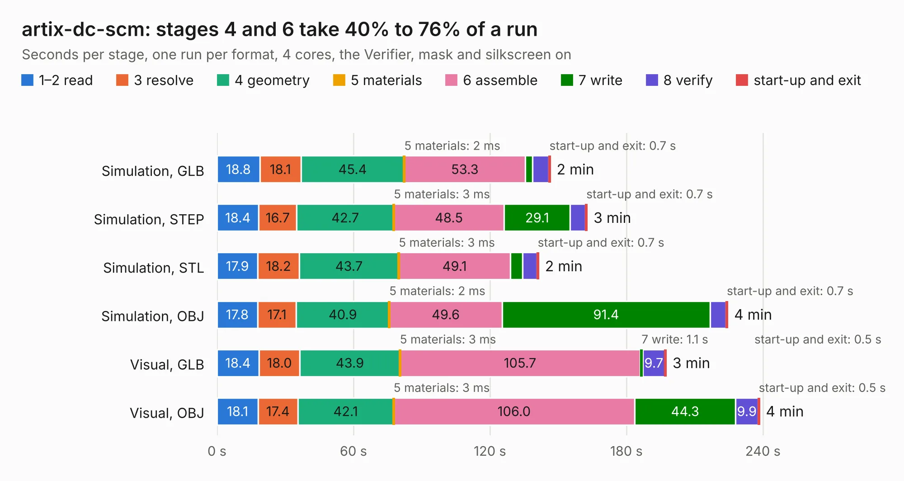

# 317. artix-dc-scm

Board 317 of the 3,124 of [Corpus Testing](../Corpus-Testing.md), on [Corpus Page 3](../CorpusTestingPages/Corpus-Testing-03.md#317-artix-dc-scm).

| Mode and format | 1–2 read | 3 resolve | 4 geometry | 5 materials | 6 assemble | 7 write | 8 verify | start-up and exit | Total |
|---|---:|---:|---:|---:|---:|---:|---:|---:|---:|
| Simulation, GLB | 18.8 | 18.1 | 45.4 | 2&nbsp;ms | 53.3 | 3.2 | 7.1 | 0.7 | 146.5 |
| Simulation, STEP | 18.4 | 16.7 | 42.7 | 3&nbsp;ms | 48.5 | 29.1 | 6.8 | 0.7 | 162.7 |
| Simulation, STL | 17.9 | 18.2 | 43.7 | 3&nbsp;ms | 49.1 | 5.4 | 6.3 | 0.7 | 141.4 |
| Simulation, OBJ | 17.8 | 17.1 | 40.9 | 2&nbsp;ms | 49.6 | 91.4 | 7.0 | 0.7 | 224.5 |
| Visual, GLB | 18.4 | 18.0 | 43.9 | 3&nbsp;ms | 105.7 | 1.1 | 9.7 | 0.5 | 197.4 |
| Visual, OBJ | 18.1 | 17.4 | 42.1 | 3&nbsp;ms | 106.0 | 44.3 | 9.9 | 0.5 | 238.4 |

<table align="center"><tr><td valign="top">

| Board | Repo: [antmicro/artix-dc-scm](https://github.com/antmicro/artix-dc-scm) Board: `artix-dc-scm.kicad_pcb` |
|---|---|
| Complexity | 504&nbsp;/&nbsp;1000 (size&nbsp;344, features&nbsp;160) |
| KESE&nbsp;features | through vias, blind and buried vias, custom pads, rounded, trapezoid or chamfered pads, filled zones, copper drawings, copper text, curved board outline, stack-up, dielectric εr and tanδ |
| Tested | 9th November 2026 |
| Copper&nbsp;layers | 8 |
| File&nbsp;format | KiCad 9 (20241229) |
| Parts,&nbsp;tracks,&nbsp;vias | 529, 12,682, 1,558 |
| Triangles,&nbsp;simulation | 12,211,974 in 719 parts |
| Verifier | PASS in all six runs |

</td><td valign="top">

<table>
<tr><th>File type</th><th>File size</th><th>Peak memory used</th></tr>
<tr><th colspan="3" align="left">Simulation</th></tr>
<tr><td>GLB</td><td align="right">411&nbsp;MB</td><td align="right">3.2&nbsp;GB</td></tr>
<tr><td>STEP</td><td align="right">1.4&nbsp;GB</td><td align="right">4.2&nbsp;GB</td></tr>
<tr><td>STL</td><td align="right">611&nbsp;MB</td><td align="right">3.1&nbsp;GB</td></tr>
<tr><td>OBJ</td><td align="right">1.4&nbsp;GB</td><td align="right">8.0&nbsp;GB</td></tr>
<tr><th colspan="3" align="left">Visual</th></tr>
<tr><td>GLB</td><td align="right">209&nbsp;MB</td><td align="right">3.7&nbsp;GB</td></tr>
<tr><td>OBJ</td><td align="right">707&nbsp;MB</td><td align="right">4.7&nbsp;GB</td></tr>
</table>

</td></tr></table>

| Previous | Next |
|:---|---:|
| [316. antmicro-alvium-flex-csi-adapter_200mm-single-same-side](b0316b_alvium-flexible-csi-adapter_antmicro-alvium-flex-csi-adapter-200mm-single-same-side.md) | [318. arty-a7-expansion](b0318b_arty-expansion-board_arty-a7-expansion.md) |
