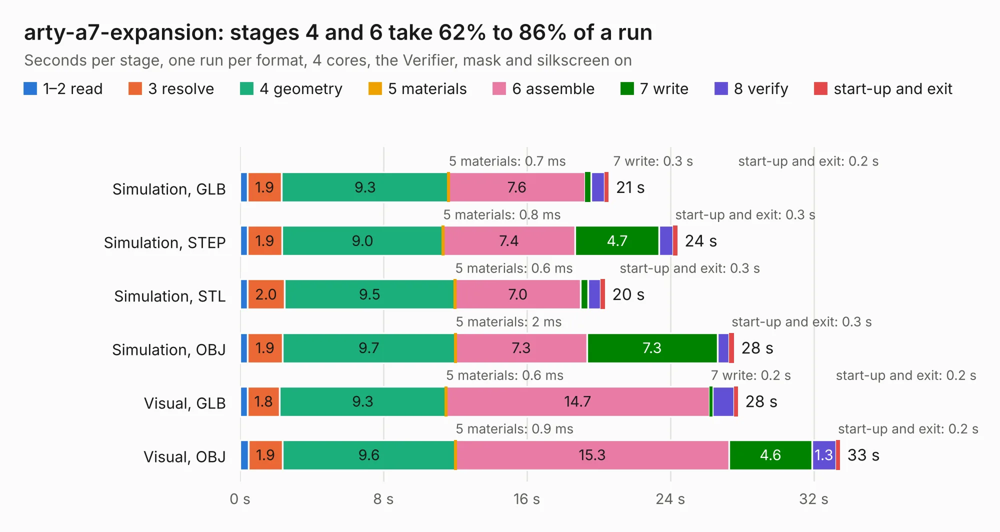

# 318. arty-a7-expansion

Board 318 of the 3,125 of [Corpus Testing](../Corpus-Testing.md), on [Corpus Page 3](../CorpusTestingPages/Corpus-Testing-03.md#318-arty-a7-expansion).

| Mode and format | 1–2 read | 3 resolve | 4 geometry | 5 materials | 6 assemble | 7 write | 8 verify | start-up and exit | Total |
|---|---:|---:|---:|---:|---:|---:|---:|---:|---:|
| Simulation, GLB | 0.4 | 1.9 | 9.3 | 0.7&nbsp;ms | 7.6 | 0.3 | 0.8 | 0.2 | 20.6 |
| Simulation, STEP | 0.4 | 1.9 | 9.0 | 0.8&nbsp;ms | 7.4 | 4.7 | 0.8 | 0.3 | 24.4 |
| Simulation, STL | 0.4 | 2.0 | 9.5 | 0.6&nbsp;ms | 7.0 | 0.4 | 0.7 | 0.3 | 20.4 |
| Simulation, OBJ | 0.4 | 1.9 | 9.7 | 2&nbsp;ms | 7.3 | 7.3 | 0.7 | 0.3 | 27.5 |
| Visual, GLB | 0.4 | 1.8 | 9.3 | 0.6&nbsp;ms | 14.7 | 0.2 | 1.2 | 0.2 | 27.8 |
| Visual, OBJ | 0.5 | 1.9 | 9.6 | 0.9&nbsp;ms | 15.3 | 4.6 | 1.3 | 0.2 | 33.5 |

<table align="center"><tr><td valign="top">

| Board | Repo: [antmicro/arty-expansion-board](https://github.com/antmicro/arty-expansion-board) Board: `arty-a7-expansion.kicad_pcb` |
|---|---|
| Complexity | 325&nbsp;/&nbsp;1000 (size&nbsp;260, features&nbsp;65) |
| KESE&nbsp;features | through vias, slotted holes, rounded, trapezoid or chamfered pads, filled zones, copper text |
| Tested | 9th November 2026 |
| Copper&nbsp;layers | 4 |
| File&nbsp;format | KiCad 5 (20171130) |
| Parts,&nbsp;tracks,&nbsp;vias | 108, 3,485, 134 |
| Triangles,&nbsp;simulation | 1,746,946 in 137 parts |
| Verifier | PASS in all six runs |

</td><td valign="top">

<table>
<tr><th>File type</th><th>File size</th><th>Peak memory used</th></tr>
<tr><th colspan="3" align="left">Simulation</th></tr>
<tr><td>GLB</td><td align="right">62&nbsp;MB</td><td align="right">700&nbsp;MB</td></tr>
<tr><td>STEP</td><td align="right">317&nbsp;MB</td><td align="right">803&nbsp;MB</td></tr>
<tr><td>STL</td><td align="right">87&nbsp;MB</td><td align="right">736&nbsp;MB</td></tr>
<tr><td>OBJ</td><td align="right">185&nbsp;MB</td><td align="right">1.2&nbsp;GB</td></tr>
<tr><th colspan="3" align="left">Visual</th></tr>
<tr><td>GLB</td><td align="right">36&nbsp;MB</td><td align="right">847&nbsp;MB</td></tr>
<tr><td>OBJ</td><td align="right">109&nbsp;MB</td><td align="right">911&nbsp;MB</td></tr>
</table>

</td></tr></table>

| Previous | Next |
|:---|---:|
| [317. artix-dc-scm](b0317b_artix-dc-scm_artix-dc-scm.md) | [319. arty-mpw-tester](b0319b_arty-mpw-tester_arty-mpw-tester.md) |
