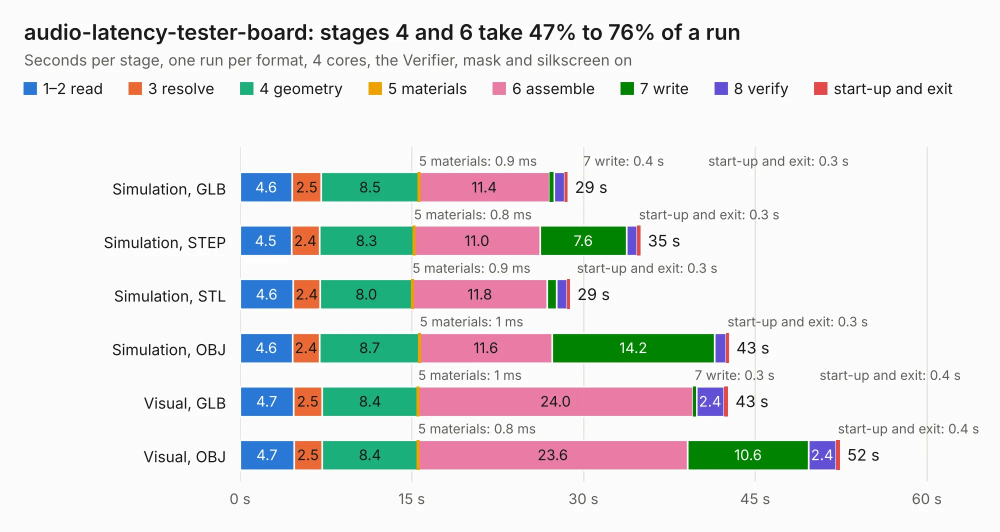

# 318. audio-latency-tester-board

Board 318 of the 3,100 of [Corpus Testing](../Corpus-Testing.md), on [Corpus Page 3](../CorpusTestingPages/Corpus-Testing-03.md#318-audio-latency-tester-board).

| Mode and format | 1–2 read | 3 resolve | 4 geometry | 5 materials | 6 assemble | 7 write | 8 verify | start-up and exit | Total |
|---|---:|---:|---:|---:|---:|---:|---:|---:|---:|
| Simulation, GLB | 4.6 | 2.5 | 8.5 | 0.9&nbsp;ms | 11.4 | 0.4 | 0.9 | 0.3 | 28.6 |
| Simulation, STEP | 4.5 | 2.4 | 8.3 | 0.8&nbsp;ms | 11.0 | 7.6 | 0.9 | 0.3 | 35.0 |
| Simulation, STL | 4.6 | 2.4 | 8.0 | 0.9&nbsp;ms | 11.8 | 0.8 | 0.9 | 0.3 | 28.8 |
| Simulation, OBJ | 4.6 | 2.4 | 8.7 | 1&nbsp;ms | 11.6 | 14.2 | 1.0 | 0.3 | 42.7 |
| Visual, GLB | 4.7 | 2.5 | 8.4 | 1&nbsp;ms | 24.0 | 0.3 | 2.4 | 0.4 | 42.7 |
| Visual, OBJ | 4.7 | 2.5 | 8.4 | 0.8&nbsp;ms | 23.6 | 10.6 | 2.4 | 0.4 | 52.4 |

<table align="center"><tr><td valign="top">

| Board | Repo: [antmicro/audio-latency-tester-board](https://github.com/antmicro/audio-latency-tester-board) Board: `audio-latency-tester-board.kicad_pcb` |
|---|---|
| Complexity | 410&nbsp;/&nbsp;1000 (size&nbsp;270, features&nbsp;140) |
| KESE&nbsp;features | through vias, slotted holes, custom pads, rounded, trapezoid or chamfered pads, arc tracks, filled zones, copper text, knockout text, stack-up, dielectric εr and tanδ |
| Tested | 9th November 2026 |
| Copper&nbsp;layers | 4 |
| File&nbsp;format | KiCad 8 (20240108) |
| Parts,&nbsp;tracks,&nbsp;vias | 212, 2,202, 302 |
| Triangles,&nbsp;simulation | 2,357,376 in 214 parts |
| Verifier | PASS in all six runs |

</td><td valign="top">

<table>
<tr><th>File type</th><th>File size</th><th>Peak memory used</th></tr>
<tr><th colspan="3" align="left">Simulation</th></tr>
<tr><td>GLB</td><td align="right">81&nbsp;MB</td><td align="right">953&nbsp;MB</td></tr>
<tr><td>STEP</td><td align="right">375&nbsp;MB</td><td align="right">1.1&nbsp;GB</td></tr>
<tr><td>STL</td><td align="right">118&nbsp;MB</td><td align="right">958&nbsp;MB</td></tr>
<tr><td>OBJ</td><td align="right">247&nbsp;MB</td><td align="right">1.7&nbsp;GB</td></tr>
<tr><th colspan="3" align="left">Visual</th></tr>
<tr><td>GLB</td><td align="right">60&nbsp;MB</td><td align="right">1.2&nbsp;GB</td></tr>
<tr><td>OBJ</td><td align="right">184&nbsp;MB</td><td align="right">1.4&nbsp;GB</td></tr>
</table>

</td></tr></table>

| Previous | Next |
|:---|---:|
| [317. arvsom](b0317b_arvsom_arvsom.md) | [319. caravel_breakout_QFN](b0319b_caravel-board_caravel-breakout-QFN.md) |
