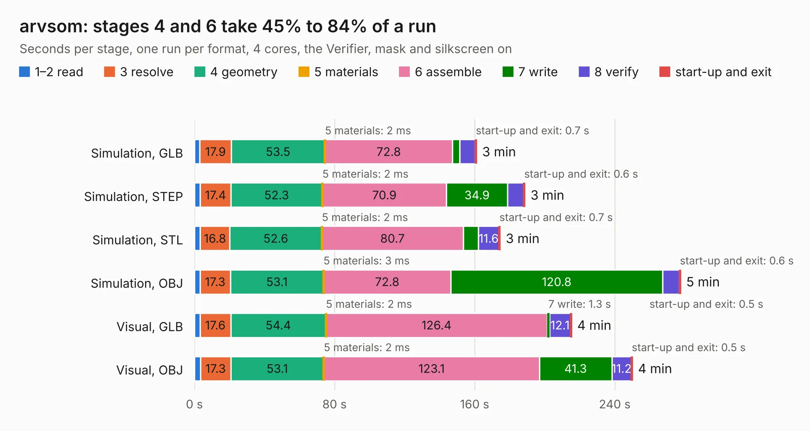

# 319. arvsom

Board 319 of the 3,110 of [Corpus Testing](../Corpus-Testing.md), on [Corpus Page 3](../CorpusTestingPages/Corpus-Testing-03.md#319-arvsom).

| Mode and format | 1–2 read | 3 resolve | 4 geometry | 5 materials | 6 assemble | 7 write | 8 verify | start-up and exit | Total |
|---|---:|---:|---:|---:|---:|---:|---:|---:|---:|
| Simulation, GLB | 3.1 | 17.9 | 53.5 | 2&nbsp;ms | 72.8 | 4.0 | 8.9 | 0.7 | 161.0 |
| Simulation, STEP | 3.3 | 17.4 | 52.3 | 2&nbsp;ms | 70.9 | 34.9 | 9.2 | 0.6 | 188.6 |
| Simulation, STL | 3.3 | 16.8 | 52.6 | 2&nbsp;ms | 80.7 | 8.7 | 11.6 | 0.7 | 174.5 |
| Simulation, OBJ | 3.2 | 17.3 | 53.1 | 3&nbsp;ms | 72.8 | 120.8 | 9.7 | 0.6 | 277.5 |
| Visual, GLB | 3.1 | 17.6 | 54.4 | 2&nbsp;ms | 126.4 | 1.3 | 12.1 | 0.5 | 215.3 |
| Visual, OBJ | 3.5 | 17.3 | 53.1 | 2&nbsp;ms | 123.1 | 41.3 | 11.2 | 0.5 | 250.0 |

<table align="center"><tr><td valign="top">

| Board | Repo: [antmicro/arvsom](https://github.com/antmicro/arvsom) Board: `arvsom.kicad_pcb` |
|---|---|
| Complexity | 404&nbsp;/&nbsp;1000 (size&nbsp;349, features&nbsp;55) |
| KESE&nbsp;features | through vias, rounded, trapezoid or chamfered pads, filled zones, copper text |
| Tested | 9th November 2026 |
| Copper&nbsp;layers | 12 |
| File&nbsp;format | KiCad 5 (20171130) |
| Parts,&nbsp;tracks,&nbsp;vias | 427, 15,505, 1,202 |
| Triangles,&nbsp;simulation | 15,923,766 in 682 parts |
| Verifier | PASS in all six runs |

</td><td valign="top">

<table>
<tr><th>File type</th><th>File size</th><th>Peak memory used</th></tr>
<tr><th colspan="3" align="left">Simulation</th></tr>
<tr><td>GLB</td><td align="right">544&nbsp;MB</td><td align="right">2.6&nbsp;GB</td></tr>
<tr><td>STEP</td><td align="right">1.7&nbsp;GB</td><td align="right">4.3&nbsp;GB</td></tr>
<tr><td>STL</td><td align="right">796&nbsp;MB</td><td align="right">3.1&nbsp;GB</td></tr>
<tr><td>OBJ</td><td align="right">1.8&nbsp;GB</td><td align="right">10&nbsp;GB</td></tr>
<tr><th colspan="3" align="left">Visual</th></tr>
<tr><td>GLB</td><td align="right">208&nbsp;MB</td><td align="right">3.6&nbsp;GB</td></tr>
<tr><td>OBJ</td><td align="right">709&nbsp;MB</td><td align="right">4.6&nbsp;GB</td></tr>
</table>

</td></tr></table>

| Previous | Next |
|:---|---:|
| [318. arty-mpw-tester](b0318b_arty-mpw-tester_arty-mpw-tester.md) | [320. audio-latency-tester-board](b0320b_audio-latency-tester-board_audio-latency-tester-board.md) |
