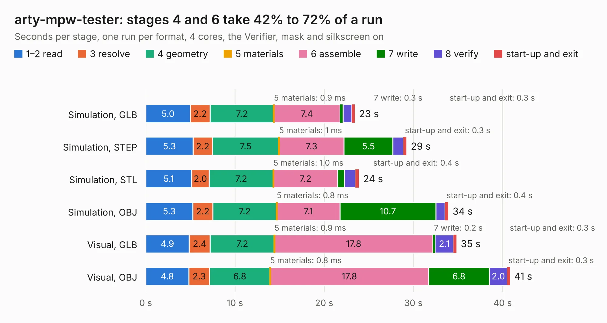

# 320. arty-mpw-tester

Board 320 of the 3,139 of [Corpus Testing](../Corpus-Testing.md), on [Corpus Page 3](../CorpusTestingPages/Corpus-Testing-03.md#320-arty-mpw-tester).

| Mode and format | 1–2 read | 3 resolve | 4 geometry | 5 materials | 6 assemble | 7 write | 8 verify | start-up and exit | Total |
|---|---:|---:|---:|---:|---:|---:|---:|---:|---:|
| Simulation, GLB | 5.0 | 2.2 | 7.2 | 0.9&nbsp;ms | 7.4 | 0.3 | 1.0 | 0.3 | 23.4 |
| Simulation, STEP | 5.3 | 2.2 | 7.5 | 1&nbsp;ms | 7.3 | 5.5 | 1.2 | 0.3 | 29.2 |
| Simulation, STL | 5.1 | 2.0 | 7.2 | 1.0&nbsp;ms | 7.2 | 0.8 | 1.2 | 0.4 | 23.9 |
| Simulation, OBJ | 5.3 | 2.2 | 7.2 | 0.8&nbsp;ms | 7.1 | 10.7 | 1.0 | 0.4 | 33.9 |
| Visual, GLB | 4.9 | 2.4 | 7.2 | 0.9&nbsp;ms | 17.8 | 0.2 | 2.1 | 0.3 | 34.8 |
| Visual, OBJ | 4.8 | 2.3 | 6.8 | 0.8&nbsp;ms | 17.8 | 6.8 | 2.0 | 0.3 | 40.8 |

<table align="center"><tr><td valign="top">

| Board | Repo: [antmicro/arty-mpw-tester](https://github.com/antmicro/arty-mpw-tester) Board: `arty-mpw-tester.kicad_pcb` |
|---|---|
| Complexity | 378&nbsp;/&nbsp;1000 (size&nbsp;248, features&nbsp;130) |
| KESE&nbsp;features | through vias, slotted holes, rounded, trapezoid or chamfered pads, filled zones, copper text, knockout text, stack-up, dielectric εr and tanδ, copper finish, mask and silkscreen colours |
| Tested | 9th November 2026 |
| Copper&nbsp;layers | 4 |
| File&nbsp;format | KiCad 9 (20241229) |
| Parts,&nbsp;tracks,&nbsp;vias | 109, 1,456, 147 |
| Triangles,&nbsp;simulation | 2,103,228 in 162 parts |
| Verifier | PASS in all six runs |

</td><td valign="top">

<table>
<tr><th>File type</th><th>File size</th><th>Peak memory used</th></tr>
<tr><th colspan="3" align="left">Simulation</th></tr>
<tr><td>GLB</td><td align="right">72&nbsp;MB</td><td align="right">891&nbsp;MB</td></tr>
<tr><td>STEP</td><td align="right">309&nbsp;MB</td><td align="right">968&nbsp;MB</td></tr>
<tr><td>STL</td><td align="right">105&nbsp;MB</td><td align="right">854&nbsp;MB</td></tr>
<tr><td>OBJ</td><td align="right">219&nbsp;MB</td><td align="right">1.5&nbsp;GB</td></tr>
<tr><th colspan="3" align="left">Visual</th></tr>
<tr><td>GLB</td><td align="right">44&nbsp;MB</td><td align="right">949&nbsp;MB</td></tr>
<tr><td>OBJ</td><td align="right">134&nbsp;MB</td><td align="right">1.1&nbsp;GB</td></tr>
</table>

</td></tr></table>

| Previous | Next |
|:---|---:|
| [319. arty-a7-expansion](b0319b_arty-expansion-board_arty-a7-expansion.md) | [321. arvsom](b0321b_arvsom_arvsom.md) |
