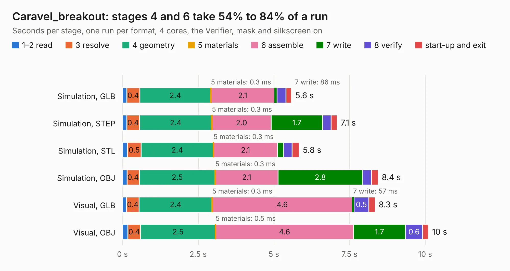

# 321. Caravel_breakout

Board 321 of the 3,103 of [Corpus Testing](../Corpus-Testing.md), on [Corpus Page 3](../CorpusTestingPages/Corpus-Testing-03.md#321-caravel_breakout).

| Mode and format | 1–2 read | 3 resolve | 4 geometry | 5 materials | 6 assemble | 7 write | 8 verify | start-up and exit | Total |
|---|---:|---:|---:|---:|---:|---:|---:|---:|---:|
| Simulation, GLB | 0.1 | 0.4 | 2.4 | 0.3&nbsp;ms | 2.1 | 86&nbsp;ms | 0.3 | 0.2 | 5.6 |
| Simulation, STEP | 0.1 | 0.4 | 2.4 | 0.3&nbsp;ms | 2.0 | 1.7 | 0.3 | 0.2 | 7.1 |
| Simulation, STL | 0.2 | 0.5 | 2.4 | 0.3&nbsp;ms | 2.1 | 0.2 | 0.3 | 0.2 | 5.8 |
| Simulation, OBJ | 0.1 | 0.4 | 2.5 | 0.3&nbsp;ms | 2.1 | 2.8 | 0.3 | 0.2 | 8.4 |
| Visual, GLB | 0.1 | 0.4 | 2.4 | 0.3&nbsp;ms | 4.6 | 57&nbsp;ms | 0.5 | 0.2 | 8.3 |
| Visual, OBJ | 0.2 | 0.4 | 2.5 | 0.5&nbsp;ms | 4.6 | 1.7 | 0.6 | 0.2 | 10.1 |

<table align="center"><tr><td valign="top">

| Board | Repo: [antmicro/caravel_board](https://github.com/antmicro/caravel_board) Board: `Caravel_breakout.kicad_pcb` |
|---|---|
| Folder | hardware / caravel_breakout_v1 |
| Complexity | 244&nbsp;/&nbsp;1000 (size&nbsp;199, features&nbsp;45) |
| KESE&nbsp;features | through vias, rounded, trapezoid or chamfered pads, filled zones |
| Tested | 9th November 2026 |
| Copper&nbsp;layers | 2 |
| File&nbsp;format | KiCad 5 (20171130) |
| Parts,&nbsp;tracks,&nbsp;vias | 12, 449, 28 |
| Triangles,&nbsp;simulation | 689,454 in 66 parts |
| Verifier | PASS in all six runs |

</td><td valign="top">

<table>
<tr><th>File type</th><th>File size</th><th>Peak memory used</th></tr>
<tr><th colspan="3" align="left">Simulation</th></tr>
<tr><td>GLB</td><td align="right">24&nbsp;MB</td><td align="right">334&nbsp;MB</td></tr>
<tr><td>STEP</td><td align="right">107&nbsp;MB</td><td align="right">398&nbsp;MB</td></tr>
<tr><td>STL</td><td align="right">34&nbsp;MB</td><td align="right">355&nbsp;MB</td></tr>
<tr><td>OBJ</td><td align="right">70&nbsp;MB</td><td align="right">489&nbsp;MB</td></tr>
<tr><th colspan="3" align="left">Visual</th></tr>
<tr><td>GLB</td><td align="right">15&nbsp;MB</td><td align="right">403&nbsp;MB</td></tr>
<tr><td>OBJ</td><td align="right">46&nbsp;MB</td><td align="right">445&nbsp;MB</td></tr>
</table>

</td></tr></table>

| Previous | Next |
|:---|---:|
| [320. caravel_breakout_QFN](b0320b_caravel-board_caravel-breakout-QFN.md) | [322. Caravel_breakout_v2](b0322b_caravel-board_Caravel-breakout-v2.md) |
