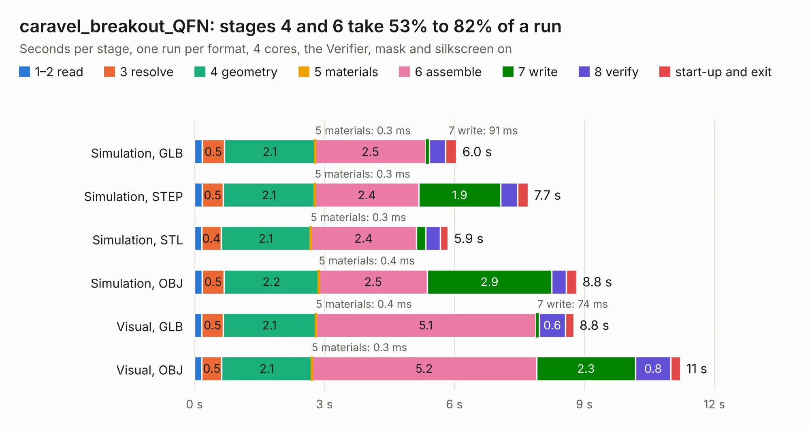

# 321. caravel_breakout_QFN

Board 321 of the 3,117 of [Corpus Testing](../Corpus-Testing.md), on [Corpus Page 3](../CorpusTestingPages/Corpus-Testing-03.md#321-caravel_breakout_qfn).

| Mode and format | 1–2 read | 3 resolve | 4 geometry | 5 materials | 6 assemble | 7 write | 8 verify | start-up and exit | Total |
|---|---:|---:|---:|---:|---:|---:|---:|---:|---:|
| Simulation, GLB | 0.2 | 0.5 | 2.1 | 0.3&nbsp;ms | 2.5 | 91&nbsp;ms | 0.4 | 0.3 | 6.0 |
| Simulation, STEP | 0.2 | 0.5 | 2.1 | 0.3&nbsp;ms | 2.4 | 1.9 | 0.4 | 0.2 | 7.7 |
| Simulation, STL | 0.2 | 0.4 | 2.1 | 0.3&nbsp;ms | 2.4 | 0.2 | 0.3 | 0.2 | 5.9 |
| Simulation, OBJ | 0.2 | 0.5 | 2.2 | 0.4&nbsp;ms | 2.5 | 2.9 | 0.3 | 0.2 | 8.8 |
| Visual, GLB | 0.2 | 0.5 | 2.1 | 0.4&nbsp;ms | 5.1 | 74&nbsp;ms | 0.6 | 0.2 | 8.8 |
| Visual, OBJ | 0.2 | 0.5 | 2.1 | 0.3&nbsp;ms | 5.2 | 2.3 | 0.8 | 0.2 | 11.2 |

<table align="center"><tr><td valign="top">

| Board | Repo: [antmicro/caravel_board](https://github.com/antmicro/caravel_board) Board: `caravel_breakout_QFN.kicad_pcb` |
|---|---|
| Folder | hardware / caravel_breakout_QFN |
| Complexity | 275&nbsp;/&nbsp;1000 (size&nbsp;200, features&nbsp;75) |
| KESE&nbsp;features | through vias, rounded, trapezoid or chamfered pads, filled zones, stack-up, dielectric εr and tanδ |
| Tested | 9th November 2026 |
| Copper&nbsp;layers | 2 |
| File&nbsp;format | KiCad 6 (20211014) |
| Parts,&nbsp;tracks,&nbsp;vias | 14, 775, 99 |
| Triangles,&nbsp;simulation | 693,354 in 70 parts |
| Verifier | PASS in all six runs |

</td><td valign="top">

<table>
<tr><th>File type</th><th>File size</th><th>Peak memory used</th></tr>
<tr><th colspan="3" align="left">Simulation</th></tr>
<tr><td>GLB</td><td align="right">24&nbsp;MB</td><td align="right">360&nbsp;MB</td></tr>
<tr><td>STEP</td><td align="right">123&nbsp;MB</td><td align="right">433&nbsp;MB</td></tr>
<tr><td>STL</td><td align="right">35&nbsp;MB</td><td align="right">361&nbsp;MB</td></tr>
<tr><td>OBJ</td><td align="right">71&nbsp;MB</td><td align="right">514&nbsp;MB</td></tr>
<tr><th colspan="3" align="left">Visual</th></tr>
<tr><td>GLB</td><td align="right">18&nbsp;MB</td><td align="right">437&nbsp;MB</td></tr>
<tr><td>OBJ</td><td align="right">54&nbsp;MB</td><td align="right">497&nbsp;MB</td></tr>
</table>

</td></tr></table>

| Previous | Next |
|:---|---:|
| [320. audio-latency-tester-board](b0320b_audio-latency-tester-board_audio-latency-tester-board.md) | [322. Caravel_breakout](b0322b_caravel-board_Caravel-breakout.md) |
