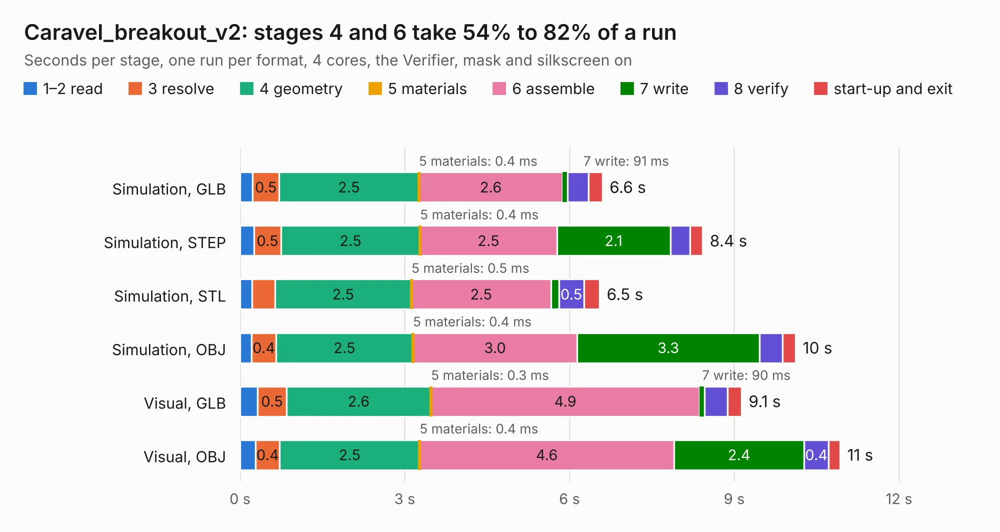

# 325. Caravel_breakout_v2

Board 325 of the 3,139 of [Corpus Testing](../Corpus-Testing.md), on [Corpus Page 4](../CorpusTestingPages/Corpus-Testing-04.md#325-caravel_breakout_v2).

| Mode and format | 1–2 read | 3 resolve | 4 geometry | 5 materials | 6 assemble | 7 write | 8 verify | start-up and exit | Total |
|---|---:|---:|---:|---:|---:|---:|---:|---:|---:|
| Simulation, GLB | 0.2 | 0.5 | 2.5 | 0.4&nbsp;ms | 2.6 | 91&nbsp;ms | 0.4 | 0.3 | 6.6 |
| Simulation, STEP | 0.3 | 0.5 | 2.5 | 0.4&nbsp;ms | 2.5 | 2.1 | 0.4 | 0.2 | 8.4 |
| Simulation, STL | 0.2 | 0.4 | 2.5 | 0.5&nbsp;ms | 2.5 | 0.1 | 0.5 | 0.3 | 6.5 |
| Simulation, OBJ | 0.2 | 0.4 | 2.5 | 0.4&nbsp;ms | 3.0 | 3.3 | 0.4 | 0.2 | 10.1 |
| Visual, GLB | 0.3 | 0.5 | 2.6 | 0.3&nbsp;ms | 4.9 | 90&nbsp;ms | 0.4 | 0.3 | 9.1 |
| Visual, OBJ | 0.3 | 0.4 | 2.5 | 0.4&nbsp;ms | 4.6 | 2.4 | 0.4 | 0.2 | 10.9 |

<table align="center"><tr><td valign="top">

| Board | Repo: [antmicro/caravel_board](https://github.com/antmicro/caravel_board) Board: `Caravel_breakout_v2.kicad_pcb` |
|---|---|
| Folder | hardware / caravel_breakout_v2 |
| Complexity | 275&nbsp;/&nbsp;1000 (size&nbsp;200, features&nbsp;75) |
| KESE&nbsp;features | through vias, rounded, trapezoid or chamfered pads, filled zones, stack-up, dielectric εr and tanδ |
| Tested | 9th November 2026 |
| Copper&nbsp;layers | 2 |
| File&nbsp;format | KiCad 6 (20211014) |
| Parts,&nbsp;tracks,&nbsp;vias | 12, 469, 28 |
| Triangles,&nbsp;simulation | 522,928 in 69 parts |
| Verifier | PASS in all six runs |

</td><td valign="top">

<table>
<tr><th>File type</th><th>File size</th><th>Peak memory used</th></tr>
<tr><th colspan="3" align="left">Simulation</th></tr>
<tr><td>GLB</td><td align="right">18&nbsp;MB</td><td align="right">300&nbsp;MB</td></tr>
<tr><td>STEP</td><td align="right">97&nbsp;MB</td><td align="right">365&nbsp;MB</td></tr>
<tr><td>STL</td><td align="right">26&nbsp;MB</td><td align="right">302&nbsp;MB</td></tr>
<tr><td>OBJ</td><td align="right">54&nbsp;MB</td><td align="right">383&nbsp;MB</td></tr>
<tr><th colspan="3" align="left">Visual</th></tr>
<tr><td>GLB</td><td align="right">13&nbsp;MB</td><td align="right">364&nbsp;MB</td></tr>
<tr><td>OBJ</td><td align="right">38&nbsp;MB</td><td align="right">369&nbsp;MB</td></tr>
</table>

</td></tr></table>

| Previous | Next |
|:---|---:|
| [324. Caravel_breakout](b0324b_caravel-board_Caravel-breakout.md) | [326. Caravel_daughter](b0326b_caravel-board_Caravel-daughter.md) |
