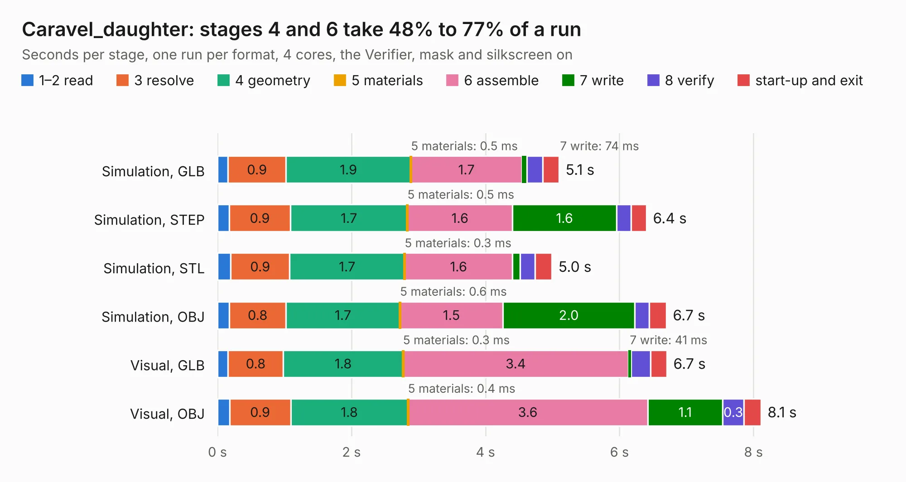

# 325. Caravel_daughter

Board 325 of the 3,126 of [Corpus Testing](../Corpus-Testing.md), on [Corpus Page 4](../CorpusTestingPages/Corpus-Testing-04.md#325-caravel_daughter).

| Mode and format | 1–2 read | 3 resolve | 4 geometry | 5 materials | 6 assemble | 7 write | 8 verify | start-up and exit | Total |
|---|---:|---:|---:|---:|---:|---:|---:|---:|---:|
| Simulation, GLB | 0.2 | 0.9 | 1.9 | 0.5&nbsp;ms | 1.7 | 74&nbsp;ms | 0.2 | 0.2 | 5.1 |
| Simulation, STEP | 0.2 | 0.9 | 1.7 | 0.5&nbsp;ms | 1.6 | 1.6 | 0.2 | 0.2 | 6.4 |
| Simulation, STL | 0.2 | 0.9 | 1.7 | 0.3&nbsp;ms | 1.6 | 0.1 | 0.2 | 0.3 | 5.0 |
| Simulation, OBJ | 0.2 | 0.8 | 1.7 | 0.6&nbsp;ms | 1.5 | 2.0 | 0.2 | 0.3 | 6.7 |
| Visual, GLB | 0.2 | 0.8 | 1.8 | 0.3&nbsp;ms | 3.4 | 41&nbsp;ms | 0.3 | 0.2 | 6.7 |
| Visual, OBJ | 0.2 | 0.9 | 1.8 | 0.4&nbsp;ms | 3.6 | 1.1 | 0.3 | 0.3 | 8.1 |

<table align="center"><tr><td valign="top">

| Board | Repo: [antmicro/caravel_board](https://github.com/antmicro/caravel_board) Board: `Caravel_daughter.kicad_pcb` |
|---|---|
| Folder | hardware / caravel_daughter |
| Complexity | 138&nbsp;/&nbsp;1000 (size&nbsp;108, features&nbsp;30) |
| KESE&nbsp;features | rounded, trapezoid or chamfered pads, filled zones |
| Tested | 9th November 2026 |
| Copper&nbsp;layers | 2 |
| File&nbsp;format | KiCad 5 (20171130) |
| Parts,&nbsp;tracks,&nbsp;vias | 36, 0, 0 |
| Triangles,&nbsp;simulation | 390,448 in 66 parts |
| Verifier | PASS in all six runs |

</td><td valign="top">

<table>
<tr><th>File type</th><th>File size</th><th>Peak memory used</th></tr>
<tr><th colspan="3" align="left">Simulation</th></tr>
<tr><td>GLB</td><td align="right">14&nbsp;MB</td><td align="right">269&nbsp;MB</td></tr>
<tr><td>STEP</td><td align="right">76&nbsp;MB</td><td align="right">318&nbsp;MB</td></tr>
<tr><td>STL</td><td align="right">20&nbsp;MB</td><td align="right">265&nbsp;MB</td></tr>
<tr><td>OBJ</td><td align="right">41&nbsp;MB</td><td align="right">322&nbsp;MB</td></tr>
<tr><th colspan="3" align="left">Visual</th></tr>
<tr><td>GLB</td><td align="right">7.5&nbsp;MB</td><td align="right">267&nbsp;MB</td></tr>
<tr><td>OBJ</td><td align="right">22&nbsp;MB</td><td align="right">266&nbsp;MB</td></tr>
</table>

</td></tr></table>

| Previous | Next |
|:---|---:|
| [324. Caravel_breakout_v2](b0324b_caravel-board_Caravel-breakout-v2.md) | [326. caravel_FTDI_QFN_test_socket](b0326b_caravel-board_caravel-FTDI-QFN-test-socket.md) |
