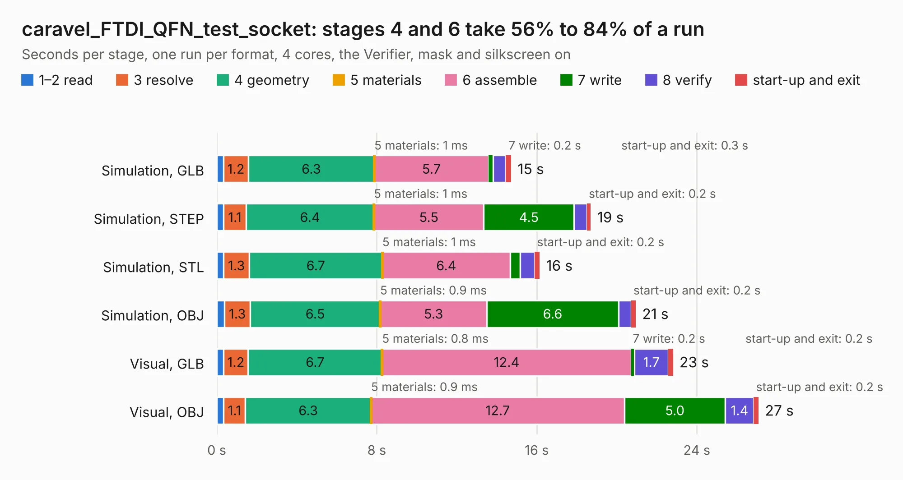

# 326. caravel_FTDI_QFN_test_socket

Board 326 of the 3,129 of [Corpus Testing](../Corpus-Testing.md), on [Corpus Page 4](../CorpusTestingPages/Corpus-Testing-04.md#326-caravel_ftdi_qfn_test_socket).

| Mode and format | 1–2 read | 3 resolve | 4 geometry | 5 materials | 6 assemble | 7 write | 8 verify | start-up and exit | Total |
|---|---:|---:|---:|---:|---:|---:|---:|---:|---:|
| Simulation, GLB | 0.3 | 1.2 | 6.3 | 1&nbsp;ms | 5.7 | 0.2 | 0.6 | 0.3 | 14.7 |
| Simulation, STEP | 0.3 | 1.1 | 6.4 | 1&nbsp;ms | 5.5 | 4.5 | 0.6 | 0.2 | 18.7 |
| Simulation, STL | 0.3 | 1.3 | 6.7 | 1&nbsp;ms | 6.4 | 0.5 | 0.7 | 0.2 | 16.1 |
| Simulation, OBJ | 0.4 | 1.3 | 6.5 | 0.9&nbsp;ms | 5.3 | 6.6 | 0.6 | 0.2 | 20.9 |
| Visual, GLB | 0.3 | 1.2 | 6.7 | 0.8&nbsp;ms | 12.4 | 0.2 | 1.7 | 0.2 | 22.8 |
| Visual, OBJ | 0.3 | 1.1 | 6.3 | 0.9&nbsp;ms | 12.7 | 5.0 | 1.4 | 0.2 | 27.1 |

<table align="center"><tr><td valign="top">

| Board | Repo: [antmicro/caravel_board](https://github.com/antmicro/caravel_board) Board: `caravel_FTDI_QFN_test_socket.kicad_pcb` |
|---|---|
| Folder | hardware / caravel_FTDI_QFN_test_socket |
| Complexity | 315&nbsp;/&nbsp;1000 (size&nbsp;230, features&nbsp;85) |
| KESE&nbsp;features | through vias, slotted holes, rounded, trapezoid or chamfered pads, filled zones, stack-up, dielectric εr and tanδ |
| Tested | 9th November 2026 |
| Copper&nbsp;layers | 2 |
| File&nbsp;format | KiCad 6 (20211014) |
| Parts,&nbsp;tracks,&nbsp;vias | 72, 1,076, 164 |
| Triangles,&nbsp;simulation | 1,635,312 in 99 parts |
| Verifier | PASS in all six runs |

</td><td valign="top">

<table>
<tr><th>File type</th><th>File size</th><th>Peak memory used</th></tr>
<tr><th colspan="3" align="left">Simulation</th></tr>
<tr><td>GLB</td><td align="right">56&nbsp;MB</td><td align="right">606&nbsp;MB</td></tr>
<tr><td>STEP</td><td align="right">277&nbsp;MB</td><td align="right">809&nbsp;MB</td></tr>
<tr><td>STL</td><td align="right">82&nbsp;MB</td><td align="right">588&nbsp;MB</td></tr>
<tr><td>OBJ</td><td align="right">169&nbsp;MB</td><td align="right">1.1&nbsp;GB</td></tr>
<tr><th colspan="3" align="left">Visual</th></tr>
<tr><td>GLB</td><td align="right">41&nbsp;MB</td><td align="right">784&nbsp;MB</td></tr>
<tr><td>OBJ</td><td align="right">126&nbsp;MB</td><td align="right">936&nbsp;MB</td></tr>
</table>

</td></tr></table>

| Previous | Next |
|:---|---:|
| [325. Caravel_daughter](b0325b_caravel-board_Caravel-daughter.md) | [327. caravel_Nucleo](b0327b_caravel-board_caravel-Nucleo.md) |
