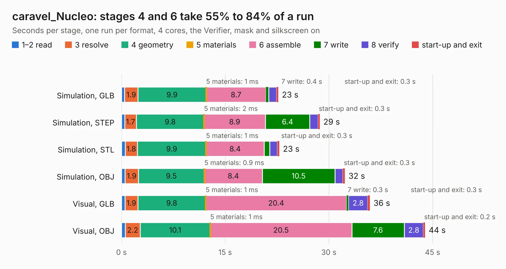

# 326. caravel_Nucleo

Board 326 of the 3,106 of [Corpus Testing](../Corpus-Testing.md), on [Corpus Page 4](../CorpusTestingPages/Corpus-Testing-04.md#326-caravel_nucleo).

| Mode and format | 1–2 read | 3 resolve | 4 geometry | 5 materials | 6 assemble | 7 write | 8 verify | start-up and exit | Total |
|---|---:|---:|---:|---:|---:|---:|---:|---:|---:|
| Simulation, GLB | 0.4 | 1.9 | 9.9 | 1&nbsp;ms | 8.7 | 0.4 | 1.1 | 0.3 | 22.7 |
| Simulation, STEP | 0.5 | 1.7 | 9.8 | 2&nbsp;ms | 8.9 | 6.4 | 1.2 | 0.3 | 28.7 |
| Simulation, STL | 0.5 | 1.8 | 9.9 | 1&nbsp;ms | 8.4 | 0.8 | 1.1 | 0.3 | 22.8 |
| Simulation, OBJ | 0.5 | 1.9 | 9.5 | 0.9&nbsp;ms | 8.4 | 10.5 | 1.1 | 0.3 | 32.3 |
| Visual, GLB | 0.5 | 1.9 | 9.8 | 1&nbsp;ms | 20.4 | 0.3 | 2.8 | 0.3 | 35.9 |
| Visual, OBJ | 0.5 | 2.2 | 10.1 | 1&nbsp;ms | 20.5 | 7.6 | 2.8 | 0.2 | 43.9 |

<table align="center"><tr><td valign="top">

| Board | Repo: [antmicro/caravel_board](https://github.com/antmicro/caravel_board) Board: `caravel_Nucleo.kicad_pcb` |
|---|---|
| Folder | hardware / caravel_Nucleo |
| Complexity | 333&nbsp;/&nbsp;1000 (size&nbsp;228, features&nbsp;105) |
| KESE&nbsp;features | through vias, slotted holes, rounded, trapezoid or chamfered pads, drill offsets, filled zones, curved board outline, stack-up, dielectric εr and tanδ |
| Tested | 9th November 2026 |
| Copper&nbsp;layers | 2 |
| File&nbsp;format | KiCad 6 (20211014) |
| Parts,&nbsp;tracks,&nbsp;vias | 89, 1,284, 162 |
| Triangles,&nbsp;simulation | 2,223,932 in 208 parts |
| Verifier | PASS in all six runs |

</td><td valign="top">

<table>
<tr><th>File type</th><th>File size</th><th>Peak memory used</th></tr>
<tr><th colspan="3" align="left">Simulation</th></tr>
<tr><td>GLB</td><td align="right">75&nbsp;MB</td><td align="right">745&nbsp;MB</td></tr>
<tr><td>STEP</td><td align="right">364&nbsp;MB</td><td align="right">998&nbsp;MB</td></tr>
<tr><td>STL</td><td align="right">111&nbsp;MB</td><td align="right">756&nbsp;MB</td></tr>
<tr><td>OBJ</td><td align="right">232&nbsp;MB</td><td align="right">1.5&nbsp;GB</td></tr>
<tr><th colspan="3" align="left">Visual</th></tr>
<tr><td>GLB</td><td align="right">55&nbsp;MB</td><td align="right">1.1&nbsp;GB</td></tr>
<tr><td>OBJ</td><td align="right">169&nbsp;MB</td><td align="right">1.2&nbsp;GB</td></tr>
</table>

</td></tr></table>

| Previous | Next |
|:---|---:|
| [325. caravel_FTDI_QFN_test_socket](b0325b_caravel-board_caravel-FTDI-QFN-test-socket.md) | [327. Caravel_pcb](b0327b_caravel-board_Caravel-pcb.md) |
