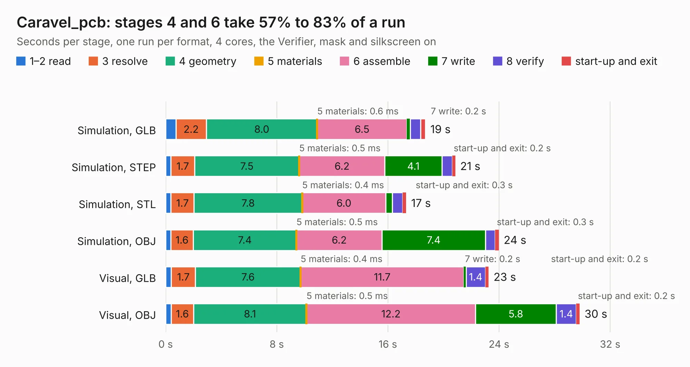

# 327. Caravel_pcb

Board 327 of the 3,106 of [Corpus Testing](../Corpus-Testing.md), on [Corpus Page 4](../CorpusTestingPages/Corpus-Testing-04.md#327-caravel_pcb).

| Mode and format | 1–2 read | 3 resolve | 4 geometry | 5 materials | 6 assemble | 7 write | 8 verify | start-up and exit | Total |
|---|---:|---:|---:|---:|---:|---:|---:|---:|---:|
| Simulation, GLB | 0.7 | 2.2 | 8.0 | 0.6&nbsp;ms | 6.5 | 0.2 | 0.7 | 0.3 | 18.7 |
| Simulation, STEP | 0.4 | 1.7 | 7.5 | 0.5&nbsp;ms | 6.2 | 4.1 | 0.7 | 0.2 | 20.9 |
| Simulation, STL | 0.4 | 1.7 | 7.8 | 0.4&nbsp;ms | 6.0 | 0.5 | 0.7 | 0.3 | 17.3 |
| Simulation, OBJ | 0.4 | 1.6 | 7.4 | 0.5&nbsp;ms | 6.2 | 7.4 | 0.7 | 0.3 | 24.0 |
| Visual, GLB | 0.4 | 1.7 | 7.6 | 0.4&nbsp;ms | 11.7 | 0.2 | 1.4 | 0.2 | 23.3 |
| Visual, OBJ | 0.4 | 1.6 | 8.1 | 0.5&nbsp;ms | 12.2 | 5.8 | 1.4 | 0.2 | 29.8 |

<table align="center"><tr><td valign="top">

| Board | Repo: [antmicro/caravel_board](https://github.com/antmicro/caravel_board) Board: `Caravel_pcb.kicad_pcb` |
|---|---|
| Folder | hardware / caravel_pcb_v1 |
| Complexity | 290&nbsp;/&nbsp;1000 (size&nbsp;235, features&nbsp;55) |
| KESE&nbsp;features | through vias, slotted holes, rounded, trapezoid or chamfered pads, filled zones |
| Tested | 9th November 2026 |
| Copper&nbsp;layers | 2 |
| File&nbsp;format | KiCad 5 (20171130) |
| Parts,&nbsp;tracks,&nbsp;vias | 72, 1,749, 98 |
| Triangles,&nbsp;simulation | 1,242,816 in 99 parts |
| Verifier | PASS in all six runs |

</td><td valign="top">

<table>
<tr><th>File type</th><th>File size</th><th>Peak memory used</th></tr>
<tr><th colspan="3" align="left">Simulation</th></tr>
<tr><td>GLB</td><td align="right">44&nbsp;MB</td><td align="right">520&nbsp;MB</td></tr>
<tr><td>STEP</td><td align="right">248&nbsp;MB</td><td align="right">654&nbsp;MB</td></tr>
<tr><td>STL</td><td align="right">62&nbsp;MB</td><td align="right">526&nbsp;MB</td></tr>
<tr><td>OBJ</td><td align="right">131&nbsp;MB</td><td align="right">885&nbsp;MB</td></tr>
<tr><th colspan="3" align="left">Visual</th></tr>
<tr><td>GLB</td><td align="right">32&nbsp;MB</td><td align="right">628&nbsp;MB</td></tr>
<tr><td>OBJ</td><td align="right">95&nbsp;MB</td><td align="right">747&nbsp;MB</td></tr>
</table>

</td></tr></table>

| Previous | Next |
|:---|---:|
| [326. caravel_Nucleo](b0326b_caravel-board_caravel-Nucleo.md) | [328. caravel_pcb_v3_FTDI_flexy](b0328b_caravel-board_hardware-caravel-pcb-v3-FTDI_caravel-pcb-v3-FTDI-flexy.md) |
