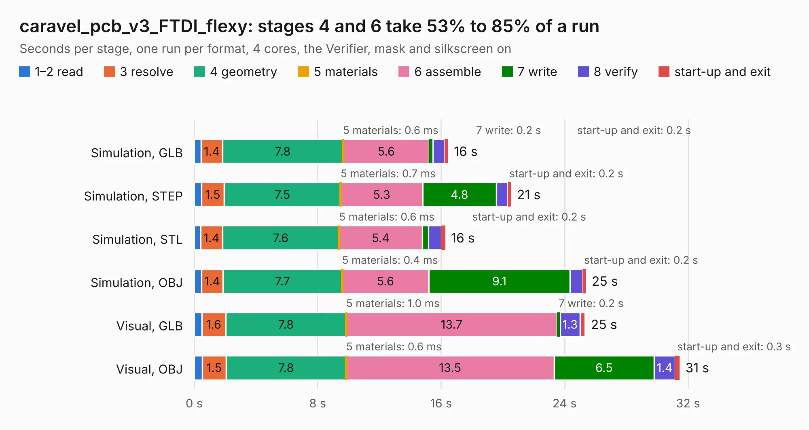

# 327. caravel_pcb_v3_FTDI_flexy

Board 327 of the 3,103 of [Corpus Testing](../Corpus-Testing.md), on [Corpus Page 4](../CorpusTestingPages/Corpus-Testing-04.md#327-caravel_pcb_v3_ftdi_flexy).

| Mode and format | 1–2 read | 3 resolve | 4 geometry | 5 materials | 6 assemble | 7 write | 8 verify | start-up and exit | Total |
|---|---:|---:|---:|---:|---:|---:|---:|---:|---:|
| Simulation, GLB | 0.4 | 1.4 | 7.8 | 0.6&nbsp;ms | 5.6 | 0.2 | 0.7 | 0.2 | 16.5 |
| Simulation, STEP | 0.5 | 1.5 | 7.5 | 0.7&nbsp;ms | 5.3 | 4.8 | 0.7 | 0.2 | 20.5 |
| Simulation, STL | 0.4 | 1.4 | 7.6 | 0.6&nbsp;ms | 5.4 | 0.4 | 0.8 | 0.2 | 16.3 |
| Simulation, OBJ | 0.5 | 1.4 | 7.7 | 0.4&nbsp;ms | 5.6 | 9.1 | 0.8 | 0.2 | 25.4 |
| Visual, GLB | 0.5 | 1.6 | 7.8 | 1.0&nbsp;ms | 13.7 | 0.2 | 1.3 | 0.3 | 25.3 |
| Visual, OBJ | 0.5 | 1.5 | 7.8 | 0.6&nbsp;ms | 13.5 | 6.5 | 1.4 | 0.3 | 31.5 |

<table align="center"><tr><td valign="top">

| Board | Repo: [antmicro/caravel_board](https://github.com/antmicro/caravel_board) Board: `caravel_pcb_v3_FTDI_flexy.kicad_pcb` |
|---|---|
| Folder | hardware / caravel_pcb_v3_FTDI |
| Complexity | 314&nbsp;/&nbsp;1000 (size&nbsp;219, features&nbsp;95) |
| KESE&nbsp;features | through vias, slotted holes, rounded, trapezoid or chamfered pads, drill offsets, filled zones, stack-up, dielectric εr and tanδ |
| Tested | 9th November 2026 |
| Copper&nbsp;layers | 2 |
| File&nbsp;format | KiCad 6 (20211014) |
| Parts,&nbsp;tracks,&nbsp;vias | 63, 935, 122 |
| Triangles,&nbsp;simulation | 1,524,006 in 98 parts |
| Verifier | PASS in all six runs |

</td><td valign="top">

<table>
<tr><th>File type</th><th>File size</th><th>Peak memory used</th></tr>
<tr><th colspan="3" align="left">Simulation</th></tr>
<tr><td>GLB</td><td align="right">52&nbsp;MB</td><td align="right">585&nbsp;MB</td></tr>
<tr><td>STEP</td><td align="right">270&nbsp;MB</td><td align="right">782&nbsp;MB</td></tr>
<tr><td>STL</td><td align="right">76&nbsp;MB</td><td align="right">605&nbsp;MB</td></tr>
<tr><td>OBJ</td><td align="right">157&nbsp;MB</td><td align="right">1.0&nbsp;GB</td></tr>
<tr><th colspan="3" align="left">Visual</th></tr>
<tr><td>GLB</td><td align="right">39&nbsp;MB</td><td align="right">715&nbsp;MB</td></tr>
<tr><td>OBJ</td><td align="right">118&nbsp;MB</td><td align="right">875&nbsp;MB</td></tr>
</table>

</td></tr></table>

| Previous | Next |
|:---|---:|
| [326. Caravel_pcb](b0326b_caravel-board_Caravel-pcb.md) | [328. caravel_pcb_v3_FTDI_SMD](b0328b_caravel-board_caravel-pcb-v3-FTDI-SMD.md) |
