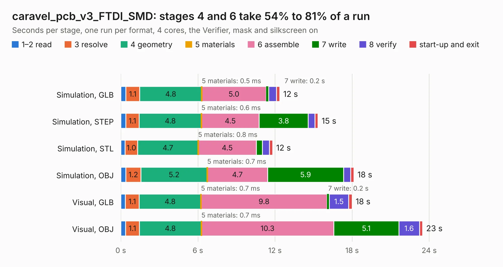

# 329. caravel_pcb_v3_FTDI_SMD

Board 329 of the 3,111 of [Corpus Testing](../Corpus-Testing.md), on [Corpus Page 4](../CorpusTestingPages/Corpus-Testing-04.md#329-caravel_pcb_v3_ftdi_smd).

| Mode and format | 1–2 read | 3 resolve | 4 geometry | 5 materials | 6 assemble | 7 write | 8 verify | start-up and exit | Total |
|---|---:|---:|---:|---:|---:|---:|---:|---:|---:|
| Simulation, GLB | 0.4 | 1.1 | 4.8 | 0.5&nbsp;ms | 5.0 | 0.2 | 0.6 | 0.3 | 12.4 |
| Simulation, STEP | 0.4 | 1.1 | 4.8 | 0.6&nbsp;ms | 4.5 | 3.8 | 0.5 | 0.2 | 15.4 |
| Simulation, STL | 0.3 | 1.0 | 4.7 | 0.8&nbsp;ms | 4.5 | 0.5 | 0.5 | 0.2 | 11.8 |
| Simulation, OBJ | 0.4 | 1.2 | 5.2 | 0.7&nbsp;ms | 4.7 | 5.9 | 0.5 | 0.3 | 18.1 |
| Visual, GLB | 0.4 | 1.1 | 4.8 | 0.7&nbsp;ms | 9.8 | 0.2 | 1.5 | 0.3 | 18.0 |
| Visual, OBJ | 0.4 | 1.1 | 4.8 | 0.7&nbsp;ms | 10.3 | 5.1 | 1.6 | 0.2 | 23.5 |

<table align="center"><tr><td valign="top">

| Board | Repo: [antmicro/caravel_board](https://github.com/antmicro/caravel_board) Board: `caravel_pcb_v3_FTDI_SMD.kicad_pcb` |
|---|---|
| Folder | hardware / caravel_pcb_v3_FTDI |
| Complexity | 305&nbsp;/&nbsp;1000 (size&nbsp;220, features&nbsp;85) |
| KESE&nbsp;features | through vias, slotted holes, rounded, trapezoid or chamfered pads, filled zones, stack-up, dielectric εr and tanδ |
| Tested | 9th November 2026 |
| Copper&nbsp;layers | 2 |
| File&nbsp;format | KiCad 6 (20211014) |
| Parts,&nbsp;tracks,&nbsp;vias | 63, 932, 131 |
| Triangles,&nbsp;simulation | 1,286,120 in 97 parts |
| Verifier | PASS in all six runs |

</td><td valign="top">

<table>
<tr><th>File type</th><th>File size</th><th>Peak memory used</th></tr>
<tr><th colspan="3" align="left">Simulation</th></tr>
<tr><td>GLB</td><td align="right">44&nbsp;MB</td><td align="right">556&nbsp;MB</td></tr>
<tr><td>STEP</td><td align="right">229&nbsp;MB</td><td align="right">681&nbsp;MB</td></tr>
<tr><td>STL</td><td align="right">64&nbsp;MB</td><td align="right">545&nbsp;MB</td></tr>
<tr><td>OBJ</td><td align="right">131&nbsp;MB</td><td align="right">861&nbsp;MB</td></tr>
<tr><th colspan="3" align="left">Visual</th></tr>
<tr><td>GLB</td><td align="right">35&nbsp;MB</td><td align="right">663&nbsp;MB</td></tr>
<tr><td>OBJ</td><td align="right">104&nbsp;MB</td><td align="right">792&nbsp;MB</td></tr>
</table>

</td></tr></table>

| Previous | Next |
|:---|---:|
| [328. caravel_pcb_v3_FTDI_flexy](b0328b_caravel-board_hardware-caravel-pcb-v3-FTDI_caravel-pcb-v3-FTDI-flexy.md) | [330. caravel_pcb_v3_MCP](b0330b_caravel-board_caravel-pcb-v3-MCP.md) |
