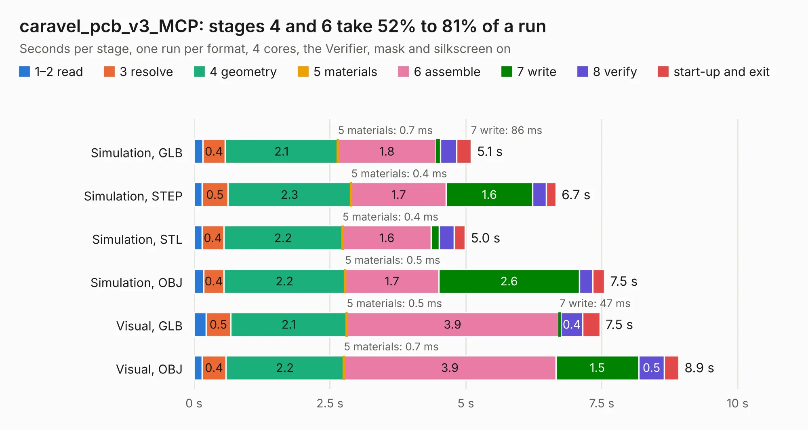

# 330. caravel_pcb_v3_MCP

Board 330 of the 3,111 of [Corpus Testing](../Corpus-Testing.md), on [Corpus Page 4](../CorpusTestingPages/Corpus-Testing-04.md#330-caravel_pcb_v3_mcp).

| Mode and format | 1–2 read | 3 resolve | 4 geometry | 5 materials | 6 assemble | 7 write | 8 verify | start-up and exit | Total |
|---|---:|---:|---:|---:|---:|---:|---:|---:|---:|
| Simulation, GLB | 0.2 | 0.4 | 2.1 | 0.7&nbsp;ms | 1.8 | 86&nbsp;ms | 0.3 | 0.3 | 5.1 |
| Simulation, STEP | 0.1 | 0.5 | 2.3 | 0.4&nbsp;ms | 1.7 | 1.6 | 0.3 | 0.2 | 6.7 |
| Simulation, STL | 0.1 | 0.4 | 2.2 | 0.4&nbsp;ms | 1.6 | 0.1 | 0.3 | 0.2 | 5.0 |
| Simulation, OBJ | 0.2 | 0.4 | 2.2 | 0.5&nbsp;ms | 1.7 | 2.6 | 0.3 | 0.2 | 7.5 |
| Visual, GLB | 0.2 | 0.5 | 2.1 | 0.5&nbsp;ms | 3.9 | 47&nbsp;ms | 0.4 | 0.3 | 7.5 |
| Visual, OBJ | 0.2 | 0.4 | 2.2 | 0.7&nbsp;ms | 3.9 | 1.5 | 0.5 | 0.3 | 8.9 |

<table align="center"><tr><td valign="top">

| Board | Repo: [antmicro/caravel_board](https://github.com/antmicro/caravel_board) Board: `caravel_pcb_v3_MCP.kicad_pcb` |
|---|---|
| Folder | hardware / caravel_pcb_v3_MCP |
| Complexity | 76&nbsp;/&nbsp;1000 (size&nbsp;56, features&nbsp;20) |
| KESE&nbsp;features | slotted holes, rounded, trapezoid or chamfered pads |
| Tested | 9th November 2026 |
| Copper&nbsp;layers | 2 |
| File&nbsp;format | KiCad 6 (20211014) |
| Parts,&nbsp;tracks,&nbsp;vias | 38, 0, 0 |
| Triangles,&nbsp;simulation | 494,144 in 78 parts |
| Verifier | PASS in all six runs |

</td><td valign="top">

<table>
<tr><th>File type</th><th>File size</th><th>Peak memory used</th></tr>
<tr><th colspan="3" align="left">Simulation</th></tr>
<tr><td>GLB</td><td align="right">16&nbsp;MB</td><td align="right">287&nbsp;MB</td></tr>
<tr><td>STEP</td><td align="right">61&nbsp;MB</td><td align="right">325&nbsp;MB</td></tr>
<tr><td>STL</td><td align="right">25&nbsp;MB</td><td align="right">281&nbsp;MB</td></tr>
<tr><td>OBJ</td><td align="right">50&nbsp;MB</td><td align="right">377&nbsp;MB</td></tr>
<tr><th colspan="3" align="left">Visual</th></tr>
<tr><td>GLB</td><td align="right">11&nbsp;MB</td><td align="right">336&nbsp;MB</td></tr>
<tr><td>OBJ</td><td align="right">32&nbsp;MB</td><td align="right">339&nbsp;MB</td></tr>
</table>

</td></tr></table>

| Previous | Next |
|:---|---:|
| [329. caravel_pcb_v3_FTDI_SMD](b0329b_caravel-board_caravel-pcb-v3-FTDI-SMD.md) | [331. caravel_pcb_v4_FTDI_flexy](b0331b_caravel-board_caravel-pcb-v4-FTDI-flexy.md) |
