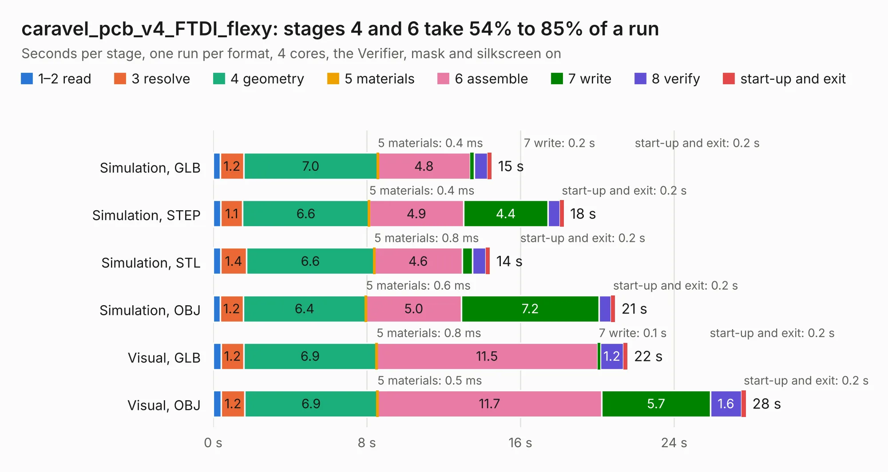

# 331. caravel_pcb_v4_FTDI_flexy

Board 331 of the 3,106 of [Corpus Testing](../Corpus-Testing.md), on [Corpus Page 4](../CorpusTestingPages/Corpus-Testing-04.md#331-caravel_pcb_v4_ftdi_flexy).

| Mode and format | 1–2 read | 3 resolve | 4 geometry | 5 materials | 6 assemble | 7 write | 8 verify | start-up and exit | Total |
|---|---:|---:|---:|---:|---:|---:|---:|---:|---:|
| Simulation, GLB | 0.4 | 1.2 | 7.0 | 0.4&nbsp;ms | 4.8 | 0.2 | 0.7 | 0.2 | 14.5 |
| Simulation, STEP | 0.4 | 1.1 | 6.6 | 0.4&nbsp;ms | 4.9 | 4.4 | 0.6 | 0.2 | 18.3 |
| Simulation, STL | 0.4 | 1.4 | 6.6 | 0.8&nbsp;ms | 4.6 | 0.5 | 0.7 | 0.2 | 14.4 |
| Simulation, OBJ | 0.4 | 1.2 | 6.4 | 0.6&nbsp;ms | 5.0 | 7.2 | 0.6 | 0.2 | 20.9 |
| Visual, GLB | 0.4 | 1.2 | 6.9 | 0.8&nbsp;ms | 11.5 | 0.1 | 1.2 | 0.2 | 21.6 |
| Visual, OBJ | 0.4 | 1.2 | 6.9 | 0.5&nbsp;ms | 11.7 | 5.7 | 1.6 | 0.2 | 27.7 |

<table align="center"><tr><td valign="top">

| Board | Repo: [antmicro/caravel_board](https://github.com/antmicro/caravel_board) Board: `caravel_pcb_v4_FTDI_flexy.kicad_pcb` |
|---|---|
| Folder | hardware / caravel_pcb_v4_FTDI |
| Complexity | 312&nbsp;/&nbsp;1000 (size&nbsp;217, features&nbsp;95) |
| KESE&nbsp;features | through vias, slotted holes, rounded, trapezoid or chamfered pads, drill offsets, filled zones, stack-up, dielectric εr and tanδ |
| Tested | 9th November 2026 |
| Copper&nbsp;layers | 2 |
| File&nbsp;format | KiCad 6 (20211014) |
| Parts,&nbsp;tracks,&nbsp;vias | 61, 884, 104 |
| Triangles,&nbsp;simulation | 1,428,776 in 104 parts |
| Verifier | PASS in all six runs |

</td><td valign="top">

<table>
<tr><th>File type</th><th>File size</th><th>Peak memory used</th></tr>
<tr><th colspan="3" align="left">Simulation</th></tr>
<tr><td>GLB</td><td align="right">49&nbsp;MB</td><td align="right">601&nbsp;MB</td></tr>
<tr><td>STEP</td><td align="right">248&nbsp;MB</td><td align="right">741&nbsp;MB</td></tr>
<tr><td>STL</td><td align="right">71&nbsp;MB</td><td align="right">583&nbsp;MB</td></tr>
<tr><td>OBJ</td><td align="right">147&nbsp;MB</td><td align="right">990&nbsp;MB</td></tr>
<tr><th colspan="3" align="left">Visual</th></tr>
<tr><td>GLB</td><td align="right">36&nbsp;MB</td><td align="right">805&nbsp;MB</td></tr>
<tr><td>OBJ</td><td align="right">108&nbsp;MB</td><td align="right">858&nbsp;MB</td></tr>
</table>

</td></tr></table>

| Previous | Next |
|:---|---:|
| [330. caravel_pcb_v3_MCP](b0330b_caravel-board_caravel-pcb-v3-MCP.md) | [332. caravel_pcb_v4_FTDI_SMD](b0332b_caravel-board_caravel-pcb-v4-FTDI-SMD.md) |
