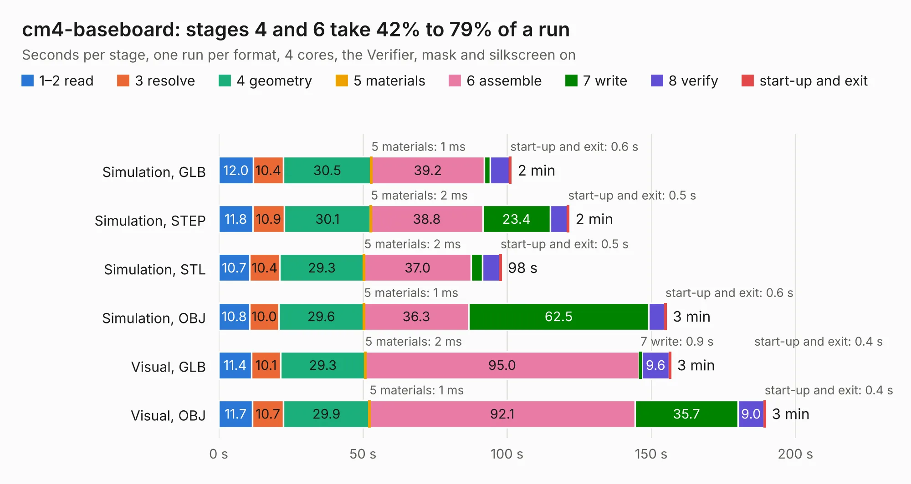

# 331. cm4-baseboard

Board 331 of the 3,100 of [Corpus Testing](../Corpus-Testing.md), on [Corpus Page 4](../CorpusTestingPages/Corpus-Testing-04.md#331-cm4-baseboard).

| Mode and format | 1–2 read | 3 resolve | 4 geometry | 5 materials | 6 assemble | 7 write | 8 verify | start-up and exit | Total |
|---|---:|---:|---:|---:|---:|---:|---:|---:|---:|
| Simulation, GLB | 12.0 | 10.4 | 30.5 | 1&nbsp;ms | 39.2 | 1.9 | 6.8 | 0.6 | 101.4 |
| Simulation, STEP | 11.8 | 10.9 | 30.1 | 2&nbsp;ms | 38.8 | 23.4 | 6.0 | 0.5 | 121.5 |
| Simulation, STL | 10.7 | 10.4 | 29.3 | 2&nbsp;ms | 37.0 | 4.0 | 6.0 | 0.5 | 98.0 |
| Simulation, OBJ | 10.8 | 10.0 | 29.6 | 1&nbsp;ms | 36.3 | 62.5 | 5.5 | 0.6 | 155.2 |
| Visual, GLB | 11.4 | 10.1 | 29.3 | 2&nbsp;ms | 95.0 | 0.9 | 9.6 | 0.4 | 156.7 |
| Visual, OBJ | 11.7 | 10.7 | 29.9 | 1&nbsp;ms | 92.1 | 35.7 | 9.0 | 0.4 | 189.5 |

<table align="center"><tr><td valign="top">

| Board | Repo: [antmicro/cm4-baseboard](https://github.com/antmicro/cm4-baseboard) Board: `cm4-baseboard.kicad_pcb` |
|---|---|
| Complexity | 472&nbsp;/&nbsp;1000 (size&nbsp;307, features&nbsp;165) |
| KESE&nbsp;features | through vias, slotted holes, custom pads, rounded, trapezoid or chamfered pads, arc tracks, filled zones, copper drawings, copper text, curved board outline, knockout text, stack-up, dielectric εr and tanδ, mask and silkscreen colours |
| Tested | 9th November 2026 |
| Copper&nbsp;layers | 6 |
| File&nbsp;format | KiCad 9 (20241229) |
| Parts,&nbsp;tracks,&nbsp;vias | 442, 6,879, 1,129 |
| Triangles,&nbsp;simulation | 9,169,160 in 522 parts |
| Verifier | PASS in all six runs |

</td><td valign="top">

<table>
<tr><th>File type</th><th>File size</th><th>Peak memory used</th></tr>
<tr><th colspan="3" align="left">Simulation</th></tr>
<tr><td>GLB</td><td align="right">312&nbsp;MB</td><td align="right">2.8&nbsp;GB</td></tr>
<tr><td>STEP</td><td align="right">1.3&nbsp;GB</td><td align="right">3.5&nbsp;GB</td></tr>
<tr><td>STL</td><td align="right">459&nbsp;MB</td><td align="right">2.8&nbsp;GB</td></tr>
<tr><td>OBJ</td><td align="right">986&nbsp;MB</td><td align="right">6.0&nbsp;GB</td></tr>
<tr><th colspan="3" align="left">Visual</th></tr>
<tr><td>GLB</td><td align="right">193&nbsp;MB</td><td align="right">3.3&nbsp;GB</td></tr>
<tr><td>OBJ</td><td align="right">622&nbsp;MB</td><td align="right">4.2&nbsp;GB</td></tr>
</table>

</td></tr></table>

| Previous | Next |
|:---|---:|
| [330. caravel_pcb_v4_FTDI_SMD](b0330b_caravel-board_caravel-pcb-v4-FTDI-SMD.md) | [332. cm4-lvds-adapter](b0332b_cm4-baseboard-lvds-adapter_cm4-lvds-adapter.md) |
