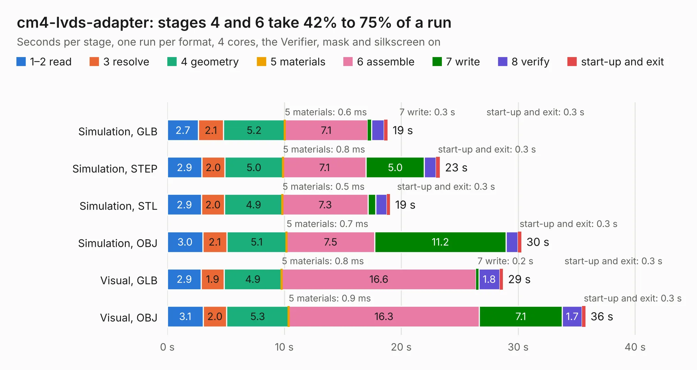

# 335. cm4-lvds-adapter

Board 335 of the 3,121 of [Corpus Testing](../Corpus-Testing.md), on [Corpus Page 4](../CorpusTestingPages/Corpus-Testing-04.md#335-cm4-lvds-adapter).

| Mode and format | 1–2 read | 3 resolve | 4 geometry | 5 materials | 6 assemble | 7 write | 8 verify | start-up and exit | Total |
|---|---:|---:|---:|---:|---:|---:|---:|---:|---:|
| Simulation, GLB | 2.7 | 2.1 | 5.2 | 0.6&nbsp;ms | 7.1 | 0.3 | 1.1 | 0.3 | 18.8 |
| Simulation, STEP | 2.9 | 2.0 | 5.0 | 0.8&nbsp;ms | 7.1 | 5.0 | 1.0 | 0.3 | 23.3 |
| Simulation, STL | 2.9 | 2.0 | 4.9 | 0.5&nbsp;ms | 7.3 | 0.7 | 1.0 | 0.3 | 19.1 |
| Simulation, OBJ | 3.0 | 2.1 | 5.1 | 0.7&nbsp;ms | 7.5 | 11.2 | 1.0 | 0.3 | 30.3 |
| Visual, GLB | 2.9 | 1.9 | 4.9 | 0.8&nbsp;ms | 16.6 | 0.2 | 1.8 | 0.3 | 28.7 |
| Visual, OBJ | 3.1 | 2.0 | 5.3 | 0.9&nbsp;ms | 16.3 | 7.1 | 1.7 | 0.3 | 35.8 |

<table align="center"><tr><td valign="top">

| Board | Repo: [antmicro/cm4-baseboard-lvds-adapter](https://github.com/antmicro/cm4-baseboard-lvds-adapter) Board: `cm4-lvds-adapter.kicad_pcb` |
|---|---|
| Complexity | 408&nbsp;/&nbsp;1000 (size&nbsp;263, features&nbsp;145) |
| KESE&nbsp;features | through vias, custom pads, rounded, trapezoid or chamfered pads, arc tracks, filled zones, copper drawings, copper text, knockout text, stack-up, dielectric εr and tanδ, mask and silkscreen colours |
| Tested | 9th November 2026 |
| Copper&nbsp;layers | 6 |
| File&nbsp;format | KiCad 9 (20241229) |
| Parts,&nbsp;tracks,&nbsp;vias | 130, 1,596, 254 |
| Triangles,&nbsp;simulation | 2,092,774 in 158 parts |
| Verifier | PASS in all six runs |

</td><td valign="top">

<table>
<tr><th>File type</th><th>File size</th><th>Peak memory used</th></tr>
<tr><th colspan="3" align="left">Simulation</th></tr>
<tr><td>GLB</td><td align="right">71&nbsp;MB</td><td align="right">737&nbsp;MB</td></tr>
<tr><td>STEP</td><td align="right">278&nbsp;MB</td><td align="right">973&nbsp;MB</td></tr>
<tr><td>STL</td><td align="right">105&nbsp;MB</td><td align="right">738&nbsp;MB</td></tr>
<tr><td>OBJ</td><td align="right">218&nbsp;MB</td><td align="right">1.4&nbsp;GB</td></tr>
<tr><th colspan="3" align="left">Visual</th></tr>
<tr><td>GLB</td><td align="right">45&nbsp;MB</td><td align="right">889&nbsp;MB</td></tr>
<tr><td>OBJ</td><td align="right">140&nbsp;MB</td><td align="right">1.1&nbsp;GB</td></tr>
</table>

</td></tr></table>

| Previous | Next |
|:---|---:|
| [334. cm4-baseboard](b0334b_cm4-baseboard_cm4-baseboard.md) | [336. com-express-7-baseboard](b0336b_com-express-7-baseboard_com-express-7-baseboard.md) |
