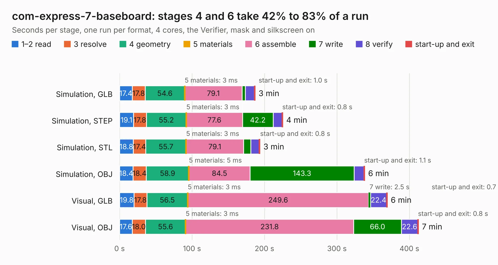

# 336. com-express-7-baseboard

Board 336 of the 3,123 of [Corpus Testing](../Corpus-Testing.md), on [Corpus Page 4](../CorpusTestingPages/Corpus-Testing-04.md#336-com-express-7-baseboard).

| Mode and format | 1–2 read | 3 resolve | 4 geometry | 5 materials | 6 assemble | 7 write | 8 verify | start-up and exit | Total |
|---|---:|---:|---:|---:|---:|---:|---:|---:|---:|
| Simulation, GLB | 17.4 | 17.8 | 54.6 | 3&nbsp;ms | 79.1 | 4.6 | 12.4 | 1.0 | 186.9 |
| Simulation, STEP | 19.1 | 17.8 | 55.2 | 3&nbsp;ms | 77.6 | 42.2 | 12.4 | 0.8 | 225.1 |
| Simulation, STL | 18.8 | 17.4 | 55.7 | 3&nbsp;ms | 79.1 | 10.2 | 11.6 | 0.8 | 193.6 |
| Simulation, OBJ | 18.4 | 18.4 | 58.9 | 5&nbsp;ms | 84.5 | 143.3 | 13.6 | 1.1 | 338.2 |
| Visual, GLB | 19.8 | 17.8 | 56.5 | 3&nbsp;ms | 249.6 | 2.5 | 22.4 | 0.7 | 369.4 |
| Visual, OBJ | 17.6 | 18.0 | 55.6 | 3&nbsp;ms | 231.8 | 66.0 | 22.6 | 0.8 | 412.4 |

<table align="center"><tr><td valign="top">

| Board | Repo: [antmicro/com-express-7-baseboard](https://github.com/antmicro/com-express-7-baseboard) Board: `com-express-7-baseboard.kicad_pcb` |
|---|---|
| Complexity | 525&nbsp;/&nbsp;1000 (size&nbsp;345, features&nbsp;180) |
| KESE&nbsp;features | through vias, slotted holes, custom pads, rounded, trapezoid or chamfered pads, arc tracks, filled zones, copper drawings, copper text, curved board outline, knockout text, TrueType text, stack-up, dielectric εr and tanδ, mask and silkscreen colours |
| Tested | 9th November 2026 to 10th November 2026 |
| Copper&nbsp;layers | 8 |
| File&nbsp;format | KiCad 9 (20241229) |
| Parts,&nbsp;tracks,&nbsp;vias | 693, 10,459, 2,865 |
| Triangles,&nbsp;simulation | 21,291,582 in 1018 parts |
| Verifier | PASS in all six runs |
| Run&nbsp;again | Simulation, OBJ: failed in the corpus run, run again with the memory cap raised from 11 GB to 14.5 GB, and passed |

</td><td valign="top">

<table>
<tr><th>File type</th><th>File size</th><th>Peak memory used</th></tr>
<tr><th colspan="3" align="left">Simulation</th></tr>
<tr><td>GLB</td><td align="right">684&nbsp;MB</td><td align="right">6.3&nbsp;GB</td></tr>
<tr><td>STEP</td><td align="right">2.3&nbsp;GB</td><td align="right">7.1&nbsp;GB</td></tr>
<tr><td>STL</td><td align="right">1.1&nbsp;GB</td><td align="right">6.2&nbsp;GB</td></tr>
<tr><td>OBJ</td><td align="right">2.3&nbsp;GB</td><td align="right">13&nbsp;GB</td></tr>
<tr><th colspan="3" align="left">Visual</th></tr>
<tr><td>GLB</td><td align="right">388&nbsp;MB</td><td align="right">6.7&nbsp;GB</td></tr>
<tr><td>OBJ</td><td align="right">1.3&nbsp;GB</td><td align="right">8.2&nbsp;GB</td></tr>
</table>

</td></tr></table>

| Previous | Next |
|:---|---:|
| [335. cm4-lvds-adapter](b0335b_cm4-baseboard-lvds-adapter_cm4-lvds-adapter.md) | [337. cvbs-mipi-bridge](b0337b_cvbs-mipi-bridge_cvbs-mipi-bridge.md) |
