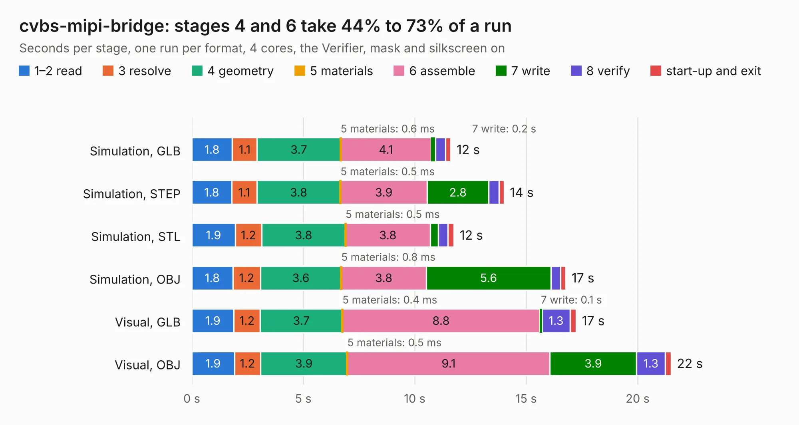

# 336. cvbs-mipi-bridge

Board 336 of the 3,106 of [Corpus Testing](../Corpus-Testing.md), on [Corpus Page 4](../CorpusTestingPages/Corpus-Testing-04.md#336-cvbs-mipi-bridge).

| Mode and format | 1–2 read | 3 resolve | 4 geometry | 5 materials | 6 assemble | 7 write | 8 verify | start-up and exit | Total |
|---|---:|---:|---:|---:|---:|---:|---:|---:|---:|
| Simulation, GLB | 1.8 | 1.1 | 3.7 | 0.6&nbsp;ms | 4.1 | 0.2 | 0.4 | 0.2 | 11.6 |
| Simulation, STEP | 1.8 | 1.1 | 3.8 | 0.5&nbsp;ms | 3.9 | 2.8 | 0.5 | 0.2 | 14.0 |
| Simulation, STL | 1.9 | 1.2 | 3.8 | 0.5&nbsp;ms | 3.8 | 0.4 | 0.4 | 0.3 | 11.8 |
| Simulation, OBJ | 1.8 | 1.2 | 3.6 | 0.8&nbsp;ms | 3.8 | 5.6 | 0.4 | 0.2 | 16.8 |
| Visual, GLB | 1.9 | 1.2 | 3.7 | 0.4&nbsp;ms | 8.8 | 0.1 | 1.3 | 0.3 | 17.2 |
| Visual, OBJ | 1.9 | 1.2 | 3.9 | 0.5&nbsp;ms | 9.1 | 3.9 | 1.3 | 0.3 | 21.5 |

<table align="center"><tr><td valign="top">

| Board | Repo: [antmicro/cvbs-mipi-bridge](https://github.com/antmicro/cvbs-mipi-bridge) Board: `cvbs-mipi-bridge.kicad_pcb` |
|---|---|
| Complexity | 375&nbsp;/&nbsp;1000 (size&nbsp;255, features&nbsp;120) |
| KESE&nbsp;features | through vias, slotted holes, rounded, trapezoid or chamfered pads, arc tracks, filled zones, stack-up, dielectric εr and tanδ, copper finish, mask and silkscreen colours |
| Tested | 9th November 2026 |
| Copper&nbsp;layers | 4 |
| File&nbsp;format | KiCad 7 (20221018) |
| Parts,&nbsp;tracks,&nbsp;vias | 98, 578, 295 |
| Triangles,&nbsp;simulation | 1,334,870 in 113 parts |
| Verifier | PASS in all six runs |

</td><td valign="top">

<table>
<tr><th>File type</th><th>File size</th><th>Peak memory used</th></tr>
<tr><th colspan="3" align="left">Simulation</th></tr>
<tr><td>GLB</td><td align="right">45&nbsp;MB</td><td align="right">595&nbsp;MB</td></tr>
<tr><td>STEP</td><td align="right">149&nbsp;MB</td><td align="right">735&nbsp;MB</td></tr>
<tr><td>STL</td><td align="right">67&nbsp;MB</td><td align="right">620&nbsp;MB</td></tr>
<tr><td>OBJ</td><td align="right">136&nbsp;MB</td><td align="right">988&nbsp;MB</td></tr>
<tr><th colspan="3" align="left">Visual</th></tr>
<tr><td>GLB</td><td align="right">30&nbsp;MB</td><td align="right">796&nbsp;MB</td></tr>
<tr><td>OBJ</td><td align="right">92&nbsp;MB</td><td align="right">760&nbsp;MB</td></tr>
</table>

</td></tr></table>

| Previous | Next |
|:---|---:|
| [335. com-express-7-baseboard](b0335b_com-express-7-baseboard_com-express-7-baseboard.md) | [337. d1600e-psu-breakout-board](b0337b_d1600e-psu-breakout_d1600e-psu-breakout-board.md) |
