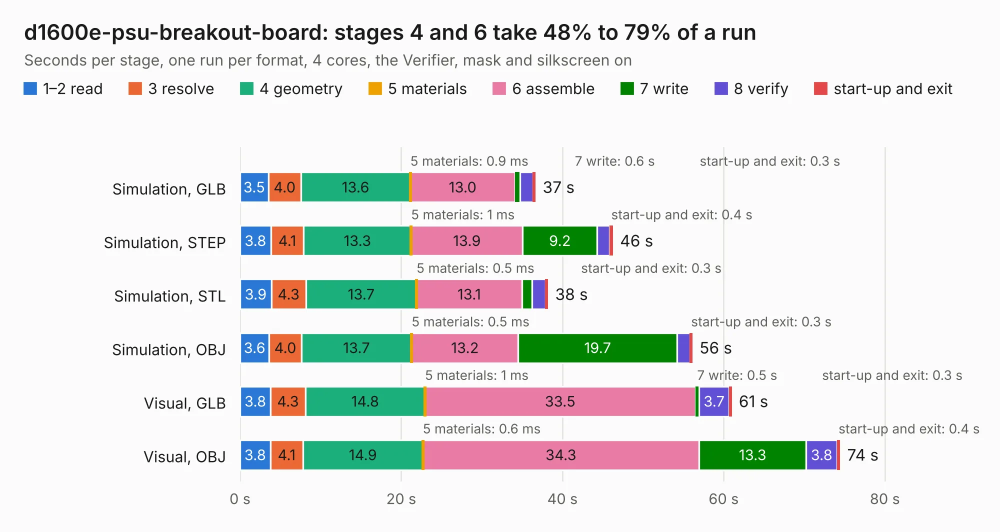

# 338. d1600e-psu-breakout-board

Board 338 of the 3,130 of [Corpus Testing](../Corpus-Testing.md), on [Corpus Page 4](../CorpusTestingPages/Corpus-Testing-04.md#338-d1600e-psu-breakout-board).

| Mode and format | 1–2 read | 3 resolve | 4 geometry | 5 materials | 6 assemble | 7 write | 8 verify | start-up and exit | Total |
|---|---:|---:|---:|---:|---:|---:|---:|---:|---:|
| Simulation, GLB | 3.5 | 4.0 | 13.6 | 0.9&nbsp;ms | 13.0 | 0.6 | 1.6 | 0.3 | 36.7 |
| Simulation, STEP | 3.8 | 4.1 | 13.3 | 1&nbsp;ms | 13.9 | 9.2 | 1.5 | 0.4 | 46.2 |
| Simulation, STL | 3.9 | 4.3 | 13.7 | 0.5&nbsp;ms | 13.1 | 1.3 | 1.6 | 0.3 | 38.2 |
| Simulation, OBJ | 3.6 | 4.0 | 13.7 | 0.5&nbsp;ms | 13.2 | 19.7 | 1.6 | 0.3 | 56.1 |
| Visual, GLB | 3.8 | 4.3 | 14.8 | 1&nbsp;ms | 33.5 | 0.5 | 3.7 | 0.3 | 61.0 |
| Visual, OBJ | 3.8 | 4.1 | 14.9 | 0.6&nbsp;ms | 34.3 | 13.3 | 3.8 | 0.4 | 74.4 |

<table align="center"><tr><td valign="top">

| Board | Repo: [antmicro/d1600e-psu-breakout](https://github.com/antmicro/d1600e-psu-breakout) Board: `d1600e-psu-breakout-board.kicad_pcb` |
|---|---|
| Complexity | 405&nbsp;/&nbsp;1000 (size&nbsp;265, features&nbsp;140) |
| KESE&nbsp;features | through vias, slotted holes, custom pads, rounded, trapezoid or chamfered pads, arc tracks, filled zones, copper drawings, curved board outline, stack-up, dielectric εr and tanδ, mask and silkscreen colours |
| Tested | 9th November 2026 to 10th November 2026 |
| Copper&nbsp;layers | 4 |
| File&nbsp;format | KiCad 7 (20221018) |
| Parts,&nbsp;tracks,&nbsp;vias | 185, 985, 903 |
| Triangles,&nbsp;simulation | 4,123,478 in 180 parts |
| Verifier | PASS in all six runs |
| Run&nbsp;again | Visual, GLB; Visual, OBJ: failed in the corpus run, run again with fixes to KESE made after the corpus run, and passed |

</td><td valign="top">

<table>
<tr><th>File type</th><th>File size</th><th>Peak memory used</th></tr>
<tr><th colspan="3" align="left">Simulation</th></tr>
<tr><td>GLB</td><td align="right">137&nbsp;MB</td><td align="right">1.4&nbsp;GB</td></tr>
<tr><td>STEP</td><td align="right">477&nbsp;MB</td><td align="right">1.8&nbsp;GB</td></tr>
<tr><td>STL</td><td align="right">206&nbsp;MB</td><td align="right">1.4&nbsp;GB</td></tr>
<tr><td>OBJ</td><td align="right">433&nbsp;MB</td><td align="right">2.7&nbsp;GB</td></tr>
<tr><th colspan="3" align="left">Visual</th></tr>
<tr><td>GLB</td><td align="right">86&nbsp;MB</td><td align="right">1.6&nbsp;GB</td></tr>
<tr><td>OBJ</td><td align="right">271&nbsp;MB</td><td align="right">1.9&nbsp;GB</td></tr>
</table>

</td></tr></table>

| Previous | Next |
|:---|---:|
| [337. cvbs-mipi-bridge](b0337b_cvbs-mipi-bridge_cvbs-mipi-bridge.md) | [339. data-center-rdimm-ddr4-tester](b0339b_data-center-dram-tester_data-center-rdimm-ddr4-tester.md) |
