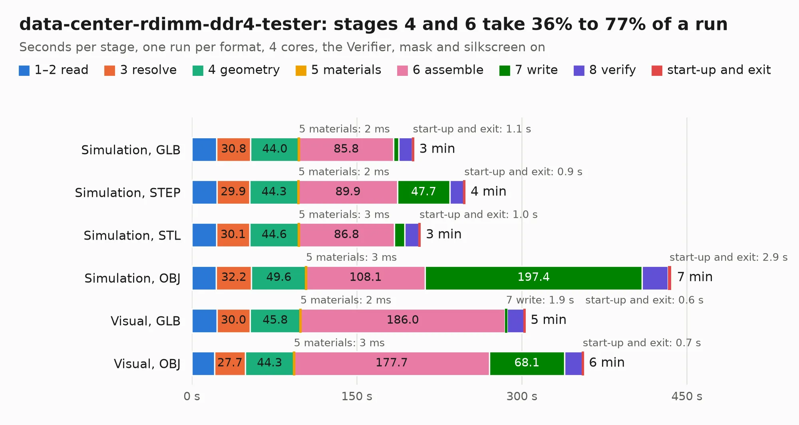

# 338. data-center-rdimm-ddr4-tester

Board 338 of the 3,117 of [Corpus Testing](../Corpus-Testing.md), on [Corpus Page 4](../CorpusTestingPages/Corpus-Testing-04.md#338-data-center-rdimm-ddr4-tester).

| Mode and format | 1–2 read | 3 resolve | 4 geometry | 5 materials | 6 assemble | 7 write | 8 verify | start-up and exit | Total |
|---|---:|---:|---:|---:|---:|---:|---:|---:|---:|
| Simulation, GLB | 22.7 | 30.8 | 44.0 | 2&nbsp;ms | 85.8 | 4.8 | 12.4 | 1.1 | 201.5 |
| Simulation, STEP | 22.8 | 29.9 | 44.3 | 2&nbsp;ms | 89.9 | 47.7 | 12.6 | 0.9 | 248.2 |
| Simulation, STL | 22.5 | 30.1 | 44.6 | 3&nbsp;ms | 86.8 | 9.7 | 12.8 | 1.0 | 207.5 |
| Simulation, OBJ | 22.1 | 32.2 | 49.6 | 3&nbsp;ms | 108.1 | 197.4 | 23.5 | 2.9 | 435.7 |
| Visual, GLB | 22.9 | 30.0 | 45.8 | 2&nbsp;ms | 186.0 | 1.9 | 15.6 | 0.6 | 302.7 |
| Visual, OBJ | 20.8 | 27.7 | 44.3 | 3&nbsp;ms | 177.7 | 68.1 | 16.4 | 0.7 | 355.7 |

<table align="center"><tr><td valign="top">

| Board | Repo: [antmicro/data-center-dram-tester](https://github.com/antmicro/data-center-dram-tester) Board: `data-center-rdimm-ddr4-tester.kicad_pcb` |
|---|---|
| Complexity | 559&nbsp;/&nbsp;1000 (size&nbsp;359, features&nbsp;200) |
| KESE&nbsp;features | through vias, blind and buried vias, slotted holes, custom pads, rounded, trapezoid or chamfered pads, arc tracks, filled zones, copper drawings, TrueType text, stack-up, dielectric εr and tanδ, copper finish, mask and silkscreen colours |
| Tested | 9th November 2026 to 11th November 2026 |
| Copper&nbsp;layers | 12 |
| File&nbsp;format | KiCad 7 (20221018) |
| Parts,&nbsp;tracks,&nbsp;vias | 648, 21,939, 2,467 |
| Triangles,&nbsp;simulation | 25,480,794 in 941 parts |
| Verifier | PASS in all six runs |
| Run&nbsp;again | Simulation, OBJ: failed in the corpus run, run again with no memory cap and no time limit (swap added to a 16 GB machine), and passed |

</td><td valign="top">

<table>
<tr><th>File type</th><th>File size</th><th>Peak memory used</th></tr>
<tr><th colspan="3" align="left">Simulation</th></tr>
<tr><td>GLB</td><td align="right">858&nbsp;MB</td><td align="right">6.1&nbsp;GB</td></tr>
<tr><td>STEP</td><td align="right">2.4&nbsp;GB</td><td align="right">7.6&nbsp;GB</td></tr>
<tr><td>STL</td><td align="right">1.3&nbsp;GB</td><td align="right">6.0&nbsp;GB</td></tr>
<tr><td>OBJ</td><td align="right">2.9&nbsp;GB</td><td align="right">16&nbsp;GB</td></tr>
<tr><th colspan="3" align="left">Visual</th></tr>
<tr><td>GLB</td><td align="right">353&nbsp;MB</td><td align="right">6.3&nbsp;GB</td></tr>
<tr><td>OBJ</td><td align="right">1.2&nbsp;GB</td><td align="right">7.9&nbsp;GB</td></tr>
</table>

</td></tr></table>

| Previous | Next |
|:---|---:|
| [337. d1600e-psu-breakout-board](b0337b_d1600e-psu-breakout_d1600e-psu-breakout-board.md) | [339. dc-sci-debug-interposer](b0339b_dc-sci-debug-interposer_dc-sci-debug-interposer.md) |
