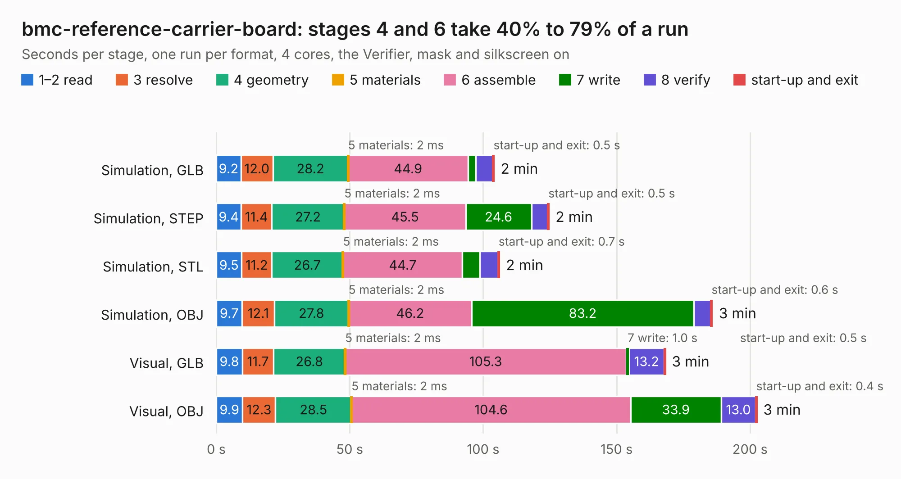

# 338. bmc-reference-carrier-board

Board 338 of the 3,100 of [Corpus Testing](../Corpus-Testing.md), on [Corpus Page 4](../CorpusTestingPages/Corpus-Testing-04.md#338-bmc-reference-carrier-board).

| Mode and format | 1–2 read | 3 resolve | 4 geometry | 5 materials | 6 assemble | 7 write | 8 verify | start-up and exit | Total |
|---|---:|---:|---:|---:|---:|---:|---:|---:|---:|
| Simulation, GLB | 9.2 | 12.0 | 28.2 | 2&nbsp;ms | 44.9 | 2.9 | 6.4 | 0.5 | 104.1 |
| Simulation, STEP | 9.4 | 11.4 | 27.2 | 2&nbsp;ms | 45.5 | 24.6 | 6.1 | 0.5 | 124.7 |
| Simulation, STL | 9.5 | 11.2 | 26.7 | 2&nbsp;ms | 44.7 | 6.5 | 6.7 | 0.7 | 106.1 |
| Simulation, OBJ | 9.7 | 12.1 | 27.8 | 2&nbsp;ms | 46.2 | 83.2 | 6.3 | 0.6 | 185.9 |
| Visual, GLB | 9.8 | 11.7 | 26.8 | 2&nbsp;ms | 105.3 | 1.0 | 13.2 | 0.5 | 168.3 |
| Visual, OBJ | 9.9 | 12.3 | 28.5 | 2&nbsp;ms | 104.6 | 33.9 | 13.0 | 0.4 | 202.6 |

<table align="center"><tr><td valign="top">

| Board | Repo: [antmicro/dc-scm-osm-l-carrier-card](https://github.com/antmicro/dc-scm-osm-l-carrier-card) Board: `bmc-reference-carrier-board.kicad_pcb` |
|---|---|
| Complexity | 527&nbsp;/&nbsp;1000 (size&nbsp;332, features&nbsp;195) |
| KESE&nbsp;features | through vias, padstacks, slotted holes, custom pads, rounded, trapezoid or chamfered pads, arc tracks, filled zones, copper drawings, copper text, curved board outline, knockout text, stack-up, dielectric εr and tanδ, mask and silkscreen colours |
| Tested | 9th November 2026 |
| Copper&nbsp;layers | 10 |
| File&nbsp;format | KiCad 9 (20241229) |
| Parts,&nbsp;tracks,&nbsp;vias | 529, 8,646, 1,355 |
| Triangles,&nbsp;simulation | 14,795,830 in 1092 parts |
| Verifier | PASS in all six runs |

</td><td valign="top">

<table>
<tr><th>File type</th><th>File size</th><th>Peak memory used</th></tr>
<tr><th colspan="3" align="left">Simulation</th></tr>
<tr><td>GLB</td><td align="right">488&nbsp;MB</td><td align="right">3.5&nbsp;GB</td></tr>
<tr><td>STEP</td><td align="right">1.5&nbsp;GB</td><td align="right">4.8&nbsp;GB</td></tr>
<tr><td>STL</td><td align="right">740&nbsp;MB</td><td align="right">3.5&nbsp;GB</td></tr>
<tr><td>OBJ</td><td align="right">1.6&nbsp;GB</td><td align="right">9.4&nbsp;GB</td></tr>
<tr><th colspan="3" align="left">Visual</th></tr>
<tr><td>GLB</td><td align="right">231&nbsp;MB</td><td align="right">4.1&nbsp;GB</td></tr>
<tr><td>OBJ</td><td align="right">765&nbsp;MB</td><td align="right">5.1&nbsp;GB</td></tr>
</table>

</td></tr></table>

| Previous | Next |
|:---|---:|
| [337. dc-scm-breakout-board](b0337b_dc-scm-breakout-board_dc-scm-breakout-board.md) | [339. dc-scm-rot-jumper-card](b0339b_dc-scm-rot-jumper-card_dc-scm-rot-jumper-card.md) |
