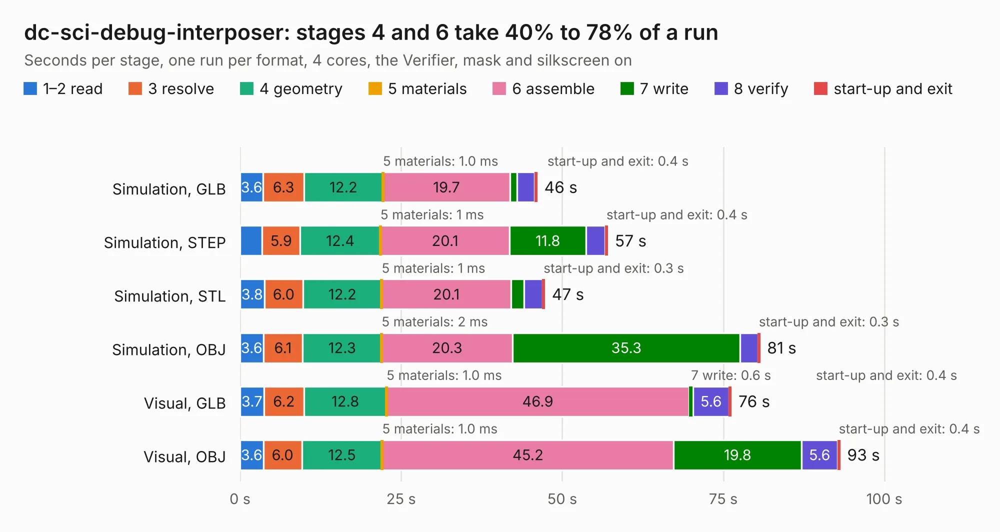

# 340. dc-sci-debug-interposer

Board 340 of the 3,118 of [Corpus Testing](../Corpus-Testing.md), on [Corpus Page 4](../CorpusTestingPages/Corpus-Testing-04.md#340-dc-sci-debug-interposer).

| Mode and format | 1–2 read | 3 resolve | 4 geometry | 5 materials | 6 assemble | 7 write | 8 verify | start-up and exit | Total |
|---|---:|---:|---:|---:|---:|---:|---:|---:|---:|
| Simulation, GLB | 3.6 | 6.3 | 12.2 | 1.0&nbsp;ms | 19.7 | 1.1 | 2.7 | 0.4 | 46.1 |
| Simulation, STEP | 3.4 | 5.9 | 12.4 | 1&nbsp;ms | 20.1 | 11.8 | 3.0 | 0.4 | 57.1 |
| Simulation, STL | 3.8 | 6.0 | 12.2 | 1&nbsp;ms | 20.1 | 2.0 | 2.9 | 0.3 | 47.3 |
| Simulation, OBJ | 3.6 | 6.1 | 12.3 | 2&nbsp;ms | 20.3 | 35.3 | 2.7 | 0.3 | 80.7 |
| Visual, GLB | 3.7 | 6.2 | 12.8 | 1.0&nbsp;ms | 46.9 | 0.6 | 5.6 | 0.4 | 76.2 |
| Visual, OBJ | 3.6 | 6.0 | 12.5 | 1.0&nbsp;ms | 45.2 | 19.8 | 5.6 | 0.4 | 93.1 |

<table align="center"><tr><td valign="top">

| Board | Repo: [antmicro/dc-sci-debug-interposer](https://github.com/antmicro/dc-sci-debug-interposer) Board: `dc-sci-debug-interposer.kicad_pcb` |
|---|---|
| Complexity | 439&nbsp;/&nbsp;1000 (size&nbsp;294, features&nbsp;145) |
| KESE&nbsp;features | through vias, rounded, trapezoid or chamfered pads, arc tracks, filled zones, copper text, curved board outline, knockout text, stack-up, dielectric εr and tanδ, copper finish, mask and silkscreen colours |
| Tested | 9th November 2026 |
| Copper&nbsp;layers | 8 |
| File&nbsp;format | KiCad 10 (20260206) |
| Parts,&nbsp;tracks,&nbsp;vias | 266, 4,217, 679 |
| Triangles,&nbsp;simulation | 5,925,818 in 368 parts |
| Verifier | PASS in all six runs |

</td><td valign="top">

<table>
<tr><th>File type</th><th>File size</th><th>Peak memory used</th></tr>
<tr><th colspan="3" align="left">Simulation</th></tr>
<tr><td>GLB</td><td align="right">199&nbsp;MB</td><td align="right">1.8&nbsp;GB</td></tr>
<tr><td>STEP</td><td align="right">706&nbsp;MB</td><td align="right">2.1&nbsp;GB</td></tr>
<tr><td>STL</td><td align="right">296&nbsp;MB</td><td align="right">1.6&nbsp;GB</td></tr>
<tr><td>OBJ</td><td align="right">632&nbsp;MB</td><td align="right">3.8&nbsp;GB</td></tr>
<tr><th colspan="3" align="left">Visual</th></tr>
<tr><td>GLB</td><td align="right">114&nbsp;MB</td><td align="right">2.0&nbsp;GB</td></tr>
<tr><td>OBJ</td><td align="right">371&nbsp;MB</td><td align="right">2.6&nbsp;GB</td></tr>
</table>

</td></tr></table>

| Previous | Next |
|:---|---:|
| [339. data-center-rdimm-ddr4-tester](b0339b_data-center-dram-tester_data-center-rdimm-ddr4-tester.md) | [341. dc-scm-breakout-board](b0341b_dc-scm-breakout-board_dc-scm-breakout-board.md) |
