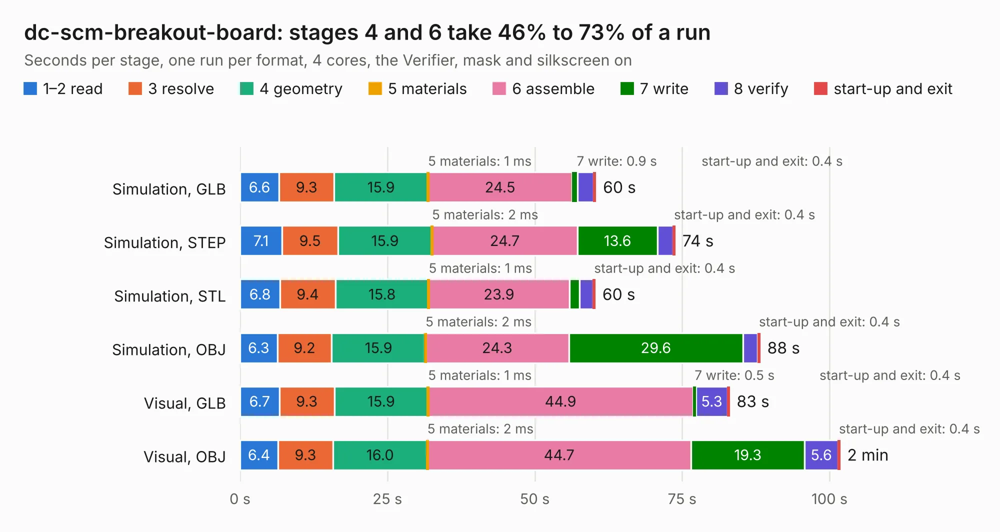

# 341. dc-scm-breakout-board

Board 341 of the 3,130 of [Corpus Testing](../Corpus-Testing.md), on [Corpus Page 4](../CorpusTestingPages/Corpus-Testing-04.md#341-dc-scm-breakout-board).

| Mode and format | 1–2 read | 3 resolve | 4 geometry | 5 materials | 6 assemble | 7 write | 8 verify | start-up and exit | Total |
|---|---:|---:|---:|---:|---:|---:|---:|---:|---:|
| Simulation, GLB | 6.6 | 9.3 | 15.9 | 1&nbsp;ms | 24.5 | 0.9 | 2.7 | 0.4 | 60.4 |
| Simulation, STEP | 7.1 | 9.5 | 15.9 | 2&nbsp;ms | 24.7 | 13.6 | 2.6 | 0.4 | 73.8 |
| Simulation, STL | 6.8 | 9.4 | 15.8 | 1&nbsp;ms | 23.9 | 1.7 | 2.3 | 0.4 | 60.3 |
| Simulation, OBJ | 6.3 | 9.2 | 15.9 | 2&nbsp;ms | 24.3 | 29.6 | 2.5 | 0.4 | 88.2 |
| Visual, GLB | 6.7 | 9.3 | 15.9 | 1&nbsp;ms | 44.9 | 0.5 | 5.3 | 0.4 | 83.0 |
| Visual, OBJ | 6.4 | 9.3 | 16.0 | 2&nbsp;ms | 44.7 | 19.3 | 5.6 | 0.4 | 101.8 |

<table align="center"><tr><td valign="top">

| Board | Repo: [antmicro/dc-scm-breakout-board](https://github.com/antmicro/dc-scm-breakout-board) Board: `dc-scm-breakout-board.kicad_pcb` |
|---|---|
| Complexity | 449&nbsp;/&nbsp;1000 (size&nbsp;284, features&nbsp;165) |
| KESE&nbsp;features | through vias, slotted holes, custom pads, rounded, trapezoid or chamfered pads, arc tracks, filled zones, copper drawings, copper text, curved board outline, knockout text, stack-up, dielectric εr and tanδ, mask and silkscreen colours |
| Tested | 9th November 2026 |
| Copper&nbsp;layers | 6 |
| File&nbsp;format | KiCad 10 (20260206) |
| Parts,&nbsp;tracks,&nbsp;vias | 282, 3,405, 582 |
| Triangles,&nbsp;simulation | 4,927,224 in 410 parts |
| Verifier | PASS in all six runs |

</td><td valign="top">

<table>
<tr><th>File type</th><th>File size</th><th>Peak memory used</th></tr>
<tr><th colspan="3" align="left">Simulation</th></tr>
<tr><td>GLB</td><td align="right">167&nbsp;MB</td><td align="right">1.5&nbsp;GB</td></tr>
<tr><td>STEP</td><td align="right">655&nbsp;MB</td><td align="right">2.1&nbsp;GB</td></tr>
<tr><td>STL</td><td align="right">246&nbsp;MB</td><td align="right">1.5&nbsp;GB</td></tr>
<tr><td>OBJ</td><td align="right">525&nbsp;MB</td><td align="right">3.3&nbsp;GB</td></tr>
<tr><th colspan="3" align="left">Visual</th></tr>
<tr><td>GLB</td><td align="right">105&nbsp;MB</td><td align="right">1.9&nbsp;GB</td></tr>
<tr><td>OBJ</td><td align="right">336&nbsp;MB</td><td align="right">2.3&nbsp;GB</td></tr>
</table>

</td></tr></table>

| Previous | Next |
|:---|---:|
| [340. dc-sci-debug-interposer](b0340b_dc-sci-debug-interposer_dc-sci-debug-interposer.md) | [342. bmc-reference-carrier-board](b0342b_dc-scm-osm-l-carrier-card_bmc-reference-carrier-board.md) |
