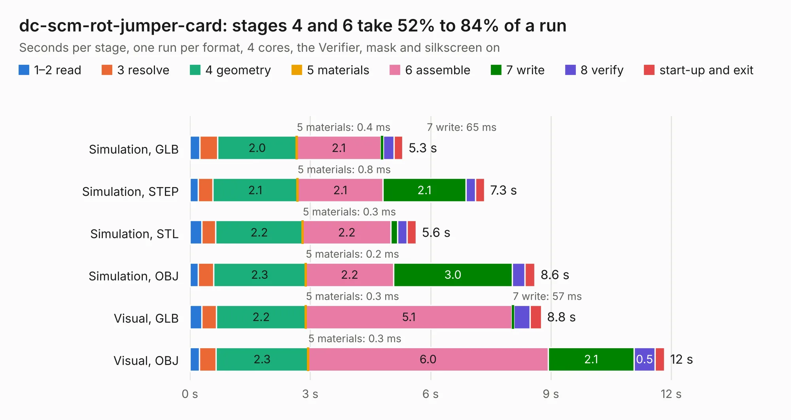

# 344. dc-scm-rot-jumper-card

Board 344 of the 3,131 of [Corpus Testing](../Corpus-Testing.md), on [Corpus Page 4](../CorpusTestingPages/Corpus-Testing-04.md#344-dc-scm-rot-jumper-card).

| Mode and format | 1–2 read | 3 resolve | 4 geometry | 5 materials | 6 assemble | 7 write | 8 verify | start-up and exit | Total |
|---|---:|---:|---:|---:|---:|---:|---:|---:|---:|
| Simulation, GLB | 0.2 | 0.4 | 2.0 | 0.4&nbsp;ms | 2.1 | 65&nbsp;ms | 0.3 | 0.2 | 5.3 |
| Simulation, STEP | 0.2 | 0.4 | 2.1 | 0.8&nbsp;ms | 2.1 | 2.1 | 0.2 | 0.2 | 7.3 |
| Simulation, STL | 0.3 | 0.3 | 2.2 | 0.3&nbsp;ms | 2.2 | 0.2 | 0.2 | 0.2 | 5.6 |
| Simulation, OBJ | 0.2 | 0.4 | 2.3 | 0.2&nbsp;ms | 2.2 | 3.0 | 0.3 | 0.2 | 8.6 |
| Visual, GLB | 0.3 | 0.4 | 2.2 | 0.3&nbsp;ms | 5.1 | 57&nbsp;ms | 0.4 | 0.3 | 8.8 |
| Visual, OBJ | 0.2 | 0.4 | 2.3 | 0.3&nbsp;ms | 6.0 | 2.1 | 0.5 | 0.2 | 11.8 |

<table align="center"><tr><td valign="top">

| Board | Repo: [antmicro/dc-scm-rot-jumper-card](https://github.com/antmicro/dc-scm-rot-jumper-card) Board: `dc-scm-rot-jumper-card.kicad_pcb` |
|---|---|
| Complexity | 188&nbsp;/&nbsp;1000 (size&nbsp;153, features&nbsp;35) |
| KESE&nbsp;features | through vias, rounded, trapezoid or chamfered pads, copper text |
| Tested | 9th November 2026 |
| Copper&nbsp;layers | 2 |
| File&nbsp;format | KiCad 5 (20171130) |
| Parts,&nbsp;tracks,&nbsp;vias | 23, 348, 48 |
| Triangles,&nbsp;simulation | 407,326 in 58 parts |
| Verifier | PASS in all six runs |

</td><td valign="top">

<table>
<tr><th>File type</th><th>File size</th><th>Peak memory used</th></tr>
<tr><th colspan="3" align="left">Simulation</th></tr>
<tr><td>GLB</td><td align="right">15&nbsp;MB</td><td align="right">292&nbsp;MB</td></tr>
<tr><td>STEP</td><td align="right">90&nbsp;MB</td><td align="right">353&nbsp;MB</td></tr>
<tr><td>STL</td><td align="right">20&nbsp;MB</td><td align="right">314&nbsp;MB</td></tr>
<tr><td>OBJ</td><td align="right">43&nbsp;MB</td><td align="right">353&nbsp;MB</td></tr>
<tr><th colspan="3" align="left">Visual</th></tr>
<tr><td>GLB</td><td align="right">10&nbsp;MB</td><td align="right">326&nbsp;MB</td></tr>
<tr><td>OBJ</td><td align="right">31&nbsp;MB</td><td align="right">331&nbsp;MB</td></tr>
</table>

</td></tr></table>

| Previous | Next |
|:---|---:|
| [343. bmc-reference-carrier-board](b0343b_dc-scm-osm-l-carrier-card_bmc-reference-carrier-board.md) | [345. ddr4-spd-breakout](b0345b_ddr4-spd-breakout-board_ddr4-spd-breakout.md) |
